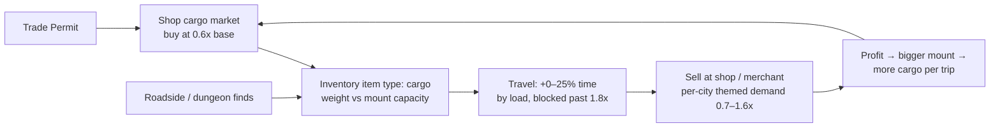

# Cargo Trade System — Implementation Design Report (v2)

Status: Design decisions locked in (2026-09-25). Implementation not started.

## 0. Decision log (locked answers)

1. **Cargo storage** → real inventory items with `"type": "cargo"`.
2. **Capacity** → overload allowed up to a hard cap of **1.8× mount capacity**.
   Purchases that would exceed 1.8× are **rejected**; cargo obtained from
   dungeons may exceed it, but **map travel is blocked** while overloaded past 1.8×.
3. **Mount sold while loaded** → max load penalty until the cargo is sold off.
4. **Sea travel** → load penalty applies. Phase B adds a **ship** system (like
   mounts) with **monthly maintenance** billed on the 1st of each month via an
   immediate popup; high-tier land mounts get a maintenance fee too. This is the
   seed of a future monthly **tax** system with a payable breakdown and allowed
   debt (gold may go negative).
5. **Charisma discount** on cargo purchases → yes (soft road-merchant cap 25%).
6. **Daily restock** → 5 units per good.
7. **Demand** → static per-city, terrain-themed (e.g. mountain goods sell better
   at beach/port cities). Any cargo can spawn anywhere, **weighted toward its
   origin city**.
8. **Merchants** → road/dungeon/guild merchant stock is a randomized selection
   of goods **including cargo**, and merchants buy cargo from the player.
9. **Venue** → the cargo market is a **new menu inside the city shop**
   (`facilities/shop.py city_shop`), not the trade hall — every city has a shop,
   so variance stays high without cluttering the ASCII map with more trade halls.
   The permit itself is still bought at a trade hall (one-time).

## 1. Goal

Give the Trade Permit real content: an Elona-style cargo trading loop.

- Buy regional cargo goods at the **city shop** (permit-gated cargo market).
- Haul them with a **mount** — each mount gets `cargo_capacity`; load slows travel.
- Sell in other cities at **static terrain-themed demand** prices.
- Cargo also drops from merchants, roadside finds, and dungeons.

## 2. Core loop



## 3. Data model

### 3.1 `resources/trade_goods.py` (new file)

Cargo goods are **inventory items** with `"type": "cargo"` (built through
`build_item`, see §3.2). The goods table:

```python
TRADE_GOODS = {
    # id: name, weight (unit measurement), base_price, origin city, theme
    "solmere_porcelain":  {"name": "Solmere Porcelain",  "weight": 10, "base_price": 60, "origin": "solmere",    "theme": "luxury"},
    "greyharbor_pearls":  {"name": "Greyharbor Pearls",  "weight": 5,  "base_price": 80, "origin": "greyharbor", "theme": "sea"},
    "sunreach_silk":      {"name": "Sunreach Silk",      "weight": 5,  "base_price": 70, "origin": "sunreach",   "theme": "luxury"},
    "sunreach_steel":     {"name": "Sun-Steel Ingots",   "weight": 20, "base_price": 90, "origin": "sunreach",   "theme": "mountain"},
    "dunemar_spices":     {"name": "Dunemar Spices",     "weight": 5,  "base_price": 75, "origin": "dunemar",    "theme": "exotic"},
    "brinewatch_saltfish":{"name": "Brinewatch Saltfish","weight": 10, "base_price": 40, "origin": "brinewatch", "theme": "sea"},
    # ...1–2 goods for every city (cinderpeak_ore, irondeep_ingots, skylume_crystals,
    # elderfen_herbs, stormhold_furs, saltmarsh_salt, coralhaven_coral, etc.)
}
```

Themes: `mountain`, `sea`, `exotic`, `luxury`, `common`.

Helpers (pure, no I/O):

- `build_cargo(good_id)` → plain inventory item dict (`"type": "cargo"`)
- `get_cargo_items(player)` → lives in `inventory.py` alongside `get_key_items`
- `cargo_total_weight(player)` → `sum(weight × count)` over cargo items in `player["inventory"]` (house-stored cargo doesn't count)
- `cargo_capacity(player)` → mount's `cargo_capacity`, `0` with no mount
- `cargo_overload_limit(player)` → `int(1.8 × capacity)`
- `cargo_travel_penalty(player)` → §4 penalty fraction
- `cargo_overloaded_for_travel(player)` → `True` past the 1.8× cap
- `cargo_buy_price(good_id, player)` → §5
- `cargo_sell_price(item, player, city_id)` → §5 (per-city demand table)
- `roll_daily_cargo_stock(city_id, count)` → §6 weighted stock roll

### 3.2 `resources/items.py` — no changes

Cargo goods are built by `build_cargo()` in `trade_goods.py`, NOT via `build_item()`.
This keeps cargo out of `ITEMS` entirely, so existing random-item pools
(shop stock, road merchants, drops) can never roll cargo accidentally.

### 3.3 `inventory.py` — cargo as a bag-exempt type

- `count_inventory()` → add `"cargo"` to the not-counted types (doesn't consume bag space).
- `add_item_to_inventory()` → add `"cargo"` to the capacity-bypass branch (stacks like key items).
- `get_sorted_items()` → **exclude** cargo (it must never appear in normal sell lists).
- New `get_cargo_items(player)` helper.

### 3.4 `resources/mounts.py` — capacity field

Weight is **unit measurement** (not item slots): goods weigh 5–25 units,
capacities are larger so the UI reads like tonnage.

```python
"mule":      {..., "cargo_capacity": 30},
"horse":     {..., "cargo_capacity": 60},
"war_horse": {..., "cargo_capacity": 90},
"caravan":   {..., "cargo_capacity": 180},
```

### 3.5 Player fields

Follow the existing shop pattern — no new `ensure_player_fields()` entries needed:
`cargo_stock_{city_id}` + `last_cargo_day_{city_id}` keys on the player dict
(same as `shop_stock_{city_id}` / `last_shop_day_{city_id}`). Old saves just work.

## 4. Capacity & overload rules

- `C` = mount `cargo_capacity`; `W` = total cargo weight in inventory.
- **`W ≤ C`** — no penalty.
- **`C < W ≤ 1.8C`** — travel allowed, penalty ramps linearly.
- **`W > 1.8C`** — **map travel blocked** (terminal `travel_to_city` prints a
  message; GUI world map shows a banner and refuses departure) until the player
  sells cargo or stashes it in house storage.
- **Purchases** (shop market, merchants): rejected when `W + item_weight > 1.8C`.
- **Pickups** (dungeon, roadside): always allowed, even past 1.8C.
- **No mount** (`C = 0`): buying is impossible; pickups allowed; travel allowed
  with the **max** penalty (decision #3 — mount sold while loaded behaves the same).

Penalty formula (applied to effective travel time):

```
penalty = 25% × max(0, min(1.0, (W - C) / (0.8 × C)))     # C > 0
penalty = 25%                                              # C == 0 and W > 0
```

## 5. Pricing

- **Buy** (shop cargo market): `int(base × 0.6 × (1 − cha_disc/100))`,
  `cha_disc = min(25, max(0, (cha − 8) × 0.4))` — the road merchant's soft cap.
- **Sell** (shop cargo market): `int(base × demand(theme, city))`.
- **Demand table** — static per-city multipliers by theme, e.g.:

  | Theme | Great (1.5–1.6) | Bad (0.7–0.8) |
  |---|---|---|
  | mountain | port/beach cities (Coralhaven, Saltmarsh, Brinewatch) | mountain cities (Irondeep, Cinderpeak) |
  | sea | inland garrison/tundra (Stormhold, Thornwall, Irondeep) | ports (Brinewatch, Saltmarsh) |
  | exotic | rich/cold cities (Solmere, Skylume, Stormhold) | anywhere self-sufficient |
  | luxury | capitals & tourist ports (Solmere, Coralhaven, Skylume) | frontier towns |

  Selling in the good's **origin city = 0.7×** (guaranteed loss, no flip loops).
- **Merchant buy rate** (road/dungeon/guild): `int(shop_sell_price × 0.75)`.

Example: Dunemar Spices (base 75). Buy 45g → sell at Stormhold (exotic 1.5) =
112g → **+67g/unit**; a full caravan (12 units) ≈ **+800g/trip** before events.

## 6. Stock & spawning (shop cargo market)

- Permit-gated option inside `city_shop`: hidden or labeled `??? — requires trade
  permit` without it.
- Daily stock regenerates on day change (same pattern as `shop_stock_*`):
  - 2–3 distinct goods, **5 units each** (decision #6).
  - Selection: **any** good can appear, weighted 5:1 toward the current city's
    origin goods (decision #7 "spawn anywhere, weighted origin").
- The market also lists the player's own cargo with sell prices (sell any amount).

## 7. Travel integration

The penalty must be applied in **both** places that compute effective travel time
(they duplicate logic and must stay in sync):

### 7.1 `facilities/travel.py` — `_effective_travel_time()` (terminal)

After mount reduction and daily multiplier, add the §4 penalty. Extend the
mount status line with `Load: 6/12`. Block `travel_to_city` when `W > 1.8C`
(message + return). **Sea segments included** (decision #4).

### 7.2 `facilities/pathfinding.py` — `find_shortest_path()` (GUI world map)

Same penalty per segment (`effective_time`), land **and** sea. `world_map_screen.py`
renders ETAs from the pathfinding result, so the display updates for free. Add
an overloaded banner + refuse departure when `W > 1.8C`.

`advance_time(player, travel_time)` already consumes the effective time — clock
cost is automatic.

## 8. Merchant integration (decision #8) — IMPLEMENTED

All three merchant implementations have cargo support:

- `facilities/travel_events.py` — `_handle_merchant`: each stock slot has a
  30% chance to roll a cargo good (uniform, `roll_cargo_good()`), priced via
  `cargo_merchant_stock_price` (market buy price × 75–90% road markdown).
  `_sell_to_merchant` buys cargo at the flat road rate
  (`cargo_merchant_sell_price`, 75% of base).
- `dungeon_rooms.py` — `handle_merchant_room`: same 30% stock rule; sell list
  buys cargo at the flat road rate.
- `facilities/guild.py` — Market Day merchant: 30% stock rule with
  origin-weighted rolls (`roll_cargo_good(city_id)`); buys cargo at 75% of the
  local city demand.
- `gui/screens/world_map_screen.py` — merchant dialogs mirror the road rules.

Roadside discovery (`_handle_discovery`) has a weighted "abandoned wagon" /
"drifting crate" outcome: 1–3 units of a random cargo good. Ship event
mitigation now reduces sea encounter chance in `run_travel_events`.

## 9. Sell-path exclusion list (cargo must never sell as a normal item)

Because cargo is a real inventory type, every generic sell path must exclude it.
All are fixed by **one** change in `inventory.get_sorted_items()` plus explicit
filters where code iterates `player["inventory"]` directly:

| File / function | Fix |
|---|---|
| `inventory.get_sorted_items` | exclude `"cargo"` (fixes `shop.sell_items` for free) |
| `dungeon_rooms.handle_merchant_room` (sell list) | filter cargo → sell at cargo road rate |
| `facilities/travel_events._sell_to_merchant` | filter cargo → cargo road rate |
| `facilities/guild._merchant_sell` | filter cargo → cargo road rate |
| `gui/screens/world_map_screen` merchant sell dialog | filter cargo → cargo road rate |
| `gui/screens/inventory_screen.py` | type label `"Cargo"`, optional weight on card |

Other inventory loops (`blacksmith`, `arcane_tower`, `temple`, `inn`, combat
consumables) filter by type/id, so cargo is already invisible to them — audit
during implementation, no changes expected.

## 10. Phase B — ships, maintenance, and the tax seed — IMPLEMENTED

### 10.1 Ship system (like mounts)

- `resources/ships.py`: three tiers — Merchant Sloop (500g, 40 wt cargo),
  War Frigate (1500g, 90 wt), Trade Galleon (4000g, 180 wt) — each with
  `sea_time_reduction`, `event_mitigation`, `cargo_capacity`, `monthly_fee`.
- Bought/upgraded/downgraded/sold at the shipyard (`facilities/shipyard.py`,
  mount-menu-style). The legacy `player["has_ship"]` + `ship_type` pair is
  migrated to `player["ship_id"]` in `character.ensure_player_fields()`.
- `pathfinding`/`port.py`/world map use the ship's sea reduction and per-leg
  capacity: load penalty per segment uses the **vehicle of that segment**
  (mount on land, ship at sea; ferries and walking use capacity 0 → max
  penalty, not blocked). `blocked_segments` from `find_shortest_path` drives
  the world map overload dialog; terminal `travel_to_city` (land) and `port`
  (sea) block on their vehicle's 1.8× cap.

### 10.2 Monthly maintenance (1st of each month)

- `facilities/monthly_billing.py` — `compute_monthly_bills()` (ship upkeep +
  high-tier land mount upkeep: war horse 30g, caravan 80g) and
  `process_monthly_billing(player, day)`, which deducts immediately and
  returns a bill event.
- Hooked in `utils.advance_time()` after day rollover for every month boundary
  crossed (`events.get_month_day(day)[1] == 1`). Bills are journaled, printed
  in terminal mode, and queued for the GUI Event Notice popup (shown on city
  return). **Debt allowed — gold may go negative.**
- This is the seed for a future monthly tax ledger — extend
  `compute_monthly_bills()` with new sources and reuse the same billing path.

## 11. Files touched (summary)

| File | Change |
|---|---|
| `resources/trade_goods.py` | **new** — goods table + weight/demand helpers |
| `resources/mounts.py` | add `cargo_capacity` per mount |
| `resources/items.py` | cargo branch in `build_item` |
| `inventory.py` | cargo exempt from bag caps + `get_cargo_items` |
| `facilities/shop.py` | permit-gated cargo market menu in `city_shop` |
| `facilities/travel.py` | penalty + overload block + load status line |
| `facilities/pathfinding.py` | penalty in segment `effective_time` |
| `facilities/travel_events.py` | merchant cargo stock/buy, abandoned-wagon discovery |
| `dungeon_rooms.py` | merchant cargo stock/buy |
| `facilities/guild.py` | Market Day merchant buys cargo |
| `gui/screens/world_map_screen.py` | merchant cargo handling + overloaded banner |
| `gui/screens/inventory_screen.py` | cargo type label |
| *(Phase B)* `resources/ships.py` | **new** — ship tiers |
| *(Phase B)* `facilities/monthly_billing.py` | **new** — maintenance/tax billing |
| *(Phase B)* `facilities/shipyard.py`, `port.py`, `utils.advance_time` | ship tiers + billing hook |
| `tests/` | smoke test: buy/sell/weight math, overload rules |

## 12. Balance knobs (single source of truth in `trade_goods.py`)

| Knob | Value |
|---|---|
| Buy multiplier | 0.60 |
| Charisma buy discount | min 25% `(cha − 8) × 0.4` |
| Demand range | 0.7× (origin/awful) – 1.6× (themed) |
| Merchant buy rate | 75% of shop demand price |
| Daily restock | 2–3 goods × 5 units, origin-weighted 5:1 |
| Overload cap | 1.8× capacity (purchase reject / travel block) |
| Load time penalty | 0 → +25% from C to 1.8C |
| Mount capacities | 30 / 60 / 90 / 180 (weight units; goods weigh 5–25) |

## 13. Implementation order

1. **Phase A (core):** ✅ DONE — goods data + item/mount/inventory integration
   + shop cargo market + travel/pathfinding penalty + overload rules +
   sell-path exclusions.
2. **Phase B (world):** ✅ DONE — merchant stock/buy + roadside wagon/crate;
   ships + monthly maintenance + tax ledger seed.
3. **Phase C (polish):** balance pass, house-merchant integration (catalogue
   listing, ally Charisma controls items sold per day and price), debt rules.
