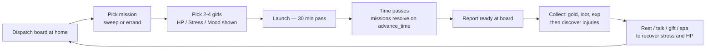

# Dispatch System — Design Sketch (v1 draft)

**Status:** Design locked (2026-10-05). **Phase 1 implemented** (2026-10-05) — see §14.
**Related:** `facilities/house.py` (venue), `docs/cargo_trade_design.md` / `docs/quest_system_design.md` (doc conventions), `memories/repo/house-system-pitfalls.md` (house routing rules).

Let the player **mobilize a small squad of housed monster girls** to sweep known dungeon floors or run errands. Missions resolve on **game time** while the player keeps playing; results are collected at the house. Girls gain **stress**, show a derived **mood** that modifies success, and can come home **hurt** (HP loss, injuries) — with clear recovery loops.

---

## 1. Goals

- Give housed girls a purpose beyond combat: idle-style work that costs nothing but time.
- Create a roster-management loop: rotate girls, watch stress/mood, heal injuries, collect rewards.
- Zero permadeath, zero combat-engine changes in v1 — stress is a dispatch-side system.
- Reuse existing systems: `advance_time` day rollover, journal events, house storage, `gain_exp_ally`.

## 2. Core loop



## 3. Decision log (locked 2026-10-05)

| # | Decision |
|---|---|
| 1 | **Venue:** new "Dispatch board" option in the **house menu** (`house_menu`); operates on the *effective home* house (see §12.6). |
| 2 | **Who goes:** only girls currently **in the house** (lounge). Party allies are untouched by dispatch. |
| 3 | **No overlap:** a dispatched girl can't be recruited until she returns; a party girl can't be dispatched; no double-booking across slots. |
| 4 | **Resolution is time-based** in `advance_time`; rewards are **collected at the house**. |
| 5 | **Stress is the only meter; mood is derived** (§7) — one source of truth. |
| 6 | **Worst case is "Downed"** — 1 HP + 2 days injured + stress jump. Monster girls never die or leave. |
| 7 | **Stress affects dispatch only in v1.** Combat stress (allies first, **eventually the player too**) is a planned later phase (§14). |
| 8 | **Sweeps farm only:** floor band ≤ `city_floors[home_city]["max_floor"]`; no `max_floor`, superboss, or quest progression. |
| 9 | **Exp granted at collection**, not resolution — `gain_exp_ally` can open the interactive attribute-choice UI. |
| 10 | **Notifications are journal-only** (`[DISPATCH]` events). No toasts; results also print at the board. |
| 11 | **Heroines allowed** (permanent/house heroines). Heroines only become housed **after their storyline completes** (the three Wonderland heroines can't be housed until their superboss — or Mary Sue — falls; Palette must survive her burst to be recruited permanently), so dispatch injuries can't interfere with in-progress stories. `_wonderland_temp` copies stay excluded by the house invariant. |
| 12 | **Dispatch slots scale with house level** — `1 + [L≥3] + [L≥7]` → **1 / 2 / 2 / 3** (L1–2 / L3–4 / L5–6 / L7–8). Slots are a ceiling; each girl can only be on one mission. |
| 13 | **Team size by house level** — min **1** (solo dispatch allowed); max **2** (L1–2) / **3** (L3–6) / **4** (L7–8). |
| 14 | **Difficulty is house-capped** — `star_cap(house_level) = min(6, 3 + (house_level − 1) // 2)` → **3/4/5/6** stars for the L1–2 / L3–4 / L5–6 / L7–8 bands. Extends the bounty ★ ladder with a 6th tier (§5.1). |
| 15 | **Offers: 4/5/6/7 per refresh** — `4 + (house_level − 1) // 2`, refreshed on a **3-day cycle**. |
| 16 | **Sweeps grant gold/items/EXP only.** City Favor was removed in v0.1.8.8; dispatch no longer writes standing. Errands likewise grant none. |
| 17 | **Mission names are procedurally rolled** (wild-dungeon style, §5.2), keyed to type + star; rolled **once at offer generation** and persisted — never re-rolled on display. |

## 4. Data model

### 4.1 Player state (`ensure_player_fields`)

```python
player.setdefault("dispatch", {
    "active": [],          # one mission per dispatch slot (§3.12)
    "reports": [],         # resolved, uncollected reports (cap 10, oldest dropped)
    "completed": 0,        # lifetime counter (future milestones)
    "offers": [],          # today's board offers
    "offers_day": 0,       # day the current 3-day offer cycle began
})
```

Active mission instance:

```python
{
    "instance_id": "sweep_solmere_16_3#a4f2",
    "template_id": "sweep_solmere_16_3",
    "name": "Clear Floors 13–16",
    "type": "sweep",             # "sweep" | "errand"
    "city_id": "solmere",
    "girls": ["mira#12", "tessa#9"],   # girl_unique_id() convention
    "girl_names": ["Mira", "Tessa"],   # snapshot for display if girl record moves
    "start_abs": 7200,           # day*1440 + time_minutes at launch
    "return_abs": 8640,          # start_abs + duration_h*60
    "power": 28, "risk": 2,
    "tag": "str",
    "resolved": False,
}
```

Report (created at resolution):

```python
{
    "instance_id": "...",
    "name": "...", "type": "sweep", "city_id": "...",
    "outcome": "great" | "success" | "partial" | "failure" | "disaster",
    "gold": 180,
    "items": [{...built items, already in bag or house storage...}],
    "exp": [{"uid": "mira#12", "amount": 60}, ...],   # granted on collect
    "injuries": [{"uid": "...", "hp_lost": 34, "downed": False}, ...],
    "stress_after": {"mira#12": 38, ...},
    "lines": ["...narrative 1-3 lines..."],
    "day": 5,
}
```

### 4.2 House girl record — new lazy fields

Read via helpers (`girl_hp(girl)`, `girl_stress(girl)`, ...) with defaults, so **old saves need no migration**; fields materialize on first dispatch or recovery tick.

| Field | Default | Meaning |
|---|---|---|
| `current_hp` | `None` → max HP | Persistent HP while housed (see §8) |
| `stress` | `0` | 0–100 meter |
| `last_dispatch` | `None` | `{"outcome": str, "day": int}` — feeds mood |
| `consecutive_dispatch` | `0` | Missions without an idle day between; success penalty |
| `dispatch_mission` | `None` | Active mission instance id — the busy flag |
| `injured_until` | `0` | Day until which she can't be dispatched/recruited (Downed) |
| `attributes` | computed lazily | Materialized from the existing attribute formula on first dispatch (see §12.5) |

`girl_max_hp(girl)` = `ally_max_hp()` output for a temp ally built from the girl record — factor the attribute computation out of `create_ally_from_girl` into a shared `compute_girl_attributes(girl)` to avoid duplication.

### 4.3 Mission templates — `resources/dispatch.py` (new file)

```python
ERRAND_TEMPLATES = {
    "herb_gathering": {"name": "Herb Gathering", "tag": "wis", "power": 12,
                       "hours": (8, 12), "risk": 0, "gold": (25, 45),
                       "exp": 18, "loot_pool": ["<biome herb ids>"]},
    "courier_run":    {...},   # tag dex
    "caravan_escort": {...},   # tag str/con
    "scout_ruins":    {...},   # tag dex/wis
    "monster_survey": {...},   # tag lrn
}
# Sweeps are generated from city floor bands, not stored verbatim.
```

Sweep generation (per home city, using `city_floors[city]["max_floor"]`):

```python
top   = max(1, max_floor)
start = max(1, top - 3)                       # band of 4 floors
power = int(6 + 2.2 * top)
gold  = (25 + 10 * top, 40 + 14 * top)
exp   = 10 + 4 * top                          # per girl
hours = (18, 36)
risk  = 1 if top < 10 else 2 if top < 25 else 3
stars = star_for_power(power)                 # §5.1
```

Board offers refresh on a **3-day cycle**: `offer_count(house_level) = 4 + (house_level − 1) // 2` → **4/5/6/7** offers. Composition: **2 errands + (count − 2) sweeps**; a sweep is skipped when its star exceeds `star_cap` (§5.1) and the slot falls back to an errand (never an empty board). Offers regenerate only when `(day − 1) // 3` changes; each offer stores its final rolled `name` and `stars` (§5.2).

### 4.4 Name pools — `DISPATCH_NAME_PARTS`

```python
# Difficulty adjectives escalate with the star rating.
STAR_ADJECTIVES = {
    1: ["Quiet", "Sunlit", "Routine", "Dusty", "Green", "Mild"],
    2: ["Watchful", "Wandering", "Dim", "Earnest", "Dusk", "Wind-Cut"],
    3: ["Bitter", "Brooding", "Rough", "Sundered", "Hollow", "Storm-Watched"],
    4: ["Dire", "Feral", "Reaving", "Grave-Bound", "Thunderous", "Sanguine"],
    5: ["Calamitous", "Abyssal", "Ruinous", "Fated", "Heaven-Scorned", "Dragon-Glass"],
    6: ["Aeon-Breaking", "Heaven-Rent", "Void-Wrought", "Sun-Eclipsed", "World-Wound", "Final"],
}

# Sweeps borrow their noun from the biome ruin pools in
# resources/wild_dungeon_themes.get_theme(biome)["ruins"]; suffixes escalate too.
SWEEP_SUFFIXES = {
    1: ["Sweep", "Push", "Patrol"],
    2: ["Sweep", "Push", "Descent"],
    3: ["Descent", "Clearing", "Assault"],
    4: ["Breach", "Onslaught", "Clearing"],
    5: ["Breach", "Onslaught", "Reckoning"],
    6: ["Cataclysm", "Finality", "Apotheosis"],
}

# Errands name themselves from per-subtype nouns + fixed suffixes.
ERRAND_NAME_PARTS = {
    "herb_gathering": {"nouns": ["Bloom", "Root", "Thicket", "Grove", "Garden"],
                       "suffixes": ["Foraging", "Harvest", "Gathering"]},
    "courier_run":    {"nouns": ["Parcel", "Letters", "Ledger", "Dispatch"],
                       "suffixes": ["Run", "Delivery", "Courier"]},
    "caravan_escort": {"nouns": ["Wagons", "Pilgrims", "Convoy", "Merchant Train"],
                       "suffixes": ["Escort", "Guard", "Watch"]},
    "scout_ruins":    {"nouns": ["Trail", "Horizon", "Ruins", "Signs"],
                       "suffixes": ["Recon", "Scouting", "Patrol"]},
    "monster_survey": {"nouns": ["Readings", "Anomaly", "Ley-Lines", "Wildlife"],
                       "suffixes": ["Survey", "Census", "Study"]},
}
```

## 5. Missions, stars & team selection

### 5.1 Difficulty stars (★–★★★★★)

Every mission gets a **star rating** derived from its power — the bounty ★ vocabulary extended to a sixth tier for endgame houses:

| Stars | Power | Tone | Offered from house level |
|---|---|---|---|
| ★ | ≤ 15 | trivial / routine | 1 |
| ★★ | 16–30 | even match | 1 |
| ★★★ | 31–55 | challenging | 1 |
| ★★★★ | 56–85 | dangerous | 3 |
| ★★★★★ | 86–120 | legendary | 5 |
| ★★★★★★ | ≥ 121 | world-class | 7 |

- `star_for_power(power)` is the single helper (sweeps derive it from generated power; errand stars are recomputed after scaling).
- **House difficulty cap:** `star_cap(house_level) = min(6, 3 + (house_level − 1) // 2)` → **3 / 4 / 5 / 6** for the L1–2 / L3–4 / L5–6 / L7–8 bands. Offers only roll at `stars ≤ star_cap` — a Hovel can't send girls into floor-25 sweeps even if the player has cleared them.
- Sweeps whose band exceeds the cap are skipped; if no sweep fits, the offer slot falls back to an errand.
- **Errands scale with progress** so high-band boards still get relevant work: `power = base_power × (1 + 0.15 × max(0, global max_floor − 10))`, stars recomputed from the scaled power.
- Stars drive the name pools, the board display, and future bounty-style framing.

### 5.2 Randomized mission names (wild-dungeon style)

Same shape as wild dungeon names (`f"{adjective} {ruin}"`, `wild_dungeons._roll_name`), extended with a type suffix and a difficulty ladder:

```text
name = f"{adjective} {noun} {suffix}"
```

- **adjective** ← `STAR_ADJECTIVES[stars]` — tone escalates with difficulty
- **noun** ← sweeps: biome ruin nouns from `get_theme(biome)["ruins"]` (direct reuse of `resources/wild_dungeon_themes.py`); errands: subtype noun pool
- **suffix** ← sweeps: `SWEEP_SUFFIXES[stars]`; errands: subtype suffix pool

Examples (rolled names, not templates):

| Type / Star | Rolled name |
|---|---|
| Sweep ★ (temperate) | Quiet Crypt Sweep |
| Sweep ★★★ (desert) | Bitter Dune-Vault Descent |
| Sweep ★★★★★ (sea caves) | Abyssal Trench Breach |
| Sweep ★★★★★★ (pandemonium) | Aeon-Breaking Refraction Cataclysm |
| Foraging ★ | Sunlit Grove Harvest |
| Courier ★★ | Dusk Ledger Delivery |
| Escort ★★★ | Storm-Watched Convoy Guard |
| Scouting ★★★★ | Grave-Bound Ruins Recon |
| Survey ★★★★★ | Heaven-Scorned Ley-Lines Study |

Rules:

- The name is rolled **once when the daily offer is generated** and stored on the offer; the launched instance and its report keep the same name. Display code never rolls.
- A mission's floor band (e.g. "Floors 13–16") appears only in the subtitle/details line — the rolled name itself stays biome/type-driven.
- Pools live in `resources/dispatch.py` (§4.4) and are data-only, so new adjectives/nouns can ship without logic changes.

### 5.3 Teams & dispatch slots

- **Team size (per mission):** min **1** (solo dispatch allowed); max by house level: **2** (L1–2) / **3** (L3–6) / **4** (L7–8).
- **Dispatch slots (concurrent missions):** `1 + [L≥3] + [L≥7]` → **1 / 2 / 2 / 3** (L1–2 / L3–4 / L5–6 / L7–8). Board header shows `Slots: 1/2 used`; launching is blocked at the cap until a mission resolves and its team returns. Pending reports do **not** hold a slot.
- **Difficulty cap:** all offers respect `star_cap(house_level)` (3/4/5/6 — §5.1); this is the house's "administrative reach" and is independent of floors the player has cleared.
- **Offers per refresh:** `4 + (house_level − 1) // 2` → **4/5/6/7**, refreshed on a **3-day cycle** (`(day − 1) // 3`); composition = 2 errands + (count − 2) sweeps, sweeps falling back to errands when capped out.
- **No double-booking:** a girl flagged `dispatch_mission` can't be selected for another team or recruited to the party; busy girls are hidden/disabled in selection.
- **Tags:** each girl's top attribute (max of `attributes`) matched against the mission tag gives her `×1.15` power. Tags: `str` (combat), `dex` (courier/scout), `wis`/`lrn` (gather/survey); no penalty for mismatch.
- **Selection UI:** terminal has no multi-select, so it's a toggle loop: pick a girl → she's marked ★ → repeat until "Done" (or team max). Preview shows projected success and risk before confirming.
- **Launch:** costs 30 minutes of game time; no gold cost in v1.

## 6. Success & outcomes

```text
power   = Σ girl.level × (1.15 if top attribute matches tag else 1.0)
ratio   = power / mission.power
base    = 50 + 55 × (ratio − 1)                 # 0.5× → 22%, 1× → 50%, 1.5× → 78%, cap 95
mods    = avg(mood_mod)                          # mood carries the stress effect, §7
        + affection_mod                          # +0 / +2 (30–59) / +4 (60–79) / +6 (80+) / +8 (married)
        + leader_mod                             # +3 if leader.level ≥ 0.6 × mission.power
        − consecutive_penalty                    # −2 per consecutive dispatch girl, cap −6
chance  = clamp(10, 95, base + mods − 2 × mission.risk)
```

Outcome roll `d100`:

| Roll | Outcome |
|---|---|
| ≤ `chance − 25` | **Great Success** |
| ≤ `chance` | **Success** |
| ≤ `chance + 15` | **Partial** (half rewards) |
| > `chance + 15` | **Failure** |
| > `chance + 25` or roll ≥ 97 (risk ≥ 2 only) | **Disaster** |

## 7. Stress & Mood

### 7.1 Stress gains (per girl, 0–100)

| Source | Stress |
|---|---|
| Errand | +2 |
| Sweep | +3 + 2 × risk |
| Outcome: Great / Success / Partial / Failure / Disaster | −2 / +0 / +3 / +6 / +14 |
| Downed (see §8) | +20 |
| Consecutive dispatch without an idle day | +2 (cap +6) |

### 7.2 Mood (derived, checked in priority order)

| Condition | Mood | Success mod |
|---|---|---|
| `stress ≥ 90` | **Burned Out** | −15, **refuses dispatch** until < 75 |
| Disaster within 3 days | **Discouraged** | −12 |
| `stress ≥ 75` | **Weary** | −9 |
| Great Success within 3 days | **Inspired** | +8 |
| `stress ≥ 50` | **Tired** | −4 |
| `affection ≥ 60` | **Spirited** | +5 |
| otherwise | **Steady** | 0 |

Mood is display + success only. Raw stress additionally drives the **injury multiplier** and **burnout refusal** — so stress always matters even when mood is "Steady".

### 7.3 Recovery (stress relief)

| Method | Effect | Notes |
|---|---|---|
| Night at home (daily tick) | −(5 + min(house_level, 6)) → −6…−11 | Amenities scale with house level |
| Full idle day (not dispatched) | extra −2, resets `consecutive_dispatch` | Encourages rotation |
| Lounge **Talk** | −3 | Reuses existing once/day talk counter |
| **Gift** (love / neutral / hate) | −12 / −6 / +4 | Reuses existing gift counter |
| **Kiss** (affection 80+) | −4 | existing action |
| **Herbal Bath Salts** (Herbalist, ~120g) | −20, one girl | Phase 2 item |
| **Temple — Day of Respite** | −30 all girls, 50g × girl count | Phase 2 service |
| Great Success afterglow | −5 all participants | Replaces the −2 for that outcome |

## 8. HP tracking & injuries

### 8.1 Sync rules (the heart of the feature)

House records currently **do not store HP** — recruiting always lands at full HP and dismissing silently resets HP. Both round-trips must change:

1. `create_ally_from_girl` → `current_hp = girl.get("current_hp") or ally_max_hp(ally)`; copy `stress`, `last_dispatch`, etc.; **block recruit if `dispatch_mission` set or `injured_until > day`**.
2. `_return_ally_to_house` / `dismiss_allies_back_to_house` → persist `current_hp` (min 1), `stress`, and set the same busy/injury fields from the ally. A defeated ally goes home at 1 HP + stress bump (still requires house rest to fight again).
3. House hp regen (below) only ticks for girls who are **home** (not on dispatch).

### 8.2 Mission damage (rolled per girl at resolution)

```text
dmg%    = table[outcome] × type_mult × risk_mult × injury_mult
table   = great 3-10% | success 8-20% | partial 18-35% | failure 30-50% | disaster 50-75%
type_mult   = 1.0 sweep | 0.4 errand
risk_mult   = 1 + 0.1 × risk
injury_mult = 1 + stress/150          # up to ×1.67
```

- **Downed:** if HP would reach ≤ 0 → set `current_hp = 1`, `injured_until = day + 2`, `stress += 20`, report line ("Tessa is carried home..."). No permadeath.
- **Regen (housed, home):** +25% of max HP per day; `injured_until` is a separate gate that clears on its day regardless of HP.
- Injured girls **can't be dispatched or recruited** until healed (open question — could be dispatch-only).

## 9. Rewards

| Outcome | Gold | Exp (per girl) | Items |
|---|---|---|---|
| Great | ×1.5 | ×1.5 | 2–3 rolls, rarity bumped |
| Success | ×1.0 | ×1.0 | 1–2 rolls |
| Partial | ×0.5 | ×0.5 | 0–1 roll |
| Failure | ×0.15 | 0 | — |
| Disaster | 0 | 0 | — |

- **Collect** at the board: gold to player, items via `build_item` + `add_item_to_inventory` (inventory full → house storage, existing pattern), **exp via `gain_exp_ally` per girl** (interactive attribute choice happens here — safe house context). Level-cap rules respected; no ascension.
- **No standing reward:** dispatch grants gold, items, and EXP only. The old small city favor (+1 Success / +2 Great) was removed in v0.1.8.8; there is no per-city favor to write and no quest progression.
- Journal gets `[DISPATCH]` events on launch and resolution; the report text prints on collect.

## 10. UI sketch (terminal / facility thread)

```text
=== DISPATCH BOARD ===  (Solmere)   Slots: 1/2 used · House limit: ★★★★
Active : ★★★ Bitter Dune-Vault Descent — returns Day 6, 08:00
         Team: Mira, Tessa, Pella
Reports: 1 uncollected        Offers refresh: Day 8 (3-day cycle)

[0] ★★   Dusk Ledger Delivery      courier · power 18 · ~14h · risk 1
[1] ★★★  Bitter Dune-Vault Descent sweep 13–16 · power 40 · ~24h · risk 2
[2] ★★★  Storm-Watched Convoy Guard escort · power 30 · ~16h · risk 1
[3] ★★★★ Hollow Ley-Lines Study    survey · power 58 · ~18h · risk 2
[4] ★★★  Sunlit Grove Harvest      foraging · power 34 · ~12h · risk 1
[5] View active dispatches (1/2)
[6] Collect reports (1)
[7] Back
```

Team select shows one line per girl:
`Mira  HP 62/85 · Stress 40 (Tired) · Mood Tired` — ★ toggles. Preview shows `≈ 68% success` plus the risk warning. Lounge girl pages gain the same HP/Stress/Mood line. Dispatched girls render as `Away — returns Day 6`.

## 11. Integration map

| File | Change |
|---|---|
| `facilities/dispatch.py` | **✅ Phase 1:** templates, offers, name pools + rolling, mood/stress helpers, success formula, launch/resolve/collect, nightly recovery. (Runtime module — lives in `facilities/` beside `guild.py`, not `resources/`, since it imports game systems and hooks `advance_time`.) |
| `facilities/house.py` | Board menu entry + UI; HP/Stress/Mood lines in lounge; recruit block for busy/injured; talk/gift stress relief |
| `utils.py::advance_time` | Call `dispatch.process_dispatch_progress(player, old_day, old_time)` on **every** call (resolution is hour-precise); recovery ticks only on day rollover using `days_passed` |
| `character.py::ensure_player_fields` | `player.setdefault("dispatch", {...})` |
| `combat/ally.py` | HP/stress read in `create_ally_from_girl`; persist in return/dismiss; busy/injury recruit block; factor `compute_girl_attributes()` |
| `combat/capture.py` | Optional: initialize the new girl fields at capture |
| `resources/items.py` + shops | Phase 2: bath salts, spa items |
| `facilities/temple.py` | Phase 2: Day of Respite |
| `gui/screens/changelog_screen.py`, `README.md` | On implementation: changelog under v0.1.8.0 (or bumped), README section |

## 12. Edge cases & pitfalls

1. **HP round-trip both directions** (§8.1) is the #1 must-do — otherwise HP silently resets on recruit/dismiss and injuries become cosmetic.
2. **`advance_time` runs everywhere** — including the Wonderland early-return (`wl_internal_time`). Missions must not progress in Wonderland (real time is frozen); place the hook after the Wonderland branch.
3. **Idempotent resolution:** guard with `resolved`/report existence — repeated `advance_time` calls, multi-day jumps, and re-opened boards must not double-resolve or double-grant.
4. **Multi-day jumps** (sleep/travel) batch: loop recovery once per day passed, but resolve missions once by absolute-time comparison.
5. **Never call `gain_exp_ally` during silent time passage** — attribute-choice UI can open; grant exp at collect (§9).
6. **House routing:** use the existing `_resolve_house()` convention (explicit city → origin → first owned). Never resurrect the `origin_city`-only bug. The board reads the *effective home*; multi-house saves: girls live at the first owned house.
7. **Stale busy flags** (edge saves): board open runs a consistency pass — if a girl's `dispatch_mission` id isn't in `dispatch["active"]` + `reports`, clear it.
8. **Downed girls**: 1 HP floor (never store 0), `injured_until` gate, clear messaging in lounge + select menus.
9. **Inventory full** on loot → house storage fallback (existing pattern).
10. **No toasts, journal-only**; the board runs in the facility background thread → `term.*` APIs only.
11. **Reports cap** 10; keep a count badge on the house menu option ("Dispatch board — 2 reports").
12. **Daily counters**: stress relief piggybacks on the existing talk/gift limits — don't reset or bypass them.
13. **Clamp stress** 0–100 everywhere; mood reads clamped values.
14. **Party allies are never dispatch targets** and never touched by the night tick (their HP/stress stays party-bound; §8.1 keeps it in sync only when housed).
15. **Names are never re-rolled at display time** — offers store the final name; active missions and reports copy it (§5.2). A re-opened board must render identical names.
16. **Slots and rosters:** launching respects `slot_cap(house_level)`; a girl's `dispatch_mission` flag is the single source of truth across all slots; a slot frees at **resolution** (return), not at collection — verify no double-launch edge when a report is still uncollected.
17. **3-day offer cycle:** regenerate offers only when `(day − 1) // 3` changes; opening the board mid-cycle must render identical offers and names (stored data, never re-rolled).
18. **Star-cap filtering is empty-safe:** if no sweep band fits `star_cap`, fall back to errands rather than showing zero offers; the difficulty cap should never produce an empty board.
19. **No standing reward:** do not reintroduce City Favor; dispatch grants gold, items, and EXP only. The old favor write was removed in v0.1.8.8.

## 13. Starter balance (first tuning pass)

| Mission | Stars | Power | Hours | Risk | Gold | Exp/girl |
|---|---|---|---|---|---|---|
| Herb Gathering (errand) | ★ | 12 | 8–12 | 0 | 25–45 | 18 |
| Caravan Escort (errand) | ★★ | 18 | 12–16 | 1 | 50–80 | 30 |
| Sweep Floors 1–4 | ★ | 15 | 18–24 | 1 | 35–80 | 14–26 |
| Sweep Floors 13–16 | ★★★ | 41 | 20–30 | 2 | 155–265 | 62–74 |
| Sweep Floors 37–40 | ★★★★★ | 94 | 24–36 | 3 | 395–600 | 170–186 |
| Sweep Floors 57–60 | ★★★★★★ | 138 | 28–36 | 3 | 625–880 | 250 |

A full-stress (33) girl in a 3-team at ~1.0 ratio sits near 50% success; a fresh, high-affection team at 1.5× sits near 80%. Tuning targets: errands ≈ always safe income, sweeps ≈ meaningful but recoverable risk.

## 14. Phases

1. **Core:** data + board + resolution + HP sync (both directions) + stress/mood + night decay + talk/gift relief. — **✅ Implemented 2026-10-05** (incl. basic report collection and success preview; `tests/_diag_dispatch.py` covers curves/offers/cycle/mood/launch/slots/resolution/idempotency/HP round-trip/collect/recovery).
2. **Polish:** items + temple respite + report UI + preview estimates + README/changelog. — **✅ Implemented 2026-10-06** (report UI + preview landed with Phase 1; Herbal Bath Salts, Temple Day of Respite, README section and changelog bullets now in).
3. **Later:** stress effects in combat (allies first, then the player), leader roles/synergies, quest hooks, dispatch milestones, growth past the L8 caps.

## 15. Verification status

**Locked (2026-10-05):** team min 1 / max 2/3/4 (**solo dispatch allowed**); slots **1/2/2/3** (L1–2 / L3–4 / L5–6 / L7–8); difficulty cap 3/4/5/6; offers 4/5/6/7 on a 3-day refresh (day-1 anchor fine); injured girls blocked from party recruitment; heroines allowed (they only get housed post-storyline — see §3.11); 6★ name pools approved; stress is dispatch-only for now (combat stress later, including the player). **Small city favor +1/+2 was removed in v0.1.8.8** — dispatch now pays gold/items/EXP only.

**Playtest verified (2026-10-06):** save/load mid-dispatch (active missions, busy flags, reports all survive); injured/Downed flow incl. recruit block; EXP level-up dialog fires correctly at collection; overlapping returns settle in one pass; old-save migration; errand scaling and stress economy confirmed **balanced**.

**Phase 2 shipped (2026-10-06):** Herbal Bath Salts (Herbalist, used from the lounge, −20 stress), Temple "Day of Respite" (−30 stress per stressed companion, 50g each), README section + changelog bullets. No planned work outstanding.
