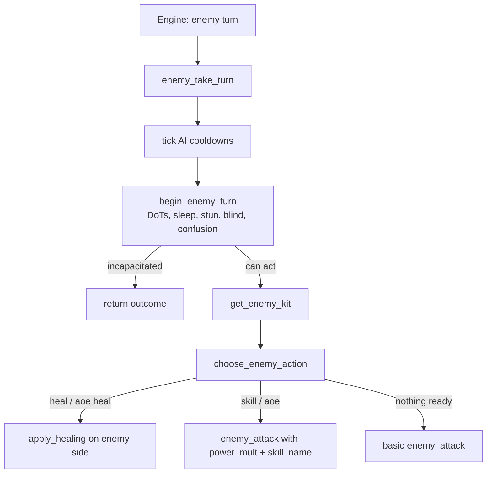

# Enemy AI Behaviors (Non-Superboss) — Design & Implementation

**Status:** Implemented 2026-10-27 (v0.1.8.4); roles & spawn weighting 2026-11-03 (v0.1.9.2)
**Modules:** `combat/enemy_skills.py` (new), `combat/enemy_ai.py`, `combat/combat_engine.py`, `combat/stats.py`, `dungeon.py`, `event_horizon_rooms.py`
**Checks:** `tests/_temp_enemy_ai_check.py`, `tests/_temp_enemy_roles_spawn_check.py`

---

## 1. Goal

Give **regular, non-superboss enemies** a readable action menu instead of
"basic attack every turn":

| Action | Purpose |
|--------|---------|
| **Basic attack** | Existing behaviour — always available. |
| **Single-target skill** | Themed damage skill (1.25–1.45× power, short cooldown). |
| **AoE skill** | Hits every living party member (0.65–0.80× power, long cooldown, unavoidable). |
| **Heal** | Support enemies mend themselves or the most wounded enemy ally. |
| **AoE heal** | Support enemies mend the whole enemy group when two or more are hurt. |

The system must **not** change superboss fights, Wonderland floor-boss
scripts, hallucinations, the training dummy, or any enemy whose turns are
already authored by bespoke code.

## 2. Locked decisions

- **Data lives on the enemy, not in the combat loop.** Kits are resolved once
  per enemy instance (`get_enemy_kit`) and cached on the dict.
- **All damage goes through `enemy_attack`.** No parallel damage math — armor,
  dodge (single-target), elemental resistance, wedding gear, barriers, reflect,
  Tarnished Jade, White Knight Expose, etc. keep working automatically.
- **Turn-start upkeep happens exactly once.** The status/tick block was
  extracted from `enemy_attack` into `begin_enemy_turn`; the AI calls it once,
  then every skill hit runs `enemy_attack(..., skip_turn_start=True)`.
- **Basic attacks remain the default.** Skills are opportunistic, not a
  replacement.
- **No smart party targeting.** The combat engine still chooses the primary
  target (weighted random, player ×2). The AI only chooses *what* to do, never
  *whom* to attack, so it can never focus-fire the lowest-HP actor. Low-tier
  healers also pick a random wounded ally instead of always triaging.
- **Behaviour escalates with monster level.** Level 1–4 enemies only basic
  attack and heal; damage skills unlock at level 5, AoE at level 10, and
  higher tiers use their kits more deliberately.
- **Roles are explicit.** Every enemy is an **attacker** or a **supporter**.
  Supporters prioritise heals and only occasionally use damage skills; they
  never become a second attacker with a heal button. Role inference and
  spawn weighting share one resolver (`get_enemy_role`).
- **Encounter composition respects roles.** Dungeon rooms mix attackers and
  supporters, cap supporters at two, never produce an all-supporter group,
  and scale the chance of support with floor level. A lone enemy is always an
  attacker.
- **Monster girls never use AoE** (auto kits). They are capture targets and
  squad-wide burst made nets unreliable. They keep single-target skills.
- **Bosses below superboss rank are included.** `boss: true` templates still
  use the generic engine and benefit from kits. Only scripted AI opts out.

## 3. Flow



## 4. Kit derivation

1. **Explicit YAML override** — if the template has an `abilities:` list, it
   replaces the race kit entirely.
2. **Race kit** — `RACE_KITS` in `combat/enemy_skills.py`.
3. **Human name flavour** — obvious Human archetypes swap the default martial
   kit:
   - mage / wizard / warlock / cultist / priest / witch … → **Arcane Bolt** /
     **Arcane Wave** (magical)
   - archer / sniper / hunter / ranger → **Aimed Shot** / **Arrow Volley**
   - assassin / thief / footpad / rogue → **Backstab** / **Fan of Knives**
4. **Support keywords** — names containing shaman / priest / healer / witch /
   cultist / acolyte / oracle / druid / cleric / medic / mender / alchemist /
   potion gain **Mend Wounds**; the same list (minus healer/medic/mender/
   alchemist/potion) plus "matriarch" gains **Soothing Chant** (AoE heal).
5. **Monster-girl trim** — AoE and AoE heal are removed.

| Race | Skill (min lvl) | AoE (min lvl) | Rider |
|------|-----------------|----------------|-------|
| Human | Power Strike (3) | Whirlwind Slash (8) | — |
| Goblin | Cheap Shot (2) | Firebomb (7) | bleed / burn |
| Orc | Brutal Smash (3) | Cleave (7) | bleed |
| Undead | Grave Touch (2) | Wail of the Dead (7) | weaken / dread |
| Beast | Feral Pounce (2) | Howling Frenzy (7) | bleed |
| Demon | Hellfire Bolt (2) | Infernal Conflagration (7) | burn |
| Construct | Gear Grind (2) | Steam Burst (7) | blind |
| Dragonkin | Rending Claw (2) | Breath Weapon (7) | burn T2 |
| Fey | Fey Hex (2) | Pixie Dust Storm (8) | silence / blind |
| Elemental | Elemental Surge (2) | Elemental Burst (7) | profile element |
| Giant | Crushing Blow (3) | Ground Quake (6) | weaken / slow |
| Vampire | Blood Drain (2) | Crimson Mist (8) | weaken, 30% drain |
| Lizardfolk | Venom Fang (2) | Caustic Spray (7) | poison |
| Gnome | Arcane Zap (2) | Chain Lightning (7) | shock |
| Shadow | Umbral Strike (2) | Shadow Sweep (7) | blind |
| Clockwork | Piston Fist (2) | Overload Pulse (7) | shock |
| Abomination | Corrosive Claw (2) | Flesh Rot Spray (7) | weaken / poison |
| Storybook | Narrative Slash (2) | Plot Twist (8) | confusion |
| Angel | Radiant Lance (2) | Choir of Judgment (7) | blind + heal kit |

Per-action `min_level` is the kit gate; the level tier gate in §5 still blocks
damage skills below level 5 and AoE below level 10.

Default cooldowns: skill **3**, AoE **5**, heal **4**, AoE heal **5**.
Cooldowns are stored per enemy instance in `_enemy_ai_cooldowns` and tick at
the start of that enemy's turn.

## 5. AI priorities and level tiers

Action chances are multiplied by the enemy's level tier. Party targeting is
never part of this decision — it stays with the engine.

| Tier | Levels | Damage skill | AoE | Support behaviour |
|------|--------|--------------|-----|-------------------|
| **Instinctive** | 1–4 | never | never | self-heal ≤35%; random wounded ally (≤60%) |
| **Trained** | 5–9 | ×0.50 chance | never | self-heal ≤38%; random wounded ally (≤62%) |
| **Coordinated** | 10–19 | ×0.85 chance | ×0.55 chance | self-heal ≤40%; triage wounded (≤65%) |
| **Tactical** | 20–34 | ×1.00 chance | ×0.85 chance | self-heal ≤43%; triage wounded (≤70%) |
| **Calculating** | 35+ | ×1.15 chance | ×1.10 chance | self-heal ≤45%; triage wounded (≤75%) |

Each AoE chance also gains its tier's party-size bonus per extra living party
member beyond two, capped at 85%. Tactical and Calculating enemies add a
further bonus when two or more party members are below 50% HP — group-state
awareness, not individual targeting. Healing chances rise slightly at higher
tiers. Level gates from an action's `min_level` still apply on top of the
tier gate.

Within those multipliers the priority is:

1. **Self preservation** — self below the tier threshold and heal ready → heal self (90%).
2. **AoE heal** — two or more wounded allies and AoE heal ready → tier-scaled chance.
3. **Ally heal** — a wounded ally and heal ready → tier-scaled chance; low tiers pick randomly, Coordinated+ picks the lowest HP.
4. **AoE damage** — two or more living party members, AoE ready → tier-scaled chance.
5. **Single-target skill** — tier-scaled chance.
6. **Basic attack** — fallback.

Chance rolls happen only after usability checks (level gate + cooldown).
Wounded counts and living targets are recalculated every turn, so dead or
captured entities are ignored.

### Role weighting

`get_enemy_role` resolves the role once: explicit `role:` → explicit
`abilities:` (heal actions imply supporter) → support name keywords → Angel
race → attacker.

| Role | Heal priority | Single-target skill | AoE skill |
|------|---------------|---------------------|-----------|
| **Attacker** | none — heal actions are ignored | full tier multiplier | full tier multiplier |
| **Supporter** | self → group → ally | tier multiplier × **0.55** | tier multiplier × **0.25** |

Supporter AoE heals are unaffected by those damage penalties. A designer can
force `role: attacker` on a template with heal abilities to make a pure
damage kit, or `role: supporter` on a non-healer to create a dedicated
support caster.

## 6. YAML override schema

```yaml
human_cultist:
  name: Cultist
  race: Human
  level: 3
  role: supporter        # attacker | supporter (optional; inferred otherwise)
  # ... existing fields ...
  abilities:
    - type: skill          # skill | aoe | heal | aoe_heal
      name: Dark Bolt
      power: 1.30          # damage multiplier for skill/aoe
      element: dark        # fire/water/.../physical/magical, or "auto"
      cooldown: 3
      min_level: 1
      chance: 0.45         # action selection weight
      status:              # optional rider
        type: weaken       # burn/poison/bleed/shock/weaken/silence/
                           # blind/confusion/dread/slow
        chance: 0.35
        duration: 2
        penalty_pct: 0.20  # weaken only
        tier: 1            # burn only
        damage_pct: 0.03   # DoT damage can scale with target max HP
    - type: heal
      name: Dark Mending
      heal_pct: 0.20       # fraction of the target's max HP
      cooldown: 4
      min_level: 1
    - type: aoe_heal
      name: Blood Chant
      heal_pct: 0.12
      cooldown: 5
      min_level: 3
```

Notes:

- One action of each type is used; later duplicates of the same type are ignored.
- `abilities:` **replaces** the auto kit (support keywords / human flavour are
  not applied). Add only the actions you want.
- `role:` is optional. If omitted, the role is inferred (heal actions →
  supporter, support name → supporter, otherwise attacker).
- Level tiers still gate usage: a level 1–4 enemy will not use damage skills or
  AoE even if they are listed, and a level 5–9 enemy will not use AoE.
- Add `ai_disabled: true` to a template to force basic-attack-only behaviour.
- `element: auto` resolves through the enemy's own `elemental_dmg` profile.

## 7. Exclusions (scripted turns)

`get_enemy_kit` returns `None` for:

- `super_boss: true` templates,
- every key in `combat/wl_floor_bosses.py::WL_FLOOR_BOSS_MAP`,
- enemies carrying a `round_hook` (e.g. the hallucination),
- the training dummy (`is_dummy`),
- templates with `ai_disabled: true`.

Superboss modules call `enemy_attack` directly and are untouched. Their
signature still works because every new `enemy_attack` parameter is
keyword-only with the old defaults.

## 8. Balance knobs

All in `combat/enemy_skills.py` unless noted:

- `AI_TIERS` — level bands, skill/AoE chance multipliers, party-size bonus,
  heal thresholds and `smart_heal` (low-tier healers pick randomly).
- `SELF_HEAL_CHANCE`, `ALLY_HEAL_CHANCE`, `AOE_HEAL_CHANCE`
- `AOE_HEAL_MIN_WOUNDED` (2), `AOE_MIN_TARGETS` (2)
- `SUPPORTER_SKILL_MULT` (0.55), `SUPPORTER_AOE_MULT` (0.25)
- Per-action `power`, `cooldown`, `min_level`, `chance`, `heal_pct`
- `dungeon.py`: `_SUPPORTER_CHANCE_BANDS`, `MAX_SUPPORTERS_PER_GROUP` (2)

If early-game casters feel too swingy, raise `min_level` on their race kit
before touching `power` — keeping low-level enemies on basic attacks is the
intended readability floor. If high-level enemies feel too passive, raise the
Tactical/Calculating multipliers rather than every kit's base chance. If
support feels too oppressive, lower the band chances or `SUPPORTER_SKILL_MULT`
before changing heal percentages.

## 9. Verification

`tests/_temp_enemy_ai_check.py` covers:

- race kits, healer keywords, human archetype flavour, YAML overrides,
- monster-girl AoE trimming and all scripted-AI exclusions,
- level tiers: low levels basic/heal only, skill unlock at 5, AoE unlock at 10,
- every selection branch (self heal, ally heal, AoE heal, AoE, skill, basic),
- execution through the real `enemy_attack` pipeline (single target and AoE),
- cooldown recording,
- player-death handling prerequisites.

`tests/_temp_enemy_roles_spawn_check.py` covers:

- role inference (keywords, explicit role, explicit abilities, Angel race),
- attackers ignoring heal abilities and supporters using them,
- role-filtered pools for `get_random_enemy_key`,
- group composition: max two supporters, never all-supporter, at least one
  attacker, high-level rooms field more support than low-level rooms,
- generated `generate_floor` rooms obey the same composition rules.

## 10. Enemy roles & spawn composition

### Role model

Two roles keep read-time decisions and encounter design aligned:

| Role | Fantasy | AI behaviour |
|------|---------|--------------|
| **Attacker** | Bruisers, casters, skirmishers | Uses its damage kit; never heals |
| **Supporter** | Shamans, priests, witches, oracles, alchemists, angels | Heals first; uses damage skills at ×0.55 and AoE at ×0.25 |

Role inference is intentionally cheap because spawn generation calls it for
every pool entry: no kit construction, just name/race/ability inspection.

### Spawn weighting

`dungeon.generate_floor` (used by normal and wild dungeons) and Event Horizon
combat rooms now call `build_enemy_group` instead of independent random picks.

| Floor band | Base supporter chance |
|------------|-----------------------|
| 1–4 | 6% |
| 5–9 | 15% |
| 10–19 | 25% |
| 20–34 | 35% |
| 35+ | 45% |

- Larger rooms add **+3% per extra enemy** (capped at 55%).
- Rooms with 4+ enemies can roll a **second supporter** at floor 20+ (18%).
- Hard cap: **2 supporters per group**, never more than half the room.
- At least one attacker is always present; a **lone enemy is always an
  attacker** so a single healer can never stall a room by itself.
- `get_random_enemy_key(role=...)` filters the level/region/boss pool by role;
  if no role exists in the band, it falls back to the unfiltered pool so
  spawning never dead-ends.
- Bounty weighting is applied after the role filter, so hunting a specific
  enemy still works inside its role slot.

## 11. Future phases

- **Telegraphs** — announce an AoE one round before it lands (visual/`[!]` tag).
- **Bestiary abilities tab** — show a defeated enemy's known actions.
- **Floor-modifier synergy** — e.g. "Mending" floors boost enemy heal kits.
- **Boss-authored kits** — per-boss `abilities:` entries for regular floor
  bosses that want a scripted cadence without a full superboss module.
- **Attacker sub-roles** — bruiser / skirmisher / artillery, and a possible
  controller role, layered on the existing attacker/supporter split.
- **Biome role themes** — crypts favour controllers, military floors favour
  shield-wall attackers, fey courts favour supporters; implemented as role
  weights on top of `_SUPPORTER_CHANCE_BANDS`.
- **Boss escorts** — guarantee one support minion at depth instead of rolling
  it, and cap combined boss + minion supporters.
