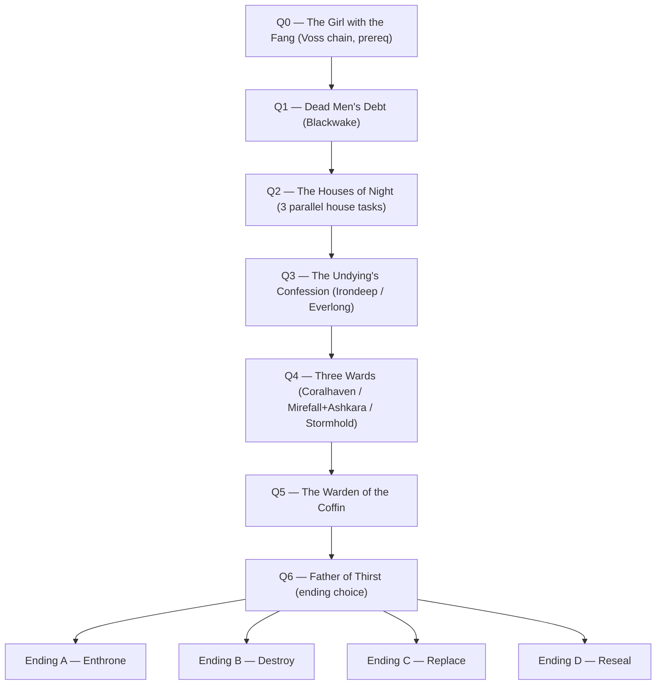

# The Father of Thirst — Vampire Questline Design

> *"Coffin" is not his name. It is only where he lies.*
> He is the nameless first vampire; his title is the **Father of Thirst**; "the Coffin" is his vessel — the houses have spoken of the vessel for so long they forget they never had a name for the thing inside.

Status: **proposal / for review** — no code yet.
Locked 2026-10-02: nameless Father + Coffin-as-vessel; all four endings (save-locked); side questline unlocked via Voss; prereq = the Daughter as an ally. Crypt format open — **site-dungeon foundation recommended** (§8).
Companion docs: `docs/quest_system_design.md` (quest runtime), `unrelated for coding/WORLDBUILDING_CODEX.md` (§6.4 Vaelthryn), `unrelated for coding/Storyline.md` (Act III).

---

## 1. Pitch

One drained ship is a tragedy. Four is a pattern.

Along the coasts and in the mountain passes, the dead are being found **exsanguinated but unmarked**, and newly-turned fledglings are fleeing *toward* something instead of away. The vampire houses — hiding in plain sight inside mortal cities for a century — know what it means.

**The Father of Thirst** — nameless first of all vampires — is waking inside his coffin beneath the world. The seal that kept him sleeping was written in **Accord-law** — and when the Accord shattered, his cage cracked with it. His get can feel it; the thirst is rising everywhere.

Every house on the continent wants him for a different reason: to enthrone him, to destroy him, to *become* him, or to lock him away forever. And one girl — an ordinary mage who insists she is human, who does not age — is the variable none of them have accounted for. House Blood calls her **the Seed**, and they are hunting her.

The player walks the path between the houses, from coast to capital to crypt, with the Daughter at their side — and decides what vampire society, the undead surge it feeds, and the girl's own future become next.

---

## 2. The player's path (plain summary)

0. **Through Voss's chain (after MQ3):** meet the girl with the fang — a Star Tower field-mage who insists she is an ordinary human — work with her, and recruit her. **Owning her is the questline's prerequisite.**
1. **Follow the drained-ship rumors** along the coast (Blackwake start) → discover self-turned fledglings fleeing something inland, and a House Blood agent asking after "the Seed."
2. **Make contact with the vampire houses** hiding in mortal cities — Nocturne the merchants, Blood the restorationists, Carmilla the radical coterie — and learn their competing agendas.
3. **Irondeep / the Everlong wreck:** learn Vaelthryn's confession — the Father is his sire, sealed with the Accord's help, and the seal is failing.
4. **Gather the three wards** across the continent (Coralhaven Temple vow, the brokers' ledger, Stormhold's frozen signal) that were set on the crypt by three different parties for three different reasons.
5. **Descend to the crypt** and defeat the First Warden — the thing that has been waiting inside for a century.
6. **Open the coffin — and choose:** enthrone him, destroy him, let a house replace him, or reseal the crypt. Each choice triggers a different battle, a different future, and a different fate for the Daughter. **One ending per save file — the world locks.**
7. **Aftermath:** vampire society reshapes, the undead surge shifts, and the houses remember what you did.

---

---

## 3. Lore frame (proposed canon — flag anything you want changed)

Built strictly on existing canon; the only *new* claims are marked.

- **Vampires predate the Accord.** Vaelthryn's "nocturnal law" governed vampire society for a century — blood-pacts, no open feeding, no turning of rulers. This is why the houses have always been able to hide among mortals (Codex §4.3, §6.4). **[extended]**
- **The Father of Thirst is the nameless first vampire — Vaelthryn's sire.** No one, not even the oldest houses, knows a name for him; the only title he is known by is *the Father of Thirst*. **"The Coffin" is his vessel** — the houses have spoken of the vessel for so long that it functions as a name, but the coffin is the prison, not the prisoner. **[new]**
- **He was sealed ~100 years ago, alongside the Accord's signing.** Vaelthryn — already the calculating one — helped bind his own sire rather than risk the new order. The crypt wards were written in the Accord's binding script. **[new]**
- **The Accord's breaking is what's waking him.** Wards written in Accord-law failed everywhere when the treaty shattered — dungeon membranes, the crypt, everything (Codex §2.2, §3.1 metaphor). Vaelthryn's undead surge is his *own* release; this is a second, older problem he cannot act on directly. **[new]**
- **Every vampire carries a trace of the Father's blood.** The stir is why vampire activity across all biomes is rising — it even explains the existing enemy ladder (Fledgling → … → First Sire) as the hunger intensifying. **[new]**
- **The Father has a daughter — the last true-born vampire.** Born before the Accord, she has never aged. She insists she is human. House Blood's fanatics call her **"the Seed"**: their coronation rite requires the Father's own bloodline, and they have hunted her since the stir began. The other houses don't know she exists — yet. **[new]**
- **The houses hid because discovery = pogrom.** Mortal cities tolerated "nocturnal law" neighbors as long as no one bled. A waking Father risks exposing everyone — merchant houses fear it, restorationist houses welcome it.

### Character: the Father of Thirst (nameless)

- "The Coffin" in the questline's title is the vessel, not the being. In-world characters say "the Coffin stirs" as shorthand; this doc uses "the Father."
- Ancient beyond the Four; not a Bound Power — the Bound Powers are younger than him. He was never bound *by* the Accord; he was sealed *with* it.
- Not a snarling monster: a **patient, courteous predator** who speaks to mortals as an inheritance he intends to collect. He is the *hunger* itself — when he feeds, his get feel it; when he hurts, they feel it too (this can drive mechanics: the finale gets harder the more his bloodline is present).
- He offers the player power openly. His first question is not "why have you come" but **"how long has it been?"**
- **In-game footprint:** `vampire_first_sire` (Level 52, 850 HP, boss: true — currently unused, per `docs/enemy_audit_report.md`) becomes the **First Warden** in Q5; the Father himself is a new boss module in Q6 (`combat/father_of_thirst.py`).

### The Daughter — "the girl with the fang" (working id: `daughter_of_thirst`)

- A Star Tower field-mage: precise, dry-humored, and adamant that she is an ordinary human. One visible fang, blamed on a childhood accident; she has not aged a day across records that already span decades.
- **She refuses to believe what she is.** The evidence is unambiguous (Voss's own archive holds the photos), but a whole life has been built on being human — and believing otherwise means becoming the thing House Blood hunts.
- **Recruitment (prereq):** introduced through Voss's field-study side quest after MQ3 (Q0); she joins as a **unique story ally** — not capturable. Owning her gates the whole questline (`prereq: daughter_in_party`).
- **Combat kit:** light/shadow mage with hidden vampire traits — self-mending she calls "long study breaks," a bite proc she always blames on bad dice; a personal skill that unlocks as her denial cracks (story-driven, not level-driven).
- **The houses' prize:** the enthronement rite needs the Father's bloodline — she is its only living carrier. Blood hunts her as the Seed; Carmilla would use her instead of the Father; Nosferatu want her blood for a true stake; Nocturne would hide her forever; Vaelthryn is the one who has always known, and said nothing.
- **Proposed ending fates** are in §5 Q6; the chain's recurring question is whether she gets to *choose*. (Adjustable — see §8.)

---

## 4. The vampire factions

All houses are hidden as ordinary city institutions (the "monster hiding in a city" premise). Champions reuse existing enemy entries, so fights are buildable without new stat design.

| House | Hidden as | City (proposal) | Champion (existing enemy) | Agenda |
|---|---|---|---|---|
| **House Nocturne** — the Court | Night market storage & ledgers | **Mirefall** (ties to Ssarak) | `vampire_nocturnal_king` | **Keep him asleep.** The current order benefits them; a waking Father ruins business. |
| **House Blood** — the Orthodox | Blood-ore tempering guild | **Cinderpeak** | `vampire_blood_sovereign` (mid-boss: `vampire_blood_baron`) | **Enthrone him — and find the Seed.** Restorationists whose coronation rite needs the Father's bloodline; they are hunting the girl with the fang. |
| **House Carmilla** — the Coterie | Perfume house / night salon | **Ashkara** | `vampire_carmilla_handmaiden` + `vampire_eclipse_countess` | **Replace him.** Drain the Father's essence and crown one of their own as a new, "modern" thirst. |
| **House Nosferatu** — the Atoners | Funeral parlor & river morticians | **Greyharbor** | `vampire_nosferatu_ancient` | **Destroy him forever.** Ancients who know exactly what he is and have spent a century dreading this. Surface *after* Q3 — they know Vaelthryn's secret. |
| **Vaelthryn's court** (wildcard) | The mountain garrisons | **Irondeep** | `vampire_dread_visor` (envoy), Captain of the Everlong Ship (existing superboss) | **Reseal quietly.** He will not fight openly — aiding him costs him leverage with the other powers. |
| **Wildcard: the thirst-touched** | — | everywhere | `vampire_fledgling`, `vampire_spawn` | Not a faction — feral victims of the stir. The rising tide everyone is drowning in. |

**Stance on the Daughter (the Seed):** Blood hunts her for the coronation · Carmilla wants her as the vessel of their replacement rite · Nosferatu want her blood for the true stake · Nocturne would hide her forever · Vaelthryn has known the longest and said nothing.

---

## 5. Quest chain

Quest IDs follow the existing convention; definitions go in `resources/quests.py`, runtime in `quests.py`. **Side questline** (NPC-offered, never missable, no deadlines), unlocked through Voss's chain: his field-study side quest after **MQ3 ("A Willing Bond")** introduces the Daughter; owning her (`prereq: daughter_in_party`) starts the Father of Thirst chain. After that, progression runs in parallel with the Voss chain, with the crypt finale naturally gated by level (~45+) and dungeon access.

### Q0 — The Girl with the Fang *(unlock + prereq — Voss side quest)*

| | |
|---|---|
| **Hook** | A field-study request from Voss after MQ3: a junior field-mage's survey reports contradict each other — the same surveyor appears in Star Tower records decades apart, unchanged. Voss, ever the archivist, wants corroboration, not a scandal. |
| **Play** | Escort/assist the mage through one field assignment; the "contradiction" resolves itself in ways she refuses to discuss. She asks to join you — "purely for the fieldwork." |
| **Reveal** | She does not age. She has a fang she is very bad at hiding. She is untroubled by holy ground… until she is. She insists, calmly and repeatedly, that she is human. |
| **Objectives** | `talk_npc:voss`, `visit_city:<field site>`, `recruit_ally:daughter_of_thirst` |
| **Reward** | The Daughter as a **unique story ally**; flag `daughter_in_party`; unlocks Q1. |

*(Her class flavor — field-mage vs. temple priest — and her name are open calls; see §8.)*

### Q1 — Dead Men's Debt *(discovery)*

| | |
|---|---|
| **Hook** | Bounty-board/inn rumor in any coastal city; directs to **Blackwake**. Salvage Court clerk **Doryn Vask** (new NPC) posts a navy bounty: three ships adrift, crews drained, no wounds. |
| **Play** | Investigate the wrecks (dungeon floors, coastal biome); clear vampire spawn; recover the **tide-log** with the entry *"the thirst woke before the ship did."* |
| **Reveal** | The fledglings aren't attacking — they're *fleeing* something inland. Pattern recurs in Irondeep (fever pits) and Elderfen ("hollow fever" victims whisper of a cocoon — existing hook). The Daughter reads the tide-log, goes quiet for a full day, and hands it back without comment. |
| **Objectives** | `visit_city:blackwake`, `talk_npc:doryn_vask`, `defeat_enemy:vampire_spawn`, `collect_item:tide_log` |
| **Reward** | Gold, XP, Journal flag `thirst_started`; introduces the three house contacts. |

### Q2 — The Houses of Night *(faction contact — 3 parallel side quests, all optional but recommended)*

Each house offers a task via an envoy **hiding as an ordinary service NPC**:

| Sub-quest | House task | Objectives | Reveal |
|---|---|---|---|
| `sq_thirst_02a` | **Nocturne:** recover a missing ledger of blood-pacts before the city watch finds it | `talk_npc:sable`, `defeat_enemy:human_bounty_hunter`, `collect_item:nocturne_ledger` | The houses have ruled themselves by a pact since the Accord; "Father of Thirst" is written in it as *the debt*. |
| `sq_thirst_02b` | **Blood:** retrieve a Conclave-era relic from a dungeon cache to prepare a "coronation" | `visit_service:blacksmith`, `defeat_enemy:vampire_lord`, `collect_item:blood_relic` | House Blood believes the old law died with the Accord; enthronement is destiny. |
| `sq_thirst_02c` | **Carmilla:** sabotage a rival's hunt — *or* quietly help the hunt and betray Carmilla (choice flag) | `visit_city:ashkara`, `talk_npc:ysolde`, `defeat_enemy:vampire_bloodknight` | The Coterie's ritual needs a *living* Father — but only long enough to drink him. |

Doing all three is possible; each sets a **trust flag** (`thirst_house_nocturne` / `_blood` / `_carmilla`) used in the finale.

### Q3 — The Undying's Confession *(midpoint — Irondeep)*

| | |
|---|---|
| **Hook** | The undead surge has changed behavior: some dead now march **toward** something and dig (Captain Aeryn Dast's garrison reports — lore NPC, bring into code or reskin a barracks officer). |
| **Play** | Fight through Irondeep's affected floors; confront the existing **Everlong Ship** superboss (or its wreck, if already defeated: its log still remains). |
| **Reveal** | The Captain's log is a confession by omission: *"He sleeps where the Accord laid him. My lord pays the tithe of silence."* Vaelthryn sealed his own sire. The seal is Accord-law — now failing. |
| **Optional — the Blood-Memory Path** | If the player owns a **Vampire-type monster girl** (Seductress / Countess / Matriarch) — *or* has any Undead/Vampire girl at high affection — the existing **"blood memory"** hook (Codex §4.5; the 200-affection Vaelthryn vision) plays a second vision showing **the crypt's location**. This unlocks the final quest with a bonus outcome and gives a genuine mechanical reason to collect vampire girls. The Daughter refuses to take part — "that memory would be a lie." |
| **Objectives** | `visit_city:irondeep`, `visit_service:barracks`, `defeat_superboss:everlong_ship` *(new hook)*, optional `blood_memory:crypt` |
| **Reward** | Crypt half-key (**Vaelthryn's signet**), flag `thirst_confession`; Nosferatu make contact. |

### Q4 — Three Wards *(continent-spanning key hunt)*

The crypt was sealed by three parties; each ward must be recovered — and **each house wants to be there when you do** (their envoy travel companions can flavor the scenes; flags decide who learns what).

| Ward | City | Set by | Task | Reward item |
|---|---|---|---|---|
| **The Temple Vow** | Coralhaven | The temples, who guard it without knowing | A vow-rite: bring a bonded/engaged girl (uses existing ring/bond systems) to witness the daylight oath | `ward_vow` |
| **The Broker's Ledger** | Mirefall → Ashkara | The black markets (Ssarak's network, the Glassman's ledger) | Trade, favors, or theft — speak to the brokers | `ward_ledger` |
| **The Frozen Crown** | Stormhold | Valdremoch's own observers (the frozen signal tower — canon) | Decode the frozen transmission: a pre-Accord record of the sealing | `ward_crown` |

**Reveal:** Vaelthryn, the Temples, and Valdremoch all separately believed they alone were guarding the crypt. They were all wrong — each held one third. Great scene: the three wards assemble into one key, and the key is shaped like a **coffin nail**.

### Q5 — The Warden of the Coffin *(crypt antechamber)*

- The crypt's format: **proposed as the first story-pinned site dungeon** (§8 decision 5, option E) — a fixed marker reachable via the world map, with its own floor count and progress, deliberately outside city-dungeon progression. Fallback formats (arena / mini-wing / hidden route) remain in §8.
- The **First Sire** (existing `vampire_first_sire`, Lv52) is the Warden — the first of the Father's get, awake and starving, guarding the coffin for a century. Fixed encounter, tailored kit.
- After the fight: the coffin is silent. It opens *by itself* a crack. **End of quest — cut to the houses arriving.**

### Q6 — Father of Thirst *(finale — the choice)*

The crypt fills with envoys — and the player's trust flags decide who stands where. One dialogue scene, then the fight that follows your choice.

**The choice is irreversible per save file:** it sets `fot_ending`, locks the world state, and the other three endings — and their rewards — cannot be earned on the same file. Warn and confirm before the choice. All four endings ship; all four fights reuse one boss module with **configuration variants** (phases/behaviors swapped).

| Choice | Who helps | Who fights you | Encounter | The Daughter's fate (proposed) |
|---|---|---|---|---|
| **A — Enthrone** | House Blood (they got what they hunted) | Nocturne + Nosferatu intervention; the partly-woken Father tests you | He "sips" the arena — blood-stack mechanic, stronger each round; accepts the crown *or* spares you | Claimed as the Seed of the coronation — whether she consents is the ending's sting |
| **B — Destroy** | House Nosferatu (+ Vaelthryn's silent aid) | House Blood charges, then **the Father fully wakes** | Full boss: `combat/father_of_thirst.py` — he drains the houses' envoys mid-fight (kills his own for power) | Her blood buys the true stake; she survives, and letting go of the immortal lie is her quiet epilogue |
| **C — Replace** | House Carmilla | The Father, then the *new* thirst (Eclipse Countess ascendant) | Two-phase trick: help the ritual for one round, then break it — or keep helping to the bitter end | The rite's true target is her bloodline — she blooms as the new thirst, willing or not |
| **D — Reseal** | Nocturne (+ Vaelthryn) | Everyone — each house tries to stop the closing | Hold the three wards for N rounds while he claws at the lid | She stays hidden, stays with you, and finally stops pretending — the gentle ending |

### Q7 — Aftertaste *(epilogue)*

Delivered as a StoryScreen on the next city entry. The world condition is now **frozen for this save file** (`fot_ending`); the Journal records it permanently. World flags per ending:

- **A — Enthrone:** the undead surge *eases* (the Father commands his blood), but vampire society ascends publicly; Nocturne loses status; new court content hook.
- **B — Destroy:** the sire-bond snaps — vampire enemies weaken across dungeons (mechanical flag), Vaelthryn sends a relic as thanks, Nosferatu go quiet; Vampire monster girls feel "lighter" (new dialogue).
- **C — Replace:** a new apex rises; vampire girls split (affection reactions), Eclipse court forms; darker setup for future content.
- **D — Reseal:** status quo preserved; Nocturne pact rewards (Black Market perks); the coffin still ticks — a future hook when you want one.

---

## 6. Systems mapping (build feasibility)

**Quest layer**
- Definitions: `resources/quests.py`; runtime hooks: `quests.py` (`start_quest`, `update_quests`, `complete_quest`, `queue_story`).
- Supported today: `visit_city`, `visit_service`, `talk_npc`, `capture_girl`, `recruit_ally`, plus state checks (`own_house`, `recruit_count`, `collection_count`, `race_count`, `married`).
- **Unlock & prereq:** Q0 is offered by Voss after MQ3; Q1 carries `prereq: daughter_in_party` (flag set when she is recruited). A soft level gate comes free via existing dungeon-ascension gating.
- **Irreversibility:** Q6's choice sets `state["flags"]["fot_ending"]`; every ending branch guards on it (no re-entry) and the four ending rewards are mutually exclusive per save file. Use the existing confirm dialog (`gui/widgets/confirm_dialog.py`) before the final choice.
- **New objective types needed:** `defeat_enemy:<key or race>`, `defeat_superboss:<key>`, `collect_item:<id>`, `clear_floor:<city>:<n>`, and a `story_choice` flag setter (dialogue-driven). Hook sites: combat victory path (defeat_*), inventory add (`collect_item`), dungeon controller (`clear_floor`).
- **Site-dungeon core (new; shared with future wild dungeons):** `player["wild_dungeons"]` data model + a `dungeon_context` fork at the top of `dungeon.py::explore_dungeon()` (site level/floors/progress; skip city milestones, Pandemonium and Wonderland branches); world-map marker + info panel in `gui/screens/world_map_screen.py`; travel-to-site via existing pathfinding + a final off-road leg; flee → nearest city; death → `apply_death_penalty()`. Do **not** touch `city_floors` or set `pandemonium_mode` (past save-pollution bugs). Full wild-dungeon spawner/caps/preview are out of scope for the crypt.
- **Story beats:** register callables in `facilities/story_beats.py`; delivered by StoryScreen on city entry — no new UI needed.

**Combat layer**
- Reuse: `vampire_first_sire` (Warden), house champions (`vampire_nocturnal_king`, `vampire_blood_sovereign`, `vampire_carmilla_handmaiden`, `vampire_eclipse_countess`, `vampire_nosferatu_ancient`, `vampire_dread_visor`), feral spawn set for Q1.
- New: **Father of Thirst** boss module per the standard superboss pipeline (`combat/father_of_thirst.py` + YAML entry + import in `dungeon.py` + tier pool), with 4 ending-variant configurations. Follow superboss hook conventions (`enemy_turn_hook` signature; ally cooldown ticking in `superboss_common.py`). `vampire_first_sire` is used as the Q5 Warden encounter instead.

**Items & rewards**
- Key items: `tide_log`, three ward keys, `vaelthryn_signet`, optional `crypt_key_blood`.
- One legendary per ending (all **actor-based** for player + allies per the unique-equipment convention), e.g.:
  - Enthrone → *first_thirst* (weapon, drain scaling)
  - Destroy → *accord_stake* (weapon, bonus vs Undead/Vampire)
  - Replace → *eclipse_chalice* (accessory, drain on kill)
  - Reseal → *nocturne_writ* (accessory, flee/stealth + black-market discount)
- Titles/flags for the Journal; all rewards surface via Journal + session log (**no toasts** — quest convention).

**NPCs**
- **The Daughter:** unique story ally — not capturable. Follow the unique-ally persistence pattern the Wonderland heroines use (house record + `_heroine_key`, restorable via `create_ally_from_girl` / inn rejoin; see `docs/wonderland_heroines_full_dict.md` and `combat/ally.py`). Proposed: she survives all endings so no path can strand her as a ghost ally.
- New dialogue NPCs (hidden-in-city envoys): Blackwake clerk, 3–4 house envoys, possibly a Nosferatu "undertaker." Existing lore NPCs (Ssarak, Aeryn Dast, the Glassman) are currently **lore-only** — bringing them into code is optional and can be deferred; use role-based stand-ins until then.

---

## 7. Suggested build phases

| Phase | Content | New systems |
|---|---|---|
| **A** | Q0 + Q1–Q4: Daughter recruitment (Voss side quest), visits, dialogues, ward quests, house flags | Unique story ally (Daughter) + new objective types & hooks (defeat/collect item), story beats, ~5 NPCs |
| **B** | Q5–Q6: crypt arena, Warden (reused), Coffin module + 4 variants | One new superboss, story arena trigger |
| **C** | Q7 + rewards + integration (vampire girl dialogue, blood-memory extension, Black Market perks) | 4 legendary items, epilogue flags |

Suggested changelog grouping: **v0.1.8.0** (current active version) unless a bump is requested.

---

## 8. Decisions & open calls

**Locked (2026-10-02):**

1. The Father is **nameless**; "the Coffin" is his vessel, not his name.
2. **All four endings ship**, one per save file — the world condition locks after the ending, and the other endings' rewards cannot be obtained on that file.
3. **Side questline**, unlocked through Voss's chain to match the level curve.
4. **Prereq = the Daughter as an ally.** She is introduced via Voss's field-study arc; she claims to be human, does not age, and House Blood hunts her as "the Seed."

**Still open:**

5. **The crypt: dungeon or area?** Options:
   - **E — Site-dungeon foundation** *(recommended)*: build the minimal **story-pinned wild dungeon** core — reviving the shelved wild-dungeon feature (§8a) in its pinned subset — and make the crypt its first instance (fixed world-map marker, own floor count, own progress, outside city-dungeon progression). One investment, reusable for future random wild dungeons.
   - **A — Single story arena:** one antechamber fight + one boss room. Cheapest; no new map/travel plumbing.
   - **B — Mini-dungeon (3–5 rooms):** reuse existing floor generation inside a dedicated crypt wing; adds exploration and filler fights.
   - **C — Full dungeon region:** new multi-floor content; most expensive; wants its own biome hook.
   - **D — Hidden route inside an existing dungeon** (e.g., Irondeep's canon blood-memory hidden route): zero new map work, but ties the crypt to one city's content.

   **§8a — Wild-dungeon status (context for option E).** A "wild dungeon" (one-time dungeon, flex level 1–80, limited floors, randomly appearing on the world map, travel rules apply, flee → nearest city, death → normal penalty, reward pool viewable before travel) was designed in discussion on **2026-07-21** but **never implemented** — no code exists today. Verified reuse points: `dungeon.py::explore_dungeon()` (room gen/combat/drops), `facilities/pathfinding.py::find_shortest_path()`, `gui/screens/world_map_screen.py` (canvas, panning, info panels), `facilities/travel.py` + `travel_events.py`, `utils.py::apply_death_penalty()`. Required for the pinned subset: a `player["wild_dungeons"]` data model; a fork at the top of `explore_dungeon()` (site level/floors/progress instead of `city_floors`; skip ascension milestones and the Pandemonium/Wonderland branches); a world-map marker + info panel; travel-to-site routing; flee/death exit handling. Pitfalls: never touch `city_floors`/`_ensure_city_floors` (bug fixed 2026-09-23), never set `pandemonium_mode` from a site run (per-run flag polluted saves — fixed 2026-09-23), and handle `origin_city` carefully (it drives death return and UI labels; keep it = nearest city, add a separate `dungeon_context` marker for UI checks). The full random system (spawner, active-dungeon caps, reward preview) is **not** needed for the crypt.
6. **The Daughter's class flavor:** field-mage (Star Tower / Voss tie — recommended for the unlock flow) vs. temple priest (Coralhaven / Temple Vow tie).
7. **Her name**, and how deep her denial runs (genuine unknowing vs. a lie she tells herself) — writer's call; it colors every scene.
8. **City/crypt assignments** in the tables — swap any to fit the world map plan.

---

*Everything in §3 beyond cited canon is proposed and safe to cut; the quest structure (§5) is designed to survive edits to the lore frame.*
