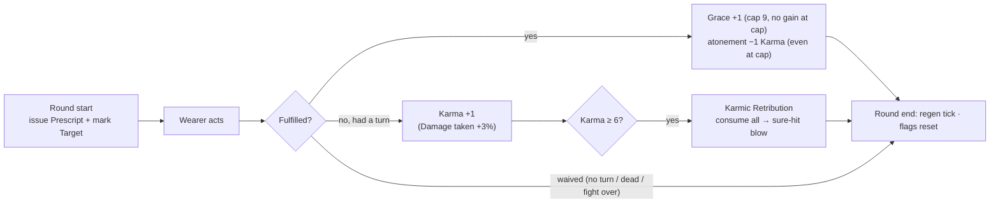

# Prescript Ledger — Pandemonium Guild Legacy Accessory Design

Status: **IMPLEMENTING 2026-10-04** — design locked (decision log §0); implementation underway.
Numbers are starting knobs (constants in `combat/weapon/prescript_ledger.py`) — playtest tuning only.

**Theme:** a guild ledger older than the guild itself. Its pages record honored contracts —
and issue new ones mid-battle. Project Moon "Index" inspiration: an obedience engine of
**Prescripts**, **Grace**, and **Karmic Consequence** (this is a stylized homage, not 1:1).

**One-line pitch:** every round the wearer receives a cryptic Prescript (strike the marked
Target, use a skill, use an item, or endure). Fulfil it and Grace of the Prescript stacks —
damage, crit and regen that snowball a long fight. Ignore it and Karmic Consequence stacks;
at 6, the ledger collects its due.

**Identifiers:** module `combat/weapon/prescript_ledger.py`, item id `prescript_ledger`,
enemy-side flag `prescript_mark`, wearer fields `prescript_grace_stacks` /
`prescript_karma_stacks`.

---

## 0. Decision log (locked)

1. **Numbers** — per Grace stack: **+2% damage / +1.5% crit / 1.5% max-HP regen**; clash tiers **+10/20/30%** at Grace 3/6/9.
2. **Grace cap 9** — at cap there is no further Grace gain (no party effect either). **Karma still accrues at cap**, and **atonement still applies at cap** — fulfilling a Prescript always cleanses 1 Karma.
3. **Karma** — damage-taken escalator (party-side `vulnerable`, **+3%/stack**). **Karmic Retribution at 6 stacks**: consumes all, sure-hit blow `8% max HP + 20`; **Defend halves** (house convention).
4. **Atonement** — fulfilling a Prescript removes 1 Karma (at any Grace level — even at the cap).
5. **Name** — Prescript Ledger (`prescript_ledger`).
6. **Skill-class** — workshops, Furioso, and brush exhibits count as "skills" for both Prescript fulfilment and clash empowerment.
7. **Persistence** — per-fight reset; all combat state is ephemeral (no save changes beyond acquisition fields).
8. **Acquisition** — guild legacy reward **#2** beside Sky Piercer: **fulfil 10 guild bounties against Level 20+ targets (lifetime)** — the level gate keeps it out of early game.

Interpretation note: "increase dt" is read as Karma's damage-taken identity with the
6-stack collection; if the per-stack 3% should step up, it is the `KARMA_DT_PER` constant.

---

## 1. Fight flow

Key rulings on the flow:

- **Rewards are instant** (fulfilment resolves the moment the action is verified, with its line).
- **Punishment is round-end** (ignored-but-feasible only), followed by the Grace regen tick.
- **Waivers**: no turn that round (stun / skip effects), dead, or fight ending mid-round → no Karma.
- **Auto-credit**: if the marked Target falls to anyone before the wearer strikes it, the Prescript counts as fulfilled ("the kill stands").
- **At cap**: no Grace gain, but **atonement still cleanses 1 Karma** (per §0.2).

## 2. The Prescript pool

| Prescript (flavor line) | Fulfilment | Feasibility gate |
|---|---|---|
| *"Shed blood upon {Target}."* | Wearer damages the marked enemy (any source; HP-delta detection) | ≥1 living enemy (Target is marked) |
| *"Exercise the art."* | Wearer uses a skill-class action (class skill, ally skill, workshop, Furioso, brush exhibit) | Kit has ≥1 usable action |
| *"Partake of your provisions."* | Wearer uses a consumable/utility | Not silenced + shared bag has a combat item |
| *"Endure."* | Wearer defends | Always |

Draw rules: feasibility-filtered via the live menus; no immediate repeats; one shared
**Prescript's Target** marked per round (rendered `📜TGT` on the enemy).

## 3. Grace of the Prescript

| Source | Effect |
|---|---|
| Fulfil a Prescript | +1 Grace (below cap); −1 Karma (atonement — any Grace level); refresh derived buffs |
| Fulfil at 9 Grace | No Grace gain — but atonement still applies (−1 Karma) |
| Per stack | `damage_boost` +2% · `crit_chance` +1.5% · 1.5% max-HP regen at round end |
| Clash tiers vs the Target | +10% / +20% / +30% skill-class damage at Grace 3 / 6 / 9 |

Derived buffs are single **source-tagged refreshes** (`remaining: 999`; `palette_stance`
precedent) — never appended repeatedly. Stripped by `reset_all_state()` at combat
start/end. HUD: `GRC×N`.

## 4. Karmic Consequence

| Trigger | Effect |
|---|---|
| Ignored-but-feasible Prescript (waivers exempt; **applies at Grace cap too**) | +1 Karma; `vulnerable` refreshed to `+3% × stacks` damage taken |
| At 6 stacks | **Karmic Retribution** — consume all; sure-hit `8% max HP + 20`; Defend halves |

- Atonement: fulfilling a Prescript cleanses 1 Karma — **at any Grace level, including the cap**.

Party-side amplification uses `vulnerable` (read in `enemy_ai.py` for any defender) —
**not** `damage_taken_up`/`get_damage_taken_multiplier`, which is enemy-only. HUD: `KRM×N`.
Retribution mirrors the White Knight's 6-stack burst convention; death through it
respects Undying Vow (`try_consume_death_ward`).

## 5. Item & guild acquisition

Item (`resources/items.py`, mirrors `sky_piercer`):

| Field | Value |
|---|---|
| id / name | `prescript_ledger` / **Prescript Ledger** |
| slot / type | accessory / equipment |
| unique | True |
| base_mods | Learning 6 · Charisma 6 (light; tune) |

Guild flow (`facilities/guild.py`):

- **Sky Piercer** — defeat **5 distinct superbosses** (unchanged).
- **Prescript Ledger** — fulfil **10 guild bounties against Level 20+ targets (lifetime)**.
  `bounties_completed` counts every turn-in; `high_bounties_completed` (target level ≥ 20)
  is the gate — `target_level` is stored at bounty generation, with a template fallback for
  bounties accepted before the field existed. Expired bounties do not count; claim-once flag
  `prescript_ledger_claimed`; grant via `build_item` → `add_item_to_inventory`.
- `_legendary_rewards` becomes a two-entry ledger (list + progress + claim selection),
  preserving the original rejection style. No retroactive bounty count (field starts at 0).

## 6. Implementation map

| File | Change |
|---|---|
| `combat/weapon/prescript_ledger.py` | **New** — equipment check (`accessory1/2/3` slots), state, issue/report/evaluate, clash bonus, reset |
| `resources/items.py` | `prescript_ledger` entry |
| `character.py` | `ensure_player_fields`: `bounties_completed`, `prescript_ledger_claimed` |
| `facilities/guild.py` | Bounty counter increment; two-reward `_legendary_rewards` |
| `combat/combat_engine.py` | Reset (combat start), issue (round start), evaluate + death signal (round end), reset in `_end_combat_with_result` |
| `combat/superboss_common.py` | Same four points (superboss loop) |
| `combat/player_actions.py`, `combat/ally.py` | Handler-entry `mark_acted`; `report_skill/item/defend` in the action branches (workshops/brush count as skill) |
| `combat/skills.py`, `combat/ally_skills.py`, `combat/weapon/black_silence_gloves.py`, `combat/weapon/palette_brush.py` | Clash empowerment hook (`get_clash_bonus`) at the 4 skill-class damage sites |
| `combat/combat_ui.py` | `GRC×N` / `KRM×N` wearer tags, `📜TGT` mark tag (auto-surfaces GUI via `buff_tags`) |
| `tests/_diag_prescript_ledger.py` | Context-only diagnostics |

### Verified gotchas

1. `_tick_all_state` runs at round end **and** at combat end — evaluation lives in the
   loop round-end blocks, never inside it.
2. The generic loop has **no hit hook** — the HP-delta detection block is added at the
   `handle_player_turn` / `handle_ally_turn` call sites (superboss loop already has one;
   the Ledger report piggybacks on it).
3. Never reuse `hunters_mark` for the Target (silent +50% damage rider); `prescript_mark`
   is inert outside the Ledger.
4. Accessories occupy `accessory1` / `accessory2` / `accessory` — check all three slots.
5. Per-stack auras use single source-tagged buff entries (refresh value, not append).

## 7. Testing checklist

- [ ] Grace: +1/fulfilment, cap 9 no-gain, atonement cleanses at cap, derived buffs single+refreshed
- [ ] Karma: accrues at cap, waivers exempt, atonement, Retribution exactly at 6 (consume-all, sure-hit, Defend-halves), death ward honored
- [ ] Prescripts: feasibility gating per kit (claws/brush/gloves), no immediate repeat, shared Target mark, auto-credit on Target death
- [ ] Clash tiers: +10/20/30 at Grace 3/6/9 across all four skill-class sites (player + ally actors)
- [ ] Reset: no buff/mark/field leakage between fights (generic + superboss), save-load safe
- [ ] Guild: counters only on honored bounties; only Level 20+ targets advance the gate; template fallback works for old bounties; claim once; both rejection paths; no retroactive counts
- [ ] HUD tags render (terminal rows + GUI cards)

---

*When shipped: changelog bullets under the active version per the changelog-versioning convention.*
