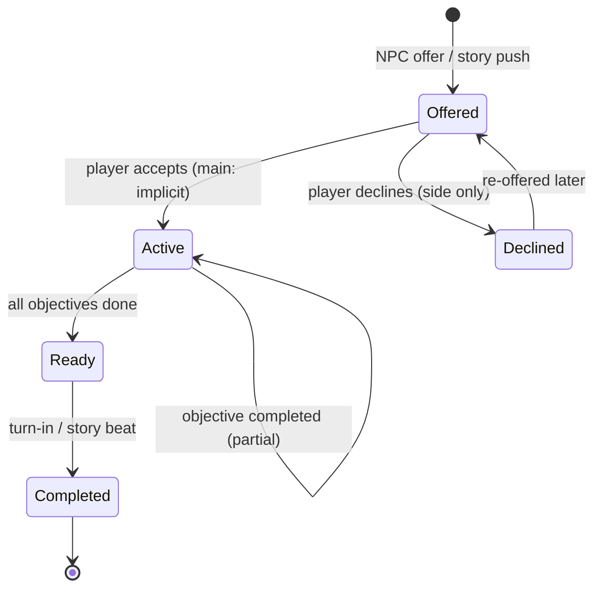

# Quest System & First Questline — Design Report

Status: Phases 1–3 **implemented 2026-09-27**. Full MQ1–MQ6 chain registered (MQ3–MQ6 as state-check wrappers + catch-up). Phase 4 polish (map markers, side quests) not started.
Scope: Quest infrastructure + **Main Quest 1 — "The Stellar Summons"** (Archivist of Skylume's Star Tower), plus the phased build-out of the Archivist's "Field Study" chain.

---

## 0. Decision log

**Locked (confirmed 2026-09-27):**

1. **NPC:** **Quillan Voss**, Archivist of Skylume's **Star Tower** ("the Stellar Archive"). Composed and precise — and never without his monster girl companion, a **moth girl** known simply as **Lumen**, who helps him every day and always seems grateful. She is a unique story NPC (not capturable/recruitable), appears in every Voss scene, and is the in-fiction source of the "star-moth" letters (§2.1). Her full name — **Lumen Quillan** — and their shared history surface later in the chain; **do not rush their story**.
2. **Opening:** the quest **starts with a tutorial-style story window** right after character creation (existing saves: on the next city entry) — Voss asks for help and summons the player to Skylume. The **Journal is updated immediately**; quests are never hunted down.
3. **Discovery model (§1.1):** main quests are **pushed**; side quests are **NPC-offered** (accept/decline, prerequisite flags allowed, never manual hunting); bounties stay their own system; Wonderland heroine quests are left as-is for now.
4. **Base party cap: 2 front / 0 bench**, grown to the existing 4/4 endpoint through the Field Study chain. Resonance grades use **unique names, never numbers** — locked: **Unattuned** (baseline) → **Pitch → Timbre → Cadence → Chord → Crescendo** (§1.3.4, §2.2).
5. **Story delivery:** pending story beats open a **StoryScreen whenever the player enters a city** — which covers dungeon exits, travel arrivals, post-floor returns, and loads. **In-person meetings only where the quest requires them** (MQ1, MQ3, MQ6).
6. **Location:** the Star Tower is a **new clickable map service** in Skylume (not nested inside the Arcane Tower).
7. **Field Allowance:** tutorial completion grants **+200 gold** alongside the class starter weapon — **300 gold total at game start** (100 base + 200 allowance). No separate stipend rides on the intro.
8. **Quest state:** `player["quests"]` (canonical) + journal display mirrors synced by one helper. Definitions in `resources/quests.py`; runtime in root `quests.py`. New fields via `ensure_player_fields()`.
9. **Changelog:** quest core and MQ1 entries both grouped under **v0.1.8.0**.
10. **No quest toasts:** quest grants/completions/updates surface through the **Journal** (plus a session-log entry) — quest flows never raise popups (user decision 2026-09-27; `quest_toast` removed).
11. **Resonance Orb (2026-09-27):** Voss also gifts a **resonance blank** — a shattered-glass key item whose wholeness tracks the grade (user request: *"more impactful that the item behaves like a shattered orb, becoming more whole the more it progresses"*). One item, `resonance_orb`: name/rarity/lore/meter refresh on every tier rise — **Shattered (Unattuned) → Cracked (Pitch) → Mending (Timbre) → Whole (Cadence) → Radiant (Chord) → Resonant (Crescendo)**, rarity common → mythic. The bag row shows a `✦` fill-meter; Examine shows lore + grade + next requirement. Old saves receive it on the next sync once `met_voss` is set. It **replaces** the plain Stats-tab status line.

---

## 1. Quest system design

### 1.1 How quests are handled (the core question)

Options considered:

| Option | Verdict |
|---|---|
| Player manually finds quests (pure exploration) | ✗ — the game's power systems would become invisible; most players would never see them |
| Main quest gates side quests behind clears | ~ — fine as *prerequisite flags*, bad as the general rule (side content shouldn't wait on the main line) |
| Tutorial ends → Journal updated → quests push themselves | ✓ — **chosen for main quests** |

**Decision — hybrid model:**

- **Main quests** — *pushed*. Granted at story beats (the first one: the tutorial ends). The Journal updates automatically and the conversation window that granted it is the narrative delivery. No deadlines, no failure states, never missable.
- **Side quests** — *offered by NPCs*. You learn about a quest by talking to a visible NPC (map marker / service), then **accept or decline** in the conversation. Declining stores the quest in `declined` so it can be re-offered later. Some side quests may carry prerequisite flags (e.g., "the Archive's requests unlock after The Stellar Summons"), but side quests do not generally wait on main-quest clears.
- **Bounties** — unchanged; they keep the Bounty tab and their deadlines.
- **Wonderland heroine quests** — unchanged in v1; migration into the quest system is deferred (user decision).

**Discoverability rules (never invisible, never hunted):**

1. A quest-grant or objective update always produces a Journal change and a session-log entry — so quests are always noticed when they change (no popups).
2. Quest-giver NPCs are reachable through services the player already visits (guild, towers, houses, port); no hidden NPCs for main content.
3. The Journal is the single source of truth for "what should I do next" — every active quest lists its objectives with done/undone state.
4. Stretch (post-v1): a `!` marker overlay on the city map for services with offered quests, using the existing `CITY_SERVICE_POSITIONS` grid.

### 1.2 Lifecycle & state machine



- Main quests skip `Offered` → `Active` (auto-accepted) and skip `Ready` → `Completed` friction where the story allows (see §2.3 — the Archivist's reports are delivered remotely so the player doesn't walk back to Skylume after every step).
- Only **bounties** can fail/expire. Main and side quests never expire silently.
- All quest progress is **monotonic** (objectives only flip to done, never back), which makes state-checking objectives safe for existing saves (see §2.3 edge cases).

### 1.3 Data model

#### 1.3.1 Definitions — `resources/quests.py` (new)

```python
QUESTS = {
    "mq_archivist_01": {
        "id": "mq_archivist_01",
        "type": "main",                       # main | side
        "name": "The Stellar Summons",
        "giver": "archivist_voss",            # npc id (informational)
        "region": "skylume",                  # informational
        "prereq": None,                       # quest id or flag name, or None
        "journal_desc": (
            "A recorded message from Archivist Quillan Voss of Skylume's "
            "Star Tower. He asks for your help — and asks you to come in person."
        ),
        "stages": [
            {
                "id": "journey",
                "desc": "Travel to Skylume and enter the Star Tower.",
                "objectives": [
                    {"type": "visit_city",    "target": "skylume",      "label": "Reach Skylume"},
                    {"type": "visit_service", "target": "star_tower",   "label": "Enter the Star Tower"},
                ],
            },
            {
                "id": "audience",
                "desc": "Speak with Archivist Voss.",
                "objectives": [
                    {"type": "talk_npc", "target": "archivist_voss", "label": "Speak with Archivist Voss"},
                ],
            },
        ],
        "rewards": {
            "xp": 150,
            "gold": 80,
            "items": [],                       # e.g. [{"id": "capture_net", "rarity": "common"}]
            "flags": ["met_voss"],             # story flags set on completion
            "next": "mq_archivist_02",         # auto-starts the next quest (pushed)
        },
    },
    # ... mq_archivist_02 .. mq_archivist_06, future side quests
}
```

#### 1.3.2 Player state — `player["quests"]` (new, via `character.ensure_player_fields`)

```python
player["quests"] = {
    "active": {
        # quest_id: per-objective booleans + bookkeeping
        # "mq_archivist_01": {
        #     "stage": 0,
        #     "objectives": {"visit_city:skylume": False,
        #                    "visit_service:star_tower": False,
        #                    "talk_npc:archivist_voss": False},
        #     "started_day": 1,
        # },
    },
    "completed": [],          # [quest_id, ...]  (permanent)
    "declined": [],           # [quest_id, ...]  (side quests only)
    "flags": {
        # "met_voss": True, "intro_seen": True,
    },
}
```

Stored with `.setdefault()` in `ensure_player_fields()` (per project convention — old saves migrate for free; `ensure_player_fields` runs on every load via `gui/screens/main_menu_screen.py`).

#### 1.3.3 Journal mirror — existing lists get a richer schema

The Journal UI already renders `journal["main_quests"]` / `journal["side_quests"]` (currently always empty — nothing in the codebase writes to them). They become the **display mirror**, written only by `quests.sync_journal(player)`:

```python
# entry pushed into journal["main_quests"] / ["side_quests"]:
{
    "id": "mq_archivist_01",
    "name": "The Stellar Summons",
    "desc": "A recorded message from Archivist Quillan Voss ...",
    "day": 1,                             # day started (existing rendered field)
    "status": "active",                   # active | ready | complete
    "objectives": [
        {"label": "Reach Skylume", "done": True},
        {"label": "Enter the Star Tower", "done": False},
        {"label": "Speak with Archivist Voss", "done": False},
    ],
}
```

Renderer upgrade in `gui/screens/inventory_screen.py` `_render_quest_subtab()`:

- status chip (ACTIVE / READY / ✓ COMPLETE — reuse `Theme.BUFF_POSITIVE` / `BUFF_NEGATIVE` / `TEXT_DIM`),
- objectives list with `☐` / `✓` prefixes,
- keep existing `name` / `desc` / `Day N` lines.

Completed quests stay visible (moved to the bottom of the tab, dimmed) — a paper trail is half the point of a Journal.

#### 1.3.4 Resonance grades — single source of truth

The ladder is stored as one table (in `resources/quests.py` alongside the definitions, or a small `resources/resonance.py` if preferred) — cap numbers, display names, and requirement text all come from here:

```python
RESONANCE_GRADES = {
    0: {"name": "Unattuned", "front": 2, "bench": 0},
    1: {"name": "Pitch",     "front": 3, "bench": 0},
    2: {"name": "Timbre",    "front": 3, "bench": 1},
    3: {"name": "Cadence",   "front": 3, "bench": 2},
    4: {"name": "Chord",     "front": 4, "bench": 2},
    5: {"name": "Crescendo", "front": 4, "bench": 4},
}
```

- `combat/ally.py get_active_limit(player)` / `get_bench_limit(player)` read the player's current grade (derived from completed quests / flags).
- UI surfaces (Star Tower menu, party management, **Journal**) render the grade name + the requirement for the next grade — never "Tier II"-style numbering.
- Grade 5 = 4/4 = today's baseline, so the endgame needs no rebalancing.

### 1.4 Runtime API — `quests.py` (new, root-level)

| Function | Purpose |
|---|---|
| `start_quest(player, quest_id)` | Validates prereqs, creates state, syncs journal, fires toast/log |
| `notify_objective(player, obj_type, target)` | Called by hooks: marks matching objectives done, advances stages, syncs journal |
| `update_quests(player)` | Single entry point used by hooks; no-ops when nothing changes |
| `complete_quest(player, quest_id)` | Grants rewards (`gain_exp`, gold, `build_item` + `add_item_to_inventory`), sets flags, moves to `completed`, auto-starts `next` |
| `sync_journal(player)` | Rebuilds the journal mirror from canonical state |
| `has_quest(player, quest_id)` / `quest_state(player, quest_id)` | Query helpers |
| `offer_side_quest(player, quest_id)` / `decline_quest(...)` | Side-quest conversation flow |
| `queue_story(player, beat_id)` / `pop_pending_story(player)` | Story-beat delivery — queue beats; the city-entry hook pops the next one and opens it as a StoryScreen (§1.6) |

Optional: on grant/complete, also `events.record_event(player, {...})` so the Event tab gets "Quest started / Quest complete" entries.

### 1.5 Objective types & their hooks (v1 set)

| Type | Fires when | Hook location |
|---|---|---|
| `visit_city` | Player arrives in a city | `facilities/travel.py` — `embark_journey()` (single-leg, after `player["location"] = dest_id`) **and** `embark_multi_leg_journey()` (world-map route, on the final leg) |
| `visit_service` | Player opens a facility | Facility entry functions (e.g., `facilities/star_tower.py` entry), so it works in both GUI and terminal paths |
| `talk_npc` | Scripted conversation reaches a beat | Direct call inside the story window / NPC dialogue |
| `capture_girl` | A monster girl is captured | `combat/capture.py` — `attempt_capture()` success path (after `store_captured_girl`) |
| `recruit_ally` | A housed girl is recruited to the party | `combat/ally.py` — `recruit_ally_from_house()` success path |

Later objective types (Field Study chain): `own_house` ✅ (state check + deed hook), `capture_girl` ✅ (state check + capture hook), `recruit_ally` ✅ (hook); count-based checks driving MQ3–MQ6: `recruit_count` ✅, `collection_count` ✅ (unique enemy `key` across house + party), `race_count` ✅, `married` ✅. Remaining for Phase 4+: `affection_reached`, `clear_floor`, `defeat_superboss`.

**Design rule:** hooks call `quests.update_quests(player, type, target)` as fire-and-forget. Hooks never assume a quest is active; the runtime no-ops if nothing matches. This keeps the hook sites tiny and future-proof.

### 1.6 UI & notifications

- **Journal** (existing, `gui/screens/inventory_screen.py` tab 5): the upgraded `_render_quest_subtab` (§1.3.3). No new screen; the sub-tab order stays as is (Bounty / Main Quest / Side Quest / Event).
- **Notifications (no popups):** quest grants/completions/updates do **not** use toasts — they surface through the **Journal** (quest tabs) and the session log (`sm.log`). `screen_manager.show_toast()` / `term.toast()` remain generic utilities for other systems, and `screen_manager.clear_toasts()` runs on main-menu entry so any toast can never linger over a menu. (`quest_toast` was removed from `quests.py`.)
- **Story windows**: new `gui/screens/story_screen.py` — a `FacilityScreen` subclass with the paused clock, same trick as `TutorialScreen` (`facilities/tutorial.py`). Reusable for all future conversation beats:

  ```python
  from facilities.tutorial import TutorialScreen
  # StoryScreen = same as TutorialScreen but conventional for conversations
  StoryScreen(title="A Message in Starlight", func=archivist_intro, func_args=(player,), on_close=...)
  ```

- **Story-beat delivery**: beats are queued on the player (`quests.queue_story(player, beat_id)`) and delivered **on city entry** — the `CityScreen` entry hook checks the queue and opens the next beat as a StoryScreen (overlay via `screen_manager.push_overlay`, or `switch_to` when chaining at character creation) before handing control back to the city. One hook covers **dungeon exits** (all return paths funnel to `CityScreen`), travel arrivals, post-floor screens, and menu loads — and guarantees story never interrupts combat, death, or a dungeon run. One beat per entry; extras stay queued in order.
- **City map marker** (stretch): `gui/widgets/city_map.py` `service_colors` map + a `!` suffix for services with offered quests.

---

## 2. First questline — the Archivist

### 2.1 Fiction & theme

- **Location:** the **Star Tower** — the rightmost of Skylume's five floating towers (Storm / Fire / Arcane / Frost / Star on the Skylume map). Its institution is the **Stellar Archive**: it records the ley-line echoes of bonds — who fought beside whom, and what that bond made possible.
- **NPC — Archivist Quillan Voss:** a scholar, not a wizard; composed, precise, gently formal. He reads the Archive and writes the entries, and he studies **Command Resonance**: why one handler can only coordinate so many monster girls in battle at once, and whether that limit can be *grown*. (This is the in-fiction explanation for the entire party-cap progression — the cap now has lore.)
- **Companion — Lumen:** a **moth girl** who lives in the tower and keeps him functional — fetching folios, filing entries, reminding him to eat — and she *always seems grateful*. Present in every Voss scene: fluttering at the edge of his recording, greeting the player at the tower door, perched on the desk while he talks, quietly correcting him. She is a **unique story NPC** (like the Wonderland heroines — an individual, not a capturable recruit). **The "star-moth" letters are her little cousins** — natural moths that carry the Archive's messages, which is why they can find the player anywhere in the world.
- **Pacing — don't rush their story:** she is **Lumen**, and only Lumen, through the early chain. Her full name — **Lumen Quillan** — and what it means (the shared name, how she came to the tower, why she seems grateful) is a slow reveal seeded across the Field Studies, not explained in MQ1. Give them room; the Archive has time.
- **Voss & Lumen are the living first grade:** his ledger's first earned rank, **Pitch**, is "a single clear note — one voice answering yours" — his bond with Lumen is the reading the whole scale grew from. It's how he built it, and why he can't climb it alone.
- **Why the player:** Voss's instruments read bonds from a distance but can't *test* them. He needs someone in the field — a handler who fights beside monster girls — to gather readings. The player is, by virtue of existing systems, exactly that.
- **Tone:** scholarly, warm, slightly distracted; he calls the player "field agent" and apologizes for the tower being "a bit tall". He is sterner with himself than with anyone else, and softer with Lumen than he pretends to be. He is the game's first NPC who treats the player's party as *the subject worth studying*.

### 2.2 The questline arc (mapping to the Command Resonance ladder)

Only MQ1 has a full conversation spec in this document; every main quest is registered in `resources/quests.QUESTS`. MQ2–MQ6 are thin state-check wrappers whose objectives mirror the roster milestones and the tier backfill. Grades are **named ranks** (no numbering); caps per grade in §1.3.4 — requirement counts locked (§5).

| Quest | Title | Objectives (summary) | Resonance grade |
|---|---|---|---|
| MQ1 `mq_archivist_01` | **The Stellar Summons** | Tour ends → travel to Skylume → enter Star Tower → speak with Voss | — (grants Field Kit + starts MQ2) |
| MQ2 `mq_archivist_02` | **A Place to Belong** | Own a house (deed); capture your first monster girl | **Pitch** — 3 front / 0 bench |
| MQ3 `mq_archivist_03` | **A Willing Bond** | Recruit your first girl (affection 50) | **Timbre** — 3 / 1 (bench + Switch tactics) |
| MQ4 `mq_archivist_04` | **Variety of Command** | 3 distinct recruits | **Cadence** — 3 / 2 |
| MQ5 `mq_archivist_05` | **The Broad Ledger** | 6 distinct girls, ≥3 races | **Chord** — 4 / 2 |
| MQ6 `mq_archivist_06` | **Grand Resonance** | 10+ distinct, ≥5 races, 1 marriage | **Crescendo** — 4 / 4 (capstone — today's baseline) |

Baseline before Pitch: **2 front / 0 bench** (player + 1 ally). Endgame lands exactly on the current 4/4 so all existing superboss tuning stays valid.

**Delivery rhythm:** Voss's reports ride the star-moths and arrive as **story screens on city entry** (§1.6) — after dungeon exits, travel stops, anywhere the player surfaces in a city. The player only **meets Voss in person where the script calls for it**: MQ1, MQ3, and the MQ6 capstone. No forced re-walks after every step.

### 2.3 MQ1 — "The Stellar Summons" (full spec)

#### Trigger

- **New characters:** chained immediately after the tutorial. `gui/screens/char_create_screen.py` `_do_create()` currently ends `TutorialScreen → CityScreen`; it becomes `TutorialScreen → StoryScreen(archivist_intro) → CityScreen`.
- **Existing saves:** the beat is queued and delivered by the city-entry story system (§1.6) — the next time the player surfaces in any city (including right after a dungeon exit). Guarded by the flag, so it fires exactly once, at any level.
- **Fully guarded:** `player["quests"]["flags"]["intro_seen"]` flips to True whether the player finishes or closes the window early (the quest is also granted even if closed early — the Journal entry is the safety net).

#### Intro window ("A Message in Starlight")

Scripted beats (draft copy — tune in implementation):

1. *A mote of light detaches from the air above the player and unfolds into a wavering, star-patterned projection of a tall, tidy man at a desk.*
2. **VOSS:** "Ah — good, it found you. I am Quillan Voss, Archivist of the Star Tower. Please don't try to shake my hand; I'm a recording."
3. *A moth the size of a teacup flutters through the edge of the projection and settles on his shoulder, glowing faintly. He doesn't acknowledge it. She studies you with open, happy curiosity.*
4. **VOSS:** "The Archive keeps records of bonds — the echoes left behind when a mortal and a monster girl choose to fight as one. Fascinating, and mostly unreadable from a desk."
5. **VOSS:** "I need field readings. What I need is someone who actually walks beside them. You, I am told."
6. **VOSS:** "Come to Skylume. Climb the Star Tower — it is the rightmost of the five; it hums at night. Ask for me." *(a pause — the moth bumps his ear)* "…There's no rush. But do come."
7. *The projection folds back into a mote, and drifts away like a firefly.*
8. → **Quest granted**: Journal updated (Main Quest: The Stellar Summons) — no popup; the Journal is the notice.

#### Objectives

1. `visit_city: skylume` — "Reach Skylume" (Skylume is on the Solmere road network — 180 min overland, or later via other routes).
2. `visit_service: star_tower` — "Enter the Star Tower".
3. `talk_npc: archivist_voss` — "Speak with Archivist Voss" → the audience scene (Lumen greets you at the door; short conversation where he sets up the Field Studies and hands over the **Stellar Field Kit** — and, just after it, the **resonance blank** (§0.11): the collapsed key item that becomes the player's living grade tracker).

#### Completion & rewards

- On the audience beat: rewards = **150 XP, 80 gold**, quest completes, flags `met_voss` + `intro_seen`, auto-starts **MQ2** (pushed — Journal updates again with a toast).
- The Stellar Field Kit (starter Capture Net) is granted as part of MQ2's opening beat so the item arrives framed as "for the first study", not as noise. (This also fixes the early-game accessibility wrinkle: nets are Black Market-only and there is no Black Market in Solmere.)
- No stipend rides on MQ1 itself — the travel money comes from the tutorial's **Field Allowance (+200 gold — 300 total at game start, §0.7)**. Conveniently, Skylume's next road leads to Veilholt (100 min), which has a Black Market — a natural route into MQ2's capture net.

#### Edge cases

- **Player already in Skylume when the intro fires** (weird but possible): after granting, `update_quests` runs a sync pass; `visit_city: skylume` marks done immediately because `player["location"] == "skylume"`.
- **Player closes windows early:** every story window grants the quest *before* the first beat renders, so the Journal is always correct.
- **Objective idempotency:** objective keys are `type:target` strings; re-firing a hook with the same key is a no-op.
- **Player travels to Skylume before accepting** (impossible for the intro chain, possible if the window was skipped somehow): when MQ1 is granted, the sync pass marks any already-true state objectives done. This is why objectives are **state-based, not event-based** — the same trick MQ2's "own a house / own a girl" checks will use for existing saves.
- **Duplicate writers to journal quest lists:** forbidden by convention — only `sync_journal()` writes them.

### 2.4 MQ2 — "A Place to Belong" (state-check wrapper)

**"A Place to Belong"** — objectives: (a) own a house (`player["houses"]` non-empty; guides the player through the Trade Hall deed purchase), (b) capture your first monster girl (hook: capture success). Completing both → a star-moth arrives with the **Pitch** grade (3 front / 0 bench) and flavour text about the first clear note answering. (Registered in Phase 2; its gameplay effect shipped with the Phase 3 party-cap refactor, and the MQ3–MQ6 Field Studies carry the chain from there.)

---

## 3. Implementation plan (phased)

### Phase 1 — Quest core (no content) — ✅ implemented 2026-09-27

- ✅ `resources/quests.py` — `QUESTS` registry (MQ1) + `RESONANCE_GRADES` ladder (single source of truth).
- ✅ `quests.py` — runtime API (§1.4): start/update/complete, `sync_journal`, reward granting, story queue, side-quest offers.
- ✅ `character.py` — `ensure_player_fields()` + `build_character()` seed `player["quests"]` (old saves migrate via setdefault).
- ✅ `gui/screens/inventory_screen.py` — `_render_quest_subtab()` upgraded: status chip (ACTIVE / ★ READY / ✓ COMPLETE), objective checkboxes, completed quests dimmed at the bottom.
- ✅ Smoke test: `tests/_diag_quests.py` (start → objectives → auto-complete → rewards → journal → idempotency → story queue).
- Notes: Journal Event entries are tagged `[QUEST]`; `completed_days` tracks the display day for finished quests; reward items that don't fit the bag are held in `pending_items`.

### Phase 2 — MQ1 content — ✅ implemented 2026-09-27

- ✅ `gui/screens/story_screen.py` — reusable paused-clock conversation screen (`FacilityScreen` subclass; chained after character creation or opened as a city-entry overlay).
- ✅ `facilities/archivist_intro.py` — "A Message in Starlight" (Voss + Lumen cameo). Grants MQ1 + `intro_seen` *before* the first beat renders — early-close safe; `grant_archivist_intro()` is reused by the tower's catch-up path.
- ✅ `facilities/story_beats.py` — beat registry (`STORY_BEATS`), consumed by the city-entry hook.
- ✅ `facilities/tutorial.py` — `_finish_tutorial()` grants the **Field Allowance (+200 gold)**; the early-exit path grants it too; City-section copy updated.
- ✅ `gui/screens/char_create_screen.py` — chain is now `TutorialScreen → StoryScreen(archivist_intro) → CityScreen`.
- ✅ `gui/screens/city_screen.py` — `_check_story_beats()` on every city entry: quest sync pass, then the intro (flag-gated) or the next queued beat, opened as a StoryScreen overlay over the city.
- ✅ `facilities/star_tower.py` — Star Tower service: `visit_service` hook; audience scene (Lumen greets you; kit granted; MQ1 completes; MQ2 starts); archive menu (Resonance Ledger, Field Studies, flavor, kit re-claim if the bag was full).
- ✅ Registration: `city.SERVICE_HANDLERS["star_tower"]`; `CITY_SERVICE_POSITIONS["skylume"]["star_tower"] = (6, 61, 65)`; Skylume `services` updated; `service_colors` entry (`#f7d794`) in `gui/widgets/city_map.py`.
- ✅ Hooks: `visit_city` (both embark paths in `facilities/travel.py`), `visit_service` (Star Tower entry), `talk_npc` (audience scene).
- ✅ `gui/terminal.py` — added thread-safe `term.toast()` (generic utility; quest flows deliberately do not use it).
- ✅ **Ahead of schedule:** `mq_archivist_02` "A Place to Belong" is registered with state-based checks (`own_house`, `capture_girl`) — completing it grants the **Pitch** grade (cosmetic until the Phase 3 cap refactor). Old saves that already own a house + a girl auto-resolve it on the next sync pass.
- ✅ Text: README gets a "Quests & The Journal" section; changelog "Quests & Story" bullets under **v0.1.8.0** (per versioning rule).
- ✅ Smoke test extended (`tests/_diag_quests.py`): allowance idempotency, intro grant, full audience flow, field-kit grant, MQ2 auto-resolution → Pitch, archive-menu path.

### Phase 3 — MQ2 hooks + the Pitch cap refactor — ✅ implemented 2026-09-27

- ✅ Party-cap refactor: `combat/ally.py` now exposes `get_resonance_tier`, `get_party_capacity`, `get_active_limit`, `get_bench_limit` (reading `player["quests"]["resonance_tier"]` via `resources/quests.RESONANCE_GRADES`). `ACTIVE_PARTY_SIZE` is gone; front slicing, bench, switch, swap and auto-fill all respect the grade. Allies beyond front + bench are simply inactive.
- ✅ Roster backfill (ahead of schedule): `quests.compute_roster_tier()` / `sync_resonance_tier()` — capability follows the collection. Runs on load (`ensure_player_fields`), in every `update_quests` sync pass, and via the hooks; monotonic (tiers never drop). Old saves are rated from their current roster the first time they load. Requirement texts in `resources/quests.GRADE_REQUIREMENTS`; `format_resonance_status(tier)` is the shared UI line.
- ✅ Hooks: `capture_girl` (`combat/capture.py` — only when she actually joined the household), `own_house` (`facilities/trade_hall.py` deed purchase), `recruit_ally` (`combat/ally.py recruit_ally_from_house`).
- ✅ UI: house lounge prints the grade line; **the Resonance Orb tracks the grade as a key item** (§0.11 — bag row shows the `✦` fill-meter, Examine shows lore + grade + next requirement; refreshed in `_refresh_resonance_orb`, granted by the audience scene and backfilled via `_sync_resonance_orb`); the city hero card stays clean (caption and key-item grid both removed); the barracks shows the grade; the Star Tower ledger shows the next grade's requirement; tutorial copy updated ("it starts at one, and grows as your story does").
- ✅ Balance: dungeon encounters scale down **only** for players whose fieldable party shrank below the historical caps — regular rooms and boss entourages are capped at (fieldable + 1) for them; full-capacity companies see the normal up-to-5. Verified: nerfed tier-2 max 4 enemies, Crescendo max 5.
- ✅ Tests: capacity table `[(1,0)…(3,4)]`, front/bench slicing, roster backfill → Crescendo, and dungeon encounter caps — all in `tests/_diag_quests.py` + inline runs.
- Note (updated 2026-09-27): MQ3–MQ6 (`A Willing Bond` → `Variety of Command` → `The Broad Ledger` → `Grand Resonance`) are registered with the count-based state checks (`recruit_count`, `collection_count`, `race_count`, `married`), and `_sync_quest_chain` starts any `next` quest whose predecessor is already complete — so a household that already qualifies sees the studies resolve one after another (old saves never dead-end at MQ2).

### Phase 4 — polish

*(MQ3–MQ6 shipped with Phase 3 on 2026-09-27, ahead of plan — the Quest registry + state checks made them cheap.)*

- Remaining objective types: `affection_reached`, `clear_floor`, `defeat_superboss`.
- Map `!` markers; side-quest offer flow (`offer_side_quest` / `decline_quest`); first optional side quest from the Archive.
- Deferred (user decision): migrating Wonderland heroine quests into the quest system — left as-is for now.

---

## 4. Risks & gotchas

- **Thread safety:** facility conversations run on background threads (I/O redirection). `term.toast()` schedules on the main thread; `screen_manager.show_toast()` must only be called from the main thread. Quest updates avoid the problem entirely (Journal + session log).
- **Two-writer hazard:** only `sync_journal()` may write `journal["main_quests"] / ["side_quests"]`. Ad-hoc appends will drift from canonical state.
- **Story beats fire only at safe points (city entry)** — never mid-combat, mid-dungeon, or on the death screen. If a beat becomes pending during a dungeon run, it waits for the next city entry.
- **Save compatibility:** every new field via `ensure_player_fields()` `.setdefault()`; nothing existing changes shape. `journal` structure already exists in all saves.
- **Journal text budgets:** `_render_quest_subtab` shows `desc` as a single label — keep `journal_desc` to ~2–3 lines; details belong in the conversation window.
- **Balance tension:** starting at 2/0 makes floors 1–10 harder than today for fresh players who used to be able to bring 3 allies early. This is intentional (the ramp *is* the reward), but it needs the Phase 3 balance pass, and MQ2 should be fast to reach. (Baseline 2/0 is confirmed; the grade requirement counts are the first tuning lever if early playtesting proves brutal.)
- **Travel reality check:** the first quest sends a low-level player on a 180-minute road with travel encounters. Mitigations: no deadline, the intro says "no rush", the Journal gives no timer, and the tutorial's **Field Allowance (+200 gold)** provisions the trip.
- **Naming consistency:** "Star Tower" (map label) vs "Stellar Archive" (institution) — keep both usages deliberate.

---

## 5. Resolutions (2026-09-27)

1. **Grade names — locked:** **Unattuned** (baseline) → **Pitch → Timbre → Cadence → Chord → Crescendo**. "Chord" fills the fifth earned rank — the full front row sounding together (4/2) before the full-ensemble swell of Crescendo (4/4).
2. **Ladder requirement counts — agreed:** house + 1 capture → 1 recruit (affection 50) → 3 distinct recruits → 6 distinct / ≥3 races → 10+ distinct / ≥5 races / 1 marriage (caps in §1.3.4).
3. **Lumen — locked:** moth girl, unique story NPC, introduced simply as **Lumen**; her full name **Lumen Quillan** and their shared history are revealed later in the chain — at their own pace, nothing rushed.
4. **Field Allowance — locked:** **300 gold total at game start** (100 base in `build_character` + 200 granted in `_finish_tutorial()`).

All Phase 2 decisions resolved — ready to start Phase 1 (quest core) on request.
