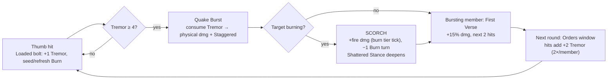
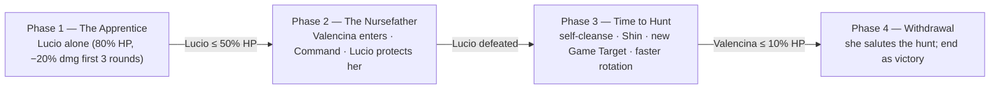

x# The Thumb — Human Syndicate Archetype (Project Moon tribute)

**Status:** 📝 Design proposal — awaiting decisions (§9). No code yet.
**Date:** 2026-10-09
**Request:** "Add a human archetype based on the Thumb from Project Moon; change the effects to fit Pandemonium; write how it works inside the world building."

**Theme:** a stylized homage to the Thumb (Project Moon) — a hierarchy-obsessed, human-only syndicate that treats etiquette as law. **Not 1:1:** the entire kit is rebuilt on Pandemonium's status/element engine (§3). Same treatment the Index received for the Prescript Ledger.

**One-line pitch:** a human syndicate that *sells guaranteed conduct* in the underworld. Its cells fight with powder hand-crossbows and a two-part art — **Tremor** (stance-breaking quake) and **Burn** — fusing into **Scorch**, the stance-shattering finish.

**Related:** `unrelated for coding/WORLDBUILDING_CODEX.md` (§4.3 taxonomy, §5 mortal races, §9 cities) · `docs/prescript_ledger_design.md` (homage precedent — the Index, same world, different Finger) · `docs/enemy_audit_report.md` (Human tops out at Lv 42) · `resources/enemies/enemies_data/all_enemies.yaml`.

---

## 0. What this adds (and doesn't)

**Adds.** One **Human-race enemy archetype**, tagged `faction: thumb`:
- a rank ladder of enemies from **Lv 28 → Lv 50** (§5), including a boss-flagged `Sottocapo`;
- the **named Sottocapo worked example — "The Thumb Nursefather" Valencina** and her apprentice Lucio (§5.1), adapted from the source example with Pandemonium-scale numbers;
- the **Sottocapo rank standard** (§5.2) — a generic boss built purely on the faction kit, for the ladder;
- one new party-side debuff — **Tremor** — and its detonation, **Quake Burst / Scorch** (§4.1–4.2);
- three "Regola" passives that make a group of Thumb fight *as a family* (§4.5).

**Doesn't add (yet).**
- No player race/class, no capturable units — humans aren't capturable, and the Thumb are not monster girls (`monster_girl` stays `false`).
- No superboss **pipeline work** in v1 unless D9 chooses it — the Valencina encounter is fully *designed* (§5.1), but its deployment (superboss-class vs regular boss slot) is an open decision. The **Capo dei Capi** stays unseen as the future hook (§10).
- No new elements or sins — Pandemonium has no sin affinities; the kit maps onto existing systems (§3).

**Why it fits.**
- The enemy audit flags **Human as a race that "tops out" at Lv 42** while its Lv 43–50 band is empty. This ladder fills it with trash and elites that *belong to a story*.
- The kit uses the game's existing idioms: race-pool placement, post-damage proc riders (`extra_logic`), source-tagged self-buffs (wolf/storybook precedent), composed debuffs (vulnerable/slow/stun), and a single death choke-point hook (`prune_dead`).
- Lore-wise, the Thumb are **ordinary mortals** — codex §5.3 taxonomy intact (born, aging, dying; nothing to do with the Accord, dungeons, or monster girls).

---

## 1. Name & homage

**Working name: The Thumb** (recommended).

In-world etymology, so the name earns itself:
- their signature punishment is **forfeit** — a thumb taken from anyone who raises a weapon against the Family or tries to weld a debt shut. *"They take the thumb so you remember how to hold your place."*
- their creed line: *"The thumb is what makes the hand close. Obedience is the grip."*

Source ranks are kept as internal jargon: **Soldato → Capo → Consigliere → Sottocapo → Capo dei Capi** (with the Soldato/Capo sub-ranks Primo–Quarto). The Italianate titles read as *the Family's own language*, not the setting's.

**Alternates** if a less direct name is preferred (§9 D1): **The Grip** · **The Palm Court** · **The Five Arrows**.

---

## 2. World building

### 2.1 What they are

The Thumb grew out of the black-market cities — Mirefall's auctions, Ashkara's contract floors, Dunemar's caravan courts, Blackwake's flooded bazaars. Where the Glassman sells *knowledge*, the Thumb sell **conduct**: for an obscene fee they witness a deal, and a witnessed deal cannot be broken. Their word binds because everyone has seen the alternative.

They are not connected to the Accord, the dungeons, or the Sundering — they are simply ordinary mortals who organized crime into a liturgy. They are also, notably, the only major underworld power that keeps a **written book of slights**, and pays out on it.

### 2.2 The creed — "Politeness is a ledger"

Three laws, recited in order when a cell inducts a Soldato:

1. **Station is worn.** Rank is read off the badge — arrows for rank, collar pins for sub-rank. Addressing someone above your arrows without leave *is* the slight.
2. **A slight is a debt; a debt is collected.** Punishments are bookkept and delivered politely: forfeits (a thumb for a raised hand, a tongue for a lie). If the offender can't pay, the bill may fall on a comrade — *"the family answers for its own; that is the entire point of a family."*
3. **Equals may speak freely.** Members of matching rank — and outsiders of equivalent station — owe each other no ceremony. A pressured member will seek out an equal just to hear one sentence without a bow inside it.

### 2.3 Hierarchy

| Rank | In the Family | What the player meets | How they read *your* station |
|---|---|---|---|
| **Soldato** (Primo → Quarto) | Foot soldiers. *Primo* is newest blood; *Quarto* is a veteran hand. Fixed ammunition, no reload. | Trash, Lv 28–42 | Guild Bronze/Silver, common sellswords, caravan guards |
| **Capo** (four sub-ranks) | Commands a cell; may reload; acts with latitude. | Elite, Lv 44 | Guild Gold, a knight-captain, a pirate bosun |
| **Consigliere** | Officer; audits conduct; keeps the family's book of slights. | Elite, Lv 47 | Guild Platinum counsel, a court adviser, a high priest's secretary |
| **Sottocapo** | Runs an entire operation — a city, a road, a dungeon claim. | Boss, Lv 50 | A city official, a merchant baron — *"no one you have met bows lower than a Sottocapo"* |
| **Capo dei Capi** | "The Fifth Arrow." Whether one currently lives is the question every cell refuses to answer. | *Unseen* (future, §10) | A ruler, a guild grandmaster — equivalences argued, never confirmed |

Etiquette rules (prose, for dialogue and flavor — no mechanics):
- Never meet a superior's eye; speak only when granted.
- Equals may be as blunt as they please; some prefer it so much they'll seek out an equal mid-fight.
- Rank may be **lent** for a night (*Investiture*) when the Padrino needs a stand-in. No cell has seen it happen; every cell has heard the story. *(Future superboss hook, §10.)*

### 2.4 Badges & attire

Black coats, red sashes, gold thread. A badge of **arrows** sits over the heart — one per rank up to five; **collar pins** mark sub-rank. They keep their uniforms immaculate even in dungeon muck — the discipline is half the intimidation.

### 2.5 Arms of the Family

**Powder hand-crossbows** — "thumb-bows." Heavy, expensive, fed one powder-charged bolt at a time. Each is fitted with a **bayonet lug** and a weighted **buttstock**, because a bolt is a coin and a coin is never wasted. Soldati are issued a fixed load and drilled never to expect another; Capos carry reload drums and can feed a new one mid-stride. When a Thumb runs dry he does not flee — he closes the distance, politely, and uses the lug and the stock.

### 2.6 The Seven Famiglie

*Sette Famiglie* — the leading families. The player meets their cells, not their courts.

| Family | Seat | Racket | Table talk |
|---|---|---|---|
| **Famiglia Marrow** | Dunemar | Amber Road caravan tolls | *"The road remembers who paid."* |
| **Famiglia Vetro** | Ashkara | Contract enforcement under glass | Thinks the Glassman "a guest at every table and a member of none." |
| **Famiglia Rovo** | Mirefall | Market arbitration and whispers | Sells silence in Ssarak's own swamp; the price is always *"a favor, later."* |
| **Famiglia Corda** | Brinewatch | Dock insurance, cargo "manners" | Half the harbor moves under a Corda seal. |
| **Famiglia Sable** | Blackwake | Smuggling charters | Has a seat at the flooded table, and the pirates know it. |
| **Famiglia Bognatelli** | Tidebreak | Sanctioned executions and the **display hunts** | The southern shore's old blade; its style is an heirloom — and its shame is named. *(See §5.1 — Valencina.)* |
| **Famiglia Osso** | Stormhold | Northern debts, cold accounts | Old money, older grudges, winter fees. |

### 2.7 Touch-points with the existing world

- **Black markets** — the Thumb are the enforcement layer. The markets' truce is *their* product: crime without them is not rarer, only ruder. (Codex §9: Mirefall, Ashkara, Dunemar, Blackwake.)
- **The Glassman** (Ashkara) — rival-tolerated. His ledger watches; the Famiglia Vetro collect. Neither has ever confirmed the other exists.
- **The pirate council** (Blackwake) — the Sable family keeps a seat; the council calls them "the only thieves who knock."
- **The Guild** — the Thumb observe guild rank *scrupulously*: a Platinum member is greeted as a Sottocapo-equal and never touched without cause. A properly sealed guild bounty is "negotiated first, collected second." *(Bounty hook, §6.)*
- **Temples** — they treat vows as contracts and clergy as notaries: polite, never devout.
- **Monster girls** — pointedly, *politely*, excluded. *"This house does not treat with unwritten words."* They address the player; they do not address the player's companions. **Flavor only — do not wire into affinity or any mechanic.**

### 2.8 Why a cell fights the party

- **Collections.** *"We are here for the account. The account names you."*
- **Quiet work.** Cells escort sealed cargo and run exchanges in dungeon rooms they've claimed as "quiet rooms." The party walks in mid-clause.
- **Courtesy tolls.** Crossing "Thumb floor" without a proper greeting is itself the slight; refusing to pay escalates it.

Suggested encounter prose (for wiki/dialogue polish; not engine keys):

| Member | Line |
|---|---|
| Soldato | *"You will state your business — politely."* |
| Capo | *"The Family extends its regards. Extend your purse, and we part as friends."* |
| Consigliere | *"You were not warned? Then the warning is free. The lesson is not."* |
| Sottocapo (on defeat) | *Straightens his coat with the last of his strength. "A fair… exchange…"* |

---

## 3. Converting the Thumb kit to Pandemonium

Every source clause → its Pandemonium form. This is the "change the effects to fit" section.

| Thumb (Project Moon source) | Pandemonium adaptation | Why / engine note |
|---|---|---|
| **Tremor** (potency/count stacks; burst = stagger damage) | **Tremor** — new *party-side* stack debuff on the target: hits add stacks; at **4** it detonates as a **Quake Burst** (§4.2) | No stagger meter exists; stack→consume mirrors Burn tiers & Abyssal Tempo conventions |
| **Burn** | **Existing Burn tiers** (Singe→Conflagration), reused unchanged | Already the game's fire DoT — no rework |
| **Tremor–Scorch** (on burst: Wrath dmg = (Tremor potency + Burn potency)/2; −1 Burn count) | **Scorch**: a burst on a burning target adds **fire damage = the burn tier's tick** (3/6/10/18/30) and consumes **1 turn of Burn** | Keeps the fusion identity; values restated in Pandemonium's burn currency |
| **"raise this unit's Stagger Threshold by the effect's potency"** | **Shattered Stance**: each burst on the same target raises its *Staggered* value by +10% (base +25%, cap +55%) for the fight | No stagger bar; "threshold" becomes the depth of the broken stance |
| **Staggered** (lose turn, take +dmg; can't act) | **Composed primitives, not a new status**: player → `vulnerable` + `slow` (standard fights cannot skip the player's turn — that's reserved for superboss `skip_player_turn`); allies → `stunned` (skip) + `vulnerable` | Reuses existing debuffs; zero new tick/cleanse code; deliberate asymmetry documented |
| **Ammo** ("boosts momentum of melee blows; augments potency and status infliction while Ammo") | **Loaded** charges (per member, per fight): while Loaded, hits deal **+10% damage** and add **+1 Tremor**; each shot spends one | Standard enemies have no inventories — a counter, per the `enemy_stats` dict style |
| **Reload** (higher ranks only) | **Capo+ auto-reload**: at 0 Loaded, a Capo/Consigliere/Sottocapo restores its load instead of adding Tremor that hit (2-round cooldown). Soldati can never reload | `extra_logic` runs *after* the hit — "spend a turn reloading" compresses into auto-reload (documented downgrade) |
| **Attack Power Up + Damage Up** (prep passive: "if this unit triggered Tremor Burst last turn") | **First Verse**: the member that triggers a burst gains `damage_boost` **+15%** for its next 2 hits (self-ticked, source-tagged) | Mirrors wolf/storybook self-buff idioms |
| **"Deal +10% damage against Staggered enemies"** | **Crush the Lower Jaw (first clause)** — +10% vs Staggered/stunned targets (§4.6) | Pre-damage multiplier hook |
| **"If an enemy was Staggered last turn: inflict Tremor On Hit (2 times per turn)"** | **Orders window**: the round after any burst, members' hits add **+2 Tremor** (max 2 procs per member per round) | No clashes exist; the "punish the gasping" rhythm is kept |
| **Clash Power Up** on ally defeat (**Regola Infranta**) | **Vendetta**: when a member falls, every survivor gains `damage_boost` **+10% per fallen comrade** (cap +30%) for the fight | No clashes; kept as escalating family retribution, single source-tagged refresh |
| **Sin affinities (Sloth / Wrath)** | Elements: **earth/physical** (weight, quakes) + **fire** (powder, burn). No sins exist in Pandemonium | |
| **Acceleration Round** (Ammo, cap 10, spent by skills) | The **Loaded** system, elevated: a per-fight ammo counter; spending attacks gain **+30% damage (Palermitan Style)**; Reload once per turn | Full spec §5.1 |
| **Poise** | **Crit buffs** — Pandemonium has a crit system: 1 Poise = +1% crit chance (cap 30); +10% crit damage at 6+ stacks | Keeps "the blade finds its line" |
| **Clash Power / Coin Power / Clash Win-Lose** | No clashes exist → flat **% damage buffs**; "clash lose" reads as "a hit she failed to dodge"; "clash win" as "attack landed" | Core downgrade of the homage — documented |
| **Unbreakable Coin** | **Sure-hit** — cannot be dodged (Defend still halves, house convention) | Used by Overheat and the Elephant |
| **Atk Weight** (multi-target) | **AoE** — hits 2–3 party members | Stag / Elephant |
| **Shields** | **Defend / barriers** — her anti-guard passive reads Burn on defending targets | §5.1 |
| **"cannot look at higher ranks" / temporary rank grants** | Kept as **lore**; future superboss hooks (§10: Averted Gaze / Investiture) | |

**Hard cuts (no Pandemonium analog — deliberate, documented):**
- **SP / Sanity / Panic** — no analogs; the source's panic becomes a low-HP escalation state (§5.1).
- **Clash / coin counts / coin power** — no clashes; converted to % damage and "landed / failed to evade" framing.
- **Mang (望)** — folded into the named encounter's **Shin** state (§5.1).
- **Tremor potency/count duality** — merged into the single **stacks** model (§4.1); multi-bursts consume all stacks.
- **50% stagger threshold** — becomes the ≤50% **Shame of the Family** state (§5.1).

### The loop



And separately: **any member's death → all survivors +10% damage per fallen (Vendetta)**. The cell gets *more* dangerous as it gets smaller — focus-fire has a price.

---

## 4. The adapted kit — implementation spec

### 4.1 Tremor (new, party-side)

```
TREMOR_BURST_AT   = 4     # stacks that detonate
TREMOR_DURATION   = 3     # rounds; refreshed by each new stack
QUAKE_DMG_PER_STACK = 2   # flat physical per stack at burst
```

- `apply_tremor(target, stacks=1)` — house order of guards, copying `apply_poison`'s pattern:
  1. `try_consume_afterimage(target)` → if consumed, no-op;
  2. `has_status_immunity(target, "tremor")` → `"immune"`;
  3. `check_status_resisted(target)` (superboss `status_res`) → `"resisted"`;
  4. append / refresh `{"type": "tremor", "stacks": n, "remaining": TREMOR_DURATION}`.
- Riders fire only on damaging hits (`dmg > 0` — house convention).
- Ticking: **one new branch in `tick_player_debuffs`** — decrement `remaining`; on expiry remove with a line (*"The shaking leaves {name}'s bones."*). Stacks persist until burst or expiry.
- Cleansable: joins normal cleanse paths (implementation note: verify `cleanse_one_debuff` / `cleanse_all_debuffs` cover new types — add if enumerated).
- HUD: add `"tremor": "Tremor"` to `get_player_status_tags` labels; shown as `Tremor ×N`.

### 4.2 Quake Burst & Scorch

`trigger_quake_burst(attacker, target)`:

1. Consume the tremor debuff.
2. Deal `stacks × QUAKE_DMG_PER_STACK` direct damage (post-hit rider; Defend does not additionally halve it — the hit itself already resolved). Death routes through the engine's normal post-`extra_logic` HP check (covers player **and** ally targets).
3. Apply **Staggered** (§4.3), depth +1 (Shattered Stance).
4. If the target is burning → **Scorch**: +fire damage equal to the burn tier tick (Singe 3 … Conflagration 30); consume **1 turn** of the burn's `remaining` (remove at 0).
5. Grant the bursting member **First Verse** (§4.5).
6. Set the cell's **Orders window** for the next round (§4.5).

### 4.3 "Staggered" is composed, not a new status

| Target | Effect | Note |
|---|---|---|
| Player | `vulnerable` (value = `0.25 + 0.10 × min(depth,3)`, cap `0.55`, 2 rounds) + `apply_slow` (2 rounds) | **No turn skip** — standard fights have no supported player skip; state this in the release notes. If the Fifth Arrow ships (§10), its fight uses `skip_player_turn` for the authentic version. |
| Ally | `target["stunned"] = True` (existing skip) + `vulnerable` 2 rounds | Allies can be skipped — that path exists (`broodmother` precedent) |

Depth (`thumb_stagger_depth`, per fight, per target) increments on each burst, caps at 3, and is **reset by combat cleanup** (§7) — never persists between fights.

### 4.4 Loaded & Reload

Per-member fields, lazy-initialized on first rider (no `enemy_stats` change needed):

| Field | Meaning |
|---|---|
| `thumb_loaded` | Shots left; starts at the rank's load (§5) |
| `thumb_reload_cd` | Rounds until a reload is possible (Capo+ only) |

Rider order on each damaging hit:

1. If `thumb_loaded > 0` → spend 1; **+1 Tremor**, and +10% damage (folded via §4.6).
2. **Burn seeding:** the first Loaded hit of the fight seeds Burn at the member's tier (Soldato: Singe; Capo/Consigliere: Burn; Sottocapo: Blaze); every 3rd Loaded hit refreshes the burn's duration.
3. If `thumb_loaded == 0` and rank ∈ {Capo, Consigliere, Sottocapo} and `thumb_reload_cd <= 0` → **Reload**: restore to max, set cd = 2, no tremor this hit.
   - Message: *"The {name} feeds a fresh drum into the crossbow without looking up. (Reload)"*
4. Otherwise (dry Soldato): melee — lug & buttstroke, flavor line, no rider.

Use the existing burn helper for the target type (`apply_burn` / `apply_burn_to_player`) so resistance and burn-tier rules apply unchanged.

> The Sottocapo's elevated version of this system — **Acceleration Rounds** (cap 10, spend-for-damage) — is specced in §5.1.

### 4.5 The three passives

| Passive | Trigger | Effect | Where it lives |
|---|---|---|---|
| **Esecuzione della Regola — First Verse** | Member triggers a Quake Burst | `damage_boost` +15%, for its next 2 hits; single source-tagged refresh (`source: "thumb_prep"`) | §4.2 step 5; self-ticked in the member's rider |
| **Crush the Lower Jaw** | Member attacks a Staggered/stunned target; and the round after any burst | +10% damage (pre-damage hook §4.6); **Orders window** — hits add +2 Tremor (max 2 procs per member per round; tracked via `enemy["_combat_round"]`, which the engine already stamps) | §4.6 + burst step 6 |
| **Regola Infranta — The Broken Rule** | A member is defeated | Every survivor gains `damage_boost` +10% per fallen member (cap +30%) for the rest of the fight; single source-tagged refresh (`source: "thumb_vendetta"`) | `process_thumb_fallen(enemies)` at the `prune_dead` choke point (§7) |

*Design intent:* First Verse rewards the cell for completing its ritual; Orders turns a burst into a death spiral rhythm; Vendetta makes "kill the weak ones last" a real tactical question.

### 4.6 Doctrine of Pressure

The source's *"the more of those two statuses the target has, the stronger their attacks become"*:

```
get_thumb_damage_multiplier(enemy, target):
    mult = 1.0 + min(0.30, 0.05 × tremor_stacks + 0.05 × burn_tier)
    if target is Staggered (vulnerable+slow) or stunned: mult += 0.10   # Crush the Lower Jaw
    if enemy.thumb_loaded > 0: mult += 0.10                            # loaded bolt
    return mult
```

Hooked **once** in `enemy_ai` pre-damage, beside the existing enemy `damage_boost` loop (~line 181). Applies per hit.

### 4.7 Constants (all starting knobs, one module)

```python
# combat/thumb.py
TREMOR_BURST_AT    = 4
TREMOR_DURATION    = 3
QUAKE_DMG_PER_STACK = 2
STAGGER_VULN_BASE  = 0.25   # +0.10 per depth, cap 0.55
STAGGER_DURATION   = 2
PRESSURE_PER_STACK = 0.05   # + per tremor stack
PRESSURE_PER_BURN  = 0.05   # + per burn tier
PRESSURE_CAP       = 0.30
CRUSH_BONUS        = 0.10   # vs staggered / stunned
LOADED_BONUS       = 0.10   # while a loaded bolt strikes
PREP_DMG           = 0.15   # First Verse
ORDERS_TREMOR      = 2      # Orders window: hits add +2
VENDETTA_PER_FALLEN = 0.10  # cap 0.30
RELOAD_COOLDOWN    = 2
```

---

## 5. Roster (the ladder)

Suggested starting values — tune to the audit curve (`docs/enemy_audit_report.md`). Two Sottocapo treatments follow the table: the named worked example (§5.1) and the rank standard (§5.2).

| id | Display name | Rank | Lv | HP | Key mods (STR/CON/DEX/LRN/CHA) | Loaded | Riders |
|---|---|---|---|---|---|---|---|
| `thumb_soldato_primo` | Thumb Soldato (Primo) | Soldato | 28 | 175 | 8/7/9/4/5 | 2 | seed Singe |
| `thumb_soldato_secondo` | Thumb Soldato (Secondo) | Soldato | 32 | 210 | 9/8/10/4/5 | 2 | seed Singe |
| `thumb_soldato_terzo` | Thumb Soldato (Terzo) | Soldato | 36 | 250 | 10/9/10/4/5 | 2 | seed Singe |
| `thumb_soldato_quarto` | Thumb Soldato (Quarto) | Soldato | 40 | 300 | 10/10/11/5/6 | 3 | seed Singe |
| `thumb_capo` | Thumb Capo | Capo | 44 | 420 | 11/10/11/5/7 | 3 | Reload; seed Burn; elite |
| `thumb_consigliere` | Thumb Consigliere | Consigliere | 47 | 450 | 11/11/10/6/8 | 3 | Reload; seed Blaze; hits also Slow ("lower your eyes") |
| `thumb_sottocapo` | Thumb Sottocapo | Sottocapo | 50 | 620 | 13/12/12/5/7 | 5 | **boss: true**; Blaze seed; heavy burst — rank standard (**§5.2**); named example **§5.1** |

YAML shape (one sample — all entries follow it, grouped under `Human:` in `all_enemies.yaml`):

```yaml
  thumb_soldato_primo:
    name: Thumb Soldato (Primo)
    race: Human
    faction: thumb
    level: 28
    base_hp: 175
    mods: {Strength: 8, Constitution: 7, Dexterity: 9, Wisdom: 4, Learning: 4, Charisma: 5}
    boss: false
    super_boss: false
```

- `faction: thumb` is a new, inert YAML field (loader preserves extra keys). Detection resolves via `ENEMIES[key]` exactly like `get_race_extra_logic` resolves `race` — no `enemy_stats` change.
- Capo/Consigliere are **not** boss-flagged on purpose: they are high-level *trash elites*, which is precisely what the audit says the Human pool is missing.
- Suggested optional flavor: `is_defeated` lines per §2.8 (engine already formats `dialogue.is_defeated`).

### 5.1 Named encounter — "The Thumb Nursefather" Valencina

*The Sottocapo worked example, adapted from the source boss "The Thumb Nursefather — Valencina" and her apprentice Lucio. **Source numbers are out of band (Lv 77 / 3204 HP) and are not used** — values below are Pandemonium-scale starting knobs.*

#### Who she is

Valencina was **Famiglia Bognatelli's** finest blade — raised on the Palermitan style, the family's school of single-prey duels whose executions are held **in the open**, because honor is the point. She came back from the undead surge a decorated **war hero**, a name the cells still lower their voices for. *(Backstory beat — editable.)*

Then she was made **Sottocapo** — and stripped of it in **three days**. For what offense, no cell will say aloud; the Bognatelli withdrew their love and left her the family's **seeing-glass relic** and the **Sword of Palermo** with the words: *"keep them — they have been defiled."* She should have vanished. Instead she kept working the outer roads with a single apprentice — because a hunt is the only ceremony the Family cannot revoke.

> **"Nursefather"** is kept from the source as her epithet — in Pandemonium's Thumb it reads as the officer who raises, examines, and buries the family's apprentices. Her household's web of informants and debts earned it the name **the House of Spiders**.

#### Why the party fights her

She is **hunting** — a name on the last writ the family sealed for her, or a quarry of her own choosing. The party stands in the line of the hunt (or is the prey — a later decision). She offers exactly one courtesy: *"Step aside, and I will note that you were polite."*

#### Encounter flow



1. **The Apprentice** — the fight opens against Lucio alone (80% HP; −20% damage dealt for his first 3 rounds).
2. **The Nursefather** — at Lucio ≤50% HP, Valencina takes the field. **The Nursefather's Command** (adapted from "lose 5 Offense Levels"): all party members **−10% damage dealt for 2 rounds**. Lucio gains **Desperate Struggle** (below).
3. **Time to Hunt** — when Lucio is defeated, she does not mourn — *"Useless boy. The hunt continues."* She **cleanses stun/slow from herself**, gains **Shin** (2 rounds), and re-marks a **Game Target**. Her rotation accelerates for the rest of the fight.
4. **Withdrawal** — at **≤10% HP** she stops, salutes the hunt, and leaves the field. The encounter ends as a **victory** (rewards resolve normally; she is never capturable — humans never are).

#### Her states (per fight, on her combat dict)

| State | Source | Pandemonium form |
|---|---|---|
| **Acceleration Rounds** | Ammo cap 10, spent by skills; Reload | Cap 10; starts 6; **+1/round**. Spending ≥1 on an attack: **+30% damage (Palermitan Style)**; heavy beats spend 1–3; **Reload** (once per turn, on the guard beat) restores +2. At 0 she can still spend — the attack fires without the bonus ("does not cancel"). |
| **Precognition** | Eye stacks 0–30; clash power; turn-start gain; SP heal | **0–30; starts 30.** Bonus: **dodge + stacks/3 % (max +10)** and **damage dealt + min(10, stacks/3) %**. Turn start: **+5**. Losses: **−1 per attack that lands on her** (a hit she failed to dodge), **−3 per Quake Burst / Scorch / stun**. At 0 → Overheat. |
| **Overheat** | −20% dmg dealt; unbreakable coins; +10/turn; converts back at 30 | **0–30; −20% damage dealt, but all her attacks are sure-hit (cannot be dodged)**; **+5/turn**; at 30, converts back to **Precognition 30**. Party window: break her eye to dull her — but she stops missing. |
| **Poise** | Crit mechanic; gains from skill use / evades / Round spends | **+1% crit chance per stack (max 30); +10% crit damage at 6+.** Gains: +2 per attack, +3 per successful dodge (2/turn), +2 per Acceleration Round spent (max 4/turn). |
| **Game Target** | Speed fixed to 1; all attacks prefer the marked foe | **HUD mark (🎯 TGT)** on one party member; her attacks prefer the mark with **+10% damage vs it**; re-marks every 4 rounds, and immediately after a Disposal kill. |
| **Shin** | "When hit, or when Lucio is defeated, gain Shin next turn" | **Once per round**, when she takes a hit → **Shin next round: −15% damage taken, +10% damage dealt**; also granted for 2 rounds when Lucio falls. |
| **Shame of the Family** | Panic: buffs + Fragile at low morale | **≤50% HP: +15% damage dealt, +10% damage taken** — the polish cracks; the blade doesn't. |
| **The Shame of Famiglia Bognatelli** (passive) | −30% dmg from Burn/Bleed/Rupture/Sinking; −30% stagger from Tremor | **−30% damage taken from Burn / Bleed / Poison** ("she has already paid worse") and **−30% burst/Scorch damage vs her**. Attrition and her own element are losing angles — beat her with steel, crits, and timing. |
| **La Spada di Palermo** (passive) | +dmg vs Shields per Burn; Damage Up after bursts; heal on crit | **+10% damage vs Defending targets and barriers per Burn tier on them (cap +30%)**; after each burst she triggers: **+5% damage next turn (max 3 stacks)**; **on a crit: +1 Acceleration Round (once per turn)**. |

#### Her rotation (priority beats for the encounter module)

| Beat | Adapted skill | Effect |
|---|---|---|
| Setup | **Colpi di Taglio** — "Cutting Blows" | Light double cut: seeds/upgrades **Burn**, adds **+1 Tremor**. |
| Setup+ | **Colpo di Punta** — "Point-Lunge" | Spends 1 Round; **+10% damage per (Burn tier + Tremor stacks) on target (cap +20%)**; adds Burn + Tremor. |
| Dissect | **Sezionatura di Coniglio / di Cervo** — "Rabbit's / Stag's Dissection" | Converts to **Scorch** and triggers **1 / 2 Quake Bursts**; Stag is heavier and may split targets (AoE). |
| Massacre | **Sezionatura di Elefante** — "Elephant's Dissection" | Spends 3 Rounds; **sure-hit AoE** (2–3 members); Scorch + 2 bursts. |
| Execution | **Disposal** | Only on the **Game Target**, telegraphed one round ahead; sure-hit; **10% of target max HP + 30**; **+100% if target ≤50% HP**; **Defend halves**; **stun-immune during the windup**; a kill re-marks. |
| Guard / counter | **Precognition** (stance) | Defending turn with high evasion; when she dodges a hit, she **ripostes with Rabbit's Cut**; Reload on use. |

#### Lucio's kit — "The Thumb Apprentice"

| Piece | Source | Pandemonium form |
|---|---|---|
| **Grueling Battle** | starts at 80% HP; Power Down 3 turns | Enters at **80% HP; −20% damage dealt for his first 3 rounds**. |
| **I Will Protect / Assist Defense** | guard ally; heal SP | While he lives, **Valencina takes −20% damage** ("the apprentice interposes"); every 3rd round he guards: **heals her 5% max HP** and gains one round of damage reduction. |
| **The Duel Escalates / Hunter's Mark / Crumbling Form** | duel-stack escalation vs one foe | He picks a **duel target** (the last party member who hit Valencina; re-picks every 4 rounds): against it **+10% damage dealt / −10% damage taken per stack (max 3)**; first trade each round gains a stack; stacks fade if he doesn't press the duel that round. **+10% damage vs targets with 3+ Tremor.** |
| **Measuring Blade Reach** | counter vs escalated target | At 2+ duel stacks, when his duel target attacks him: **counter for 50% damage**. |
| **Severed Tendon** | −base power stacking, decays | His cuts apply **Severed Tendon**: −10% damage dealt per stack (max 3); one fades per round. |
| **Desperate Struggle** | post-entry heals, assists, follow-ups | Once Valencina enters: **+20% initiative**; his protection strengthens (**−25% damage she takes**); after each of her attacks he **follows up with a light cut (once per round)**. |
| **On his defeat** | → Time to Hunt | (See Phase 3 — she cleanses, gains Shin, re-marks.) |

#### Numbers (Pandemonium-scale starting knobs)

| Actor | id | Lv | HP | Mods (STR/CON/DEX/WIS/LRN/CHA) | Flags |
|---|---|---|---|---|---|
| Valencina | `thumb_valencina` | 52 | ~1,000 | 12 / 11 / 13 / 6 / 5 / 8 | `super_boss: true` (superboss-class) — or **Lv 48 / ~650 HP, `boss: true`** for the boss-slot variant (D9) |
| Lucio | `thumb_lucio` | 46 | ~400 | 9 / 9 / 10 / 4 / 4 / 6 | `minion_only: true` (summoned by her encounter) |

- Both carry `faction: thumb`; detection reuses the §7 key-lookup, and her module replaces the generic rider pipeline where it says so.
- Elemental profiles: **Valencina:** physical 1.2 ("the sword finds her"), fire 0.8 (burn dulls on her), magical 1.0. **Lucio:** physical 1.15, fire 1.0.
- Encounter budget ≈1,400 HP across two actors + mitigation — sits inside the house superboss band (Black Silence 770 · Chrysalis 1300 · Mary Sue 2030). Tune at playtest.

#### Cuts & folds (quick reference)

SP / Panic → the ≤50% **Shame** state · Mang → **Shin** · clash / coin rules → dodge / "failed to evade" framing · 50% stagger threshold → the **Shame** state · Tremor potency/count → single **stacks** (§4.1) · "cannot be Staggered before using" → **stun-immune windup** on Disposal.

### 5.2 The rank standard — what any Sottocapo brings

*The generic Sottocapo for the rank ladder: the same doctrine as §5.1 — same creed, same Burn + Tremor + Scorch loop, same etiquette — but **none of the personal kits**. No relic, no Palermitan engine, no apprentice, no executions, no name. This is what a cell faces when it has merely displeased management. Valencina is the exception; this is the rule.*

#### Who they are

- One per operation, titled by its territory: *"the Sottocapo of the Amber Road," "of the Glass Courts," "of the Sunken Charters."* Cells use the title, never the name — a Sottocapo's name belongs to the Padrino's book.
- They travel with a **retinue** — the operation, not a duel. Suggested encounter composition: **1 Sottocapo + 1–2 Thumb Soldati** (or a single Quarto as escort).
- Etiquette: they do not bow to the party; they **grade** it. If your guild rank is high enough, the wound they open is a compliment.

#### Rank privileges (everything the rank adds to the core kit)

| Privilege | Effect | Note |
|---|---|---|
| **Elevated load** | Loaded **5** (the standard system's max), reload 2-round CD | He is *provisioned* — the rank's whole point |
| **Blaze seed** | Burn seeding at **tier 3** on the first loaded hit; every 3rd loaded hit refreshes | Core rule §4.4, rank value |
| **Heavy burst** | Quake Burst **×1.5** damage; Staggered **+1 round** | Core rule §4.2, rank value |
| **The Sottocapo's Command** *(rank standard — D12)* | At combat start, each Thumb Soldato in the fight **gains +1 Loaded** ("he provisions the cell"); when **he** triggers a burst, the Orders window opens for **the whole cell** | Makes the rank read as leadership, not just stats |
| **One courtesy** *(rank standard — D12)* | His burst beat is **telegraphed one round ahead** — *"The Sottocapo raises one finger. You have one round."* — a scripted warning beat in his rotation | The only warning the Family ever gives; the warning *is* the mechanic |

#### Fight rhythm

The cell builds Burn + Tremor together → the warning beat → his heavy Scorch burst → cell-wide Orders → the retinue surges. The counter-rhythm: cleanse after the warning, defend the burst — and remember that killing the retinue is **not free**: every fallen Soldato feeds **Vendetta**, making his next burst worse (core design, §4.5).

#### Deliberately absent (the personal kits — §5.1 only)

- **No relic / Precognition / Overheat** — if he cannot see the outcome, he simply tries again.
- **No Acceleration Rounds** — standard **Loaded** only (spend → melee fallback, reload on cooldown).
- **No crit engine (Poise)** — he crits like anyone else; no stacking discipline.
- **No Game Target / Disposal** — he executes with the **burst**, not a coup de grâce; no marks, no telegraphs beyond the courtesy.
- **No Shin / Shame / anti-DoT passives** — no lowered threshold, no panic state, no burn resistance: **attrition works on him** — the deliberate counterplay contrast with her.
- **No apprentice, no phases, no yield** — the fight is the operation; when he falls, it is over (normal death, normal rewards).

#### Numbers

`thumb_sottocapo` — **Lv 50 · HP 620** (starting knob) · mods 13 / 12 / 12 / 5 / 7 · `boss: true`; he sits clearly below the named encounter's two-actor budget (§5.1). A lone Sottocapo is a fair fight only at the top of the band — he is designed to be fought with his cell.

---

## 6. Encounter & content integration

- **Biome pools:** `race: Human` places them automatically in the temperate / coastal / forest / mountain / desert / pandemonium pools (`biome_races.py`). Level gating keeps them deep (Lv 28+ floors, high-level wilds).
- **The audit gap:** fills Human Lv 43–50 (Capo 44 · Consigliere 47 · Sottocapo 50) and adds mid-band variety at 28–42.
- **Bounties:** once in `ENEMIES`, guild bounty generation can target them at their level band — no code needed. (Optional later: "sealed warrant" flavor text.)
- **Cells:** they spawn like any enemy; a future room hook could force 2–3 member formations ("a cell meeting") — not in scope.
- **HUD:** player-side `Tremor ×N` tag (§4.1); enemy side needs nothing new.
- **Wiki:** enemy tables regenerate from YAML automatically; no plumbing.
- **The named encounter (§5.1):** if D9 picks superboss-class, it follows the house pipeline (`combat/valencina.py` + YAML entries + `dungeon.py` import + tier pool); if boss-slot, she enters the regular boss schedule. Lore home: Famiglia Bognatelli (Tidebreak). The Game Target HUD mark can reuse the Prescript's-Target mark approach (`📜TGT` → `🎯 TGT`).

---

## 7. Implementation plan

- [ ] **`combat/thumb.py` (NEW)** — constants; `is_thumb_member(enemy)`; `apply_tremor`; `trigger_quake_burst` (incl. Scorch); `apply_staggered`; `get_thumb_extra_logic(enemy)`; `get_thumb_damage_multiplier(enemy, target)`; `process_thumb_fallen(enemies)`; `clear_thumb_state(player)`.
- [ ] **`resources/enemies/enemies_data/all_enemies.yaml`** — 7 entries under `Human:` (§5).
- [ ] **`combat/thumb.py` — Sottocapo branch (§5.2):** Loaded 5, Blaze seed, burst ×1.5 + Staggered +1, Cell Command (Thumb Soldati get +1 Loaded; his burst opens cell-wide Orders), and the scripted one-round warning beat (if D12 keeps it).
- [ ] **`combat/enemy_ai.py`** — (a) thumb branch at the top of `get_race_extra_logic` (deferred import — WL-boss precedent); (b) one guarded pre-damage multiplier call beside the enemy `damage_boost` loop.
- [ ] **`combat/combat_engine.py`** —
  - (a) `process_thumb_fallen(enemies)` at the top of **`prune_dead`** — the single removal choke point, so one edit covers every standard *and* superboss death path (`superboss_common` imports `prune_dead`);
  - (b) `clear_thumb_state(player)` inside **`clear_battle_scoped_state`** (the canonical scrub that runs on every combat end *and* defensive exits);
  - (c) defensive `clear_thumb_state(player)` at `_combat_inner` start, beside `clear_abyss_fang_state` (house convention).
- [ ] **`combat/status_effects.py`** — `tick_player_debuffs` tremor branch; `get_player_status_tags` label.
- [ ] Verify cleanse coverage for `tremor`; add to enumerations if needed.
- [ ] **`tests/_temp_thumb_check.py`** (§8).

**Phase 2 — the named encounter (§5.1, if D9 approves):**
- [ ] **`combat/valencina.py` (NEW)** — phase state machine (Lucio 80% → Valencina at his ≤50% → Time to Hunt on his defeat → withdraw at ≤10%); Precognition/Overheat cycle; Acceleration Rounds; Poise→crit; Game Target + Disposal telegraph; La Spada di Palermo riders; anti-DoT passive; Shin/Shame states.
- [ ] **Lucio behavior** — duel mark/stacking, interpose (−20% to her), guard-heal, Severed Tendon, counter at 2+ duel stacks, follow-up after Phase 2.
- [ ] **YAML** — `thumb_valencina` (`super_boss: true` if superboss-class) + `thumb_lucio` (`minion_only: true`), both `faction: thumb`.
- [ ] **Superboss pipeline** if chosen: import in `dungeon.py` + tier pool entry (house convention).

**No save changes** — all state is per-fight, living on combat dicts and the player's `thumb_stagger_depth`, which cleanup resets.

---

## 8. Test plan

`tests/_temp_thumb_check.py`, sectioned like `_temp_race_passives_check.py`:

1. **Membership** — non-members return `None` / `1.0×`; key-lookup resolves for all 7 ladder entries.
2. **Tremor** — apply / refresh / resist / afterimage / immunity; expiry tick message + removal.
3. **Burst** — detonates exactly at 4; consumes; damage = 2/stack; Staggered values (0.25 → 0.55 cap); depth cap 3.
4. **Scorch** — fire damage = tier tick; burn `remaining` −1; burn removed at 0; no scorch when not burning.
5. **Loaded / Reload** — spend → melee fallback; Soldati never reload; Capo reload cooldown; burn seed on first loaded hit; 3rd-hit refresh.
6. **First Verse** — source-tagged refresh, not stacking; expires after 2 hits.
7. **Orders** — +2 tremor; 2 procs/member/round; window closes after one round (`_combat_round`).
8. **Vendetta** — per-death stacking; cap +30%; single buff refresh; fires exactly once per member.
9. **Pressure** — scaling math incl. caps; crush bonus; loaded bonus.
10. **Cleanup** — `clear_thumb_state` resets depth; no bleed between fights.
11. **Death paths** — burst killing an ally/player routes through normal death handling; Undying Vow interplay; `prune_dead` hook idempotent.

Named encounter (§5.1, when built):

12. **Phases** — Lucio-only → Valencina at Lucio ≤50% (Command debuff applies) → Time to Hunt on his defeat (self-cleanse + Shin + re-mark) → yield at ≤10% (victory path, not death).
13. **Eye cycle** — Precognition starts at 30; decay (−1 landed hit, −3 burst/stun); Overheat at 0 (−20% dealt, sure-hit, +5/turn); converts back at 30.
14. **Ammo** — spend 1–3 per beat; spent attacks +30%; spending at 0 still fires without the bonus; Reload +2 once per turn.
15. **Game Target / Disposal** — mark preference (+10% vs mark); one-round telegraph; +100% at target ≤50% HP; Defend halves; stun-immune windup; kill re-marks.
16. **Lucio** — 80% start; −20% dealt 3 rounds; interpose; duel stacks (gain/fade); Severed Tendon stacks; follow-up after Phase 2.
17. **Anti-DoT** — Burn/Bleed/Poison −30% taken; burst damage vs her −30%.
18. **Sottocapo (rank standard, §5.2)** — Loaded 5; provisioning (+1 Loaded to cell); his burst opens cell-wide Orders; the warning beat fires exactly one round before the burst; no personal-kit fields leak (no Precognition / marks / Shin / Acceleration Rounds).

---

## 9. Decision log (to lock)

| # | Question | Recommendation |
|---|---|---|
| D1 | Name | **Keep "The Thumb"** (etymology §1); alternates listed |
| D2 | v1 scope | Ladder (7) + composed statuses as specced; Valencina encounter **designed** (§5.1), build in phase 2; Fifth Arrow superboss deferred |
| D3 | Numbers | Constants §4.7 as starting knobs; playtest then tune |
| D4 | Ally skip vs player no-skip asymmetry | **Accept** (engine constraint + fairness); document in release notes |
| D5 | Capo/Consigliere boss-flagged? | **No** — high-level trash elites (fills the audit's empty 43–50 band) |
| D6 | Family names & lore | §2.6 — approve or edit; names are placeholders |
| D7 | In-game homage credit | None in-game; **docs-only** (Prescript precedent) |
| D8 | Player-usable Thumb gear | Later (§10); would follow the actor-based unique-equipment convention |
| D9 | Valencina deployment | **Superboss-class named encounter** (phases as specced; house superboss pipeline) — alternative: regular boss slot (both actors on field from the start, simplified phases; numbers ×~0.6) |
| D10 | Famiglia Bognatelli | Replace `Famiglia Argent` with **Bognatelli** at Tidebreak (homage to the example); keep Argent instead if a fully original family set is preferred |
| D11 | Valencina backstory wording | War-hero beat + "unknown offense" kept deliberately vague (per request); edit freely |
| D12 | Sottocapo rank-standard extras | **Keep** Cell Command + the one-round warning (they make the rank read without personal kits) — alternative: strip to the pure core kit |

**Next step:** lock §9 → implement §7 checklist. This doc stays the source of truth (numbers tuned here first).

---

## 10. Future hooks (not in v1)

- **The Fifth Arrow — superboss.** Stagger mechanics made literal: **Averted Gaze** (striking the Padrino while lieutenants stand triggers Punishment counterstrokes), **Investiture** (he lends a rank mid-fight, promoting a Soldato into a buffed "Capo" — the lore's rank-lending turned into a phase mechanic), and `skip_player_turn` Stagger for the authentic feel. Reward themes: a unique hand-crossbow or a family seal accessory. *(If Valencina ships first (§5.1), she establishes the "named Thumb boss" pattern this escalates.)*
- **The Defiled Blade.** Valencina keeps the **Sword of Palermo** and the **seeing-glass relic** — future questline/reward material (she yields them, or they fall when her hunt finally ends).
- **Player gear — "Regola" pattern crossbow.** Mirror the kit for the player and allies (Tremor on enemies, Scorch finisher) using the actor-based unique-equipment convention; would add a party-side tremor tick branch.
- **A Mirefall courtesy encounter.** Non-combat room variant: pay the toll → safe passage; refuse → fight. Turns §2.8's fiction into content.
- **Sealed warrants.** Bounty flavor pass: bounties on Thumb targets are "served" before collection.
- **Cell formations.** Optional room hook: force 2–3 member cells so Orders/Vendetta read clearly in play.
