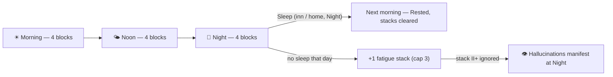

# Time Blocks — Design (Morning / Noon / Night)

**Status:** Design locked (2026-10-13, rev 3 — all review questions resolved; see §15). **Travel pricing revised 2026-10-13 (rev 3.1):** 1 block per started 30 min, mount `tier//2` shave (min 1), rain +1 / heavy +2 per hop with tier 3–4 resistance — confirmed. **Implementation progress:** engine + fields done (steps 1–2); **switchover Stage A live (2026-10-13)** — `utils.advance_time` delegates to blocks, wall clock deleted, sleep → `end_day`, migration on load. **Stage C live (2026-10-13)** — travel spends blocks per segment (minute trickle gone), day-boundary Set Camp via Portable Camp item / Caravan mount (camp FacilityScreen overlay), travel-event delays are flavor-only, and the phase difficulty (1.0/1.1/1.25) is live with Pande/EH frozen at the night baseline. **Stage C+ (2026-10-13):** fatigue hallucinations implemented as designed and reviewed — solo illusion fights at stack II+ during Night, with telegraph, immunity, Dread, evasion and the tier-III flicker; fatigue also applies its −N all-stats combat penalty. **Pandemonium accrual (rev 3.5, 2026-10-14 — player call):** Pandemonium runs now accrue fatigue stacks, roll hallucinations and suffer the stack penalty — `pandemonium_mode` no longer suppresses anything; **Event Horizon keeps full suppression** (frozen clock).
**Interim:** the legacy real-time clock still ticks (including in combat) until this lands; the AFK-guard removals from 2026-10-13 remain in force either way.
**Related:** `utils.py` (`advance_time` — the single choke point), `gui/screen_manager.py` (real-time clock — removed by this design), `facilities/inn.py` / `facilities/house.py` (rest/sleep), `events.py` (day rollover), `combat/stats.py` + `facilities/travel_events.py` + `gui/screens/world_map_screen.py` (difficulty consumers), `docs/dispatch_system_design.md` (doc conventions).

Replace the wall-clock minute tick and minute-denominated costs with a **block budget**: a day is **24 blocks across three phases** (Morning / Noon / Night, 8 each — 60 min per block; rev 3.2 doubled the day after the 2026-10-13 playtest). Actions spend blocks; the clock never moves on its own. Every day-based system (events, bounties, billing, dispatch, wild dungeons) stays as-is — it just gets a clock that tracks *play* instead of wall time.

---

## 1. Problems this solves

- **The real-time tick conflicts with itself.** 1 min / 2 s on city/dungeon/map screens (48 real minutes per day), paused in menus/story, and (since 2026-10-13) ticking in combat → "is time dynamic or static?" confusion, days passing while AFK, and event popups arriving with no player action.
- **Time-of-day difficulty is hollow.** The 1.0–1.8× multiplier is bypassed by Pandemonium/EH (frozen ×1.4) and cheesed elsewhere (wait/travel/sleep into a better hour). It mostly taxes whoever plays late.
- **Healing/rest decayed.** Inn rest is a full heal for pocket gold; Life Drain, dark leech, race passives and potions mean attrition never pressures healing. Sleep has no unique role.
- **Minute amounts (5–120) are noise.** No legible budget exists; "60 minutes" means nothing without doing division.

## 2. Core loop



Days are spent in sequence: block 1 → 12. Sleep (Night) ends the day rested; a day that ends without sleep adds a fatigue stack — and enough ignored stacks start manifesting hallucinations.

## 3. Locked decisions (2026-10-13, rev 3 — final)

| # | Decision |
|---|---|
| 1 | **Day = 24 blocks** — Morning (0–7), Noon (8–15), Night (16–23). |
| 2 | **Time only moves when the player acts.** The real-time tick is removed entirely (interim: keep ticking until implementation — user call). |
| 3 | **Costs:** short actions free (≤15 min), standard long = **1 block** (16–90), heavy = **2 blocks** (91–240). Sleep ends the day. |
| 4 | **Fatigue stacks:** a day that ends **without Sleep** adds **+1 stack** (cap 3). Effects −1/−2/−3 all stats; Sleep resets to 0. Stack II+ can trigger hallucinations (§5). |
| 5 | **Night's teeth = fatigue AND a small phase bump** (see §7) — replaces the old 1.0–1.8× swing. |
| 6 | **Rest/sleep at inn/home** — no dungeon camping. Exception: **road camp** on multi-day journeys (row 15). Long dungeon runs are multi-day pushes by design. |
| 7 | **Pandemonium / EH:** rooms cost 1 block (parity with today's 1 h/room); difficulty freeze unchanged (baseline revisited as a tuning knob); **Event Horizon suppresses fatigue stacks and hallucinations — Pandemonium accrues both as of rev 3.5 (player call 2026-10-14)**. |
| 8 | **UI shows phases/blocks, not HH:MM** — e.g. `☀ Morning ▮▮▮▮▮▯▯▯ · Day 12 (M1-D12)`; fatigue rides along (` · 👁 FATIGUE II` from stack II). |
| 9 | **Blocks are canonical; `time_minutes` becomes a derived compat value** for legacy readers (block × 120, day starts 06:00). |
| 10 | **Travel is priced in blocks (rev 3.1):** 1 block per **started 30 min** (min 1); mounts shave `tier//2` (encounter mitigation unchanged); rain +1 / heavy rain +2 — tier 3–4 mounts ignore plain rain (+1 heavy only). Journeys may span days (§15); travel-event delays no longer add time (§8). |
| 11 | **Facility opening hours** by phase (§9): most trades Morning–Noon, black market Night-only, inn/house always; closed services are dimmed with a message. |
| 12 | **Wait** (city/home): **A Brief** passes 1 block (any phase, repeatable); **A While** passes to the next phase — from Night you greet the morning unslept (+1 fatigue). Wording avoids block-talk; dialog X is a pure cancel. |
| 13 | **Sleep is Night-phase only — confirmed:** Night is the rest window; skipping it is what stacks fatigue. |
| 14 | **Overflow:** an action may cost more blocks than remain — it is allowed, and the excess consumes the **next day's blocks** (the day rolls at the boundary). |
| 15 | **Multi-day journeys & road camp:** journeys may span days; when the day boundary arrives, the party can **Set Camp** if capable — a **Portable Camp** (new item) or the **Caravan** mount (confirmed: only the Caravan carries camp gear). Camping runs a camp event on the FacilityScreen, ends the day without fatigue, and resumes at morning. Otherwise: march through the night (+1 stack, night danger). |
| 16 | **Quest time-gating is a design tool:** quests may require specific phases (e.g., espionage at Night) — signpost it clearly; keep main-story windows generous. |
| 17 | **Hallucination fight rules:** solo — no allies, no reinforcements; stats derive from the **party's average level** (+ stack-scaled bonus); it does **not count as a room clear**; victory removes **1 stack**; aftermath flavor: the party is confused/scared by what the player just did. |
| 18 | **Hours:** per-city flavor overrides the template; **guild is always open** (no bounty turn-in friction). |
| 19 | **Wonderland is a time pocket:** actions that would cost blocks cost **nothing**, and exiting shows the **same day/blocks** as entering (the current `wonderland_active` behavior, in block form — `wl_internal_time` becomes unused). The whimsical flavor text still re-rolls, but only when the screen changes/renders — never on a per-second tick. |

## 4. Block costs

Conversion happens **inside `advance_time(minutes)`** — the 81 existing call sites are not touched:

| Current minutes | Blocks | Typical actions |
|---|---|---|
| ≤ 15 | **0** | all window opens, shop buys/sells (10–15), bounty accepts (5), Ascension Stone (15), home rest at Villa+ (≤15) |
| 16–90 | **1** | most facility visits (25–60), **dungeon room (60)**, blacksmith 20–30, short travels |
| 91–240 | **2** | temple major blessing (120), long travel legs (90+), major crafting |
| sleep | **ends day** | inn/home sleep (480) → next Morning |

Notes:
- Sub-block costs do **not** accumulate — cheap actions are genuinely free.
- An action that costs more blocks than remain **overflows into the next day** (confirmed): the day rolls at the boundary and the remainder comes out of tomorrow's blocks. Spending the 12th block ends the day immediately.
- `travel_time_mult` (Heavy Rain) and similar multipliers apply to minutes **before** conversion; the 1↔2 threshold is where most retuning will land.
- A 10-room floor ≈ **1 day** (was ~0.4 day) — days now track play, and day-based content (Full Moon, bounties, billing) interacts with runs properly. Bounty/billing pacing needs one tuning pass (§14).

**Zero-cost actions (free)** — sub-block costs don't accumulate, so any number of these in a day is fine:
- **Windows:** Bag/Inventory (30-min charge removed 2026-10-13 — player call), Skill Book, World Map, Settings, Help, Journal.
- **Shop:** buy one item (15 min), sell (15), backpack upgrade (15), character view (10); failed purchase (10).
- **Guild:** accept bounty (5), counter services (10–15); leave (15).
- **Leaving any facility is free** (2026-10-13) — departure charges removed everywhere: shop, inn (both menus), temple, gift shop, arcane tower, black market, herbalist, trade hall, barracks.
- **Temple:** Ascension Stone (15). **Blacksmith:** farewell (15). **Shipyard:** end of visit (15).
- **Home:** quick rest at **Villa and up** (15/10/5 min by tier) — Hovel–Manor rest (20–30 min) costs 1 block.
- Everything 16+ min costs **1 block per visit** (inn rest 30, blacksmith enhance/fuse 30, temple rites 30, gift-shop buys 25, arcane tower 20–60, barracks train/teach 30, black_market / herbalist purchases 30) — plus the 90/120-min outliers at 1–2 blocks.

## 5. Fatigue, stacking & hallucinations

- **Stacking:** a day that ends **without Sleep** adds **+1 fatigue stack** (cap **3**); Sleep resets to **0**. Working through the night (blocks 16–23) is exactly how you miss the rest window — the original "no rest in the last two blocks" rule, expressed as one counter. Stacks are visible everywhere: every top bar appends `👁 FATIGUE II` from stack II, and combat shows the same tag (rev 3.2).
- **Effects:** stack N → **−N all stats** in combat (HUD debuff tag). Stack III also denies house `well_rested` until slept. The stack is visible in the status area ("😵 Fatigued II").
- **Warnings:** from block 10, "It's getting late — you should rest soon."
- **Rested:** Sleep (inn/home, Night) always clears all stacks; house Sleep still grants `well_rested` by tier.

### Hallucinations (stack II+)

> **Implemented 2026-10-13** (`combat/hallucination.py` + encounter hooks in both dungeon loops). Locked refinements: **telegraph** = blocking pre-fight prompt ("A hazy figure stands where the path narrows — your companions are nowhere to be found") + glitched enemy name + `👁 FATIGUE II/III` HUD tag; **unreal rules** = 100% status/debuff immunity (`status_res = 1.0`), one bounded **Dread** pulse at fight start, evasion (15% at II / 28% at III), and the stack-III **flicker** (re-forms once at 50% HP: +15% heal + name swap via the engine's new `round_hook` dispatch); **solo** = allies temporarily parked by the engine (`player["_combat_solo"]`) so no allies/reinforcement ever join; **instability** = `hallucination_tier()` from fatigue stacks (Karma plugs in there later); victory clears one stack **at II only** — stack III is sleep-only, making high-stack fights a pure hazard; flee leaves stacks unchanged; losing is a **collapse** (wake at 1 HP, ally panic lines), never a death; no loot/XP, never a room clear. Fatigue now also applies its −N all-stats combat penalty (suppressed in Event Horizon runs only — Pandemonium penalizes since rev 3.5). The solo park also brings your **front/bench arrangement back untouched** — party order is parked and restored with the allies (rev 3.5 fix). When the illusion ends the log gets a beat — *"The room still awaits..."* + Enter — so the aftermath and ally lines in the dungeon log are seen before the interrupted room resumes.

Ignoring the warnings should have a face — literally.

- **Trigger:** stack ≥ 2, **Night phase**, normal content only (dungeon rooms, wild dungeons, road/sea travel events). Roll per applicable encounter: stack II ≈ 15–20%, stack III ≈ 40–50%; max one per room. **Never** in Event Horizon runs, superboss fights, story scenes, or cities — Pandemonium rolls like any dungeon as of rev 3.5.
- **The enemy:** a single generated illusion — *The Watcher*, *Mirror Shade*, *Hollow You* — whose stats derive from the **party's average level** (level = round(avg living party level)), boosted by the phase multiplier **plus** a stack-scaled bonus (≈ +15% at II, +25% at III) so it always fights above the party's curve. Reuse `enemy_stats` + a party-scaling post-step (same pattern as the training dummy's `create_dummy_enemy`).
- **Telegraphing:** one distinct intro line ("Something steps out of the corner of your eye. The others don't react."), a glitched name in the HUD/log; the status readout shows 👁️ while stacks are high.
- **Solo fight:** only the player participates — **no allies join and reinforcement is disabled** for this fight (it's *your* hallucination). It also **does not count as a room clear**: the room's own content still happens afterwards.
- **Stakes:** no gold/loot/XP — it isn't real. **Defeating it removes 1 stack** (the on-the-road relief valve when you can't reach a bed); **fleeing leaves stacks unchanged**. It never triggers while the player is below ~25% HP (knob).
- **Aftermath:** the party is confused/scared by what the player just did (swung at something they couldn't see) — a short reaction block after the fight, flavor-only.
- **Lore hook:** dark already has leech/dread and Wonderland has madness — this is the world's answer to a mind that won't stop.

## 6. Rest, Sleep & Wait (`facilities/inn.py`, `facilities/house.py`)

| Service | Cost | Effect |
|---|---|---|
| **Rest** (inn + home) | 1 block | Full heal, as today's 30-min rest. |
| **Sleep** (inn) | ends day (Night only) | Full heal; next morning fresh, all fatigue stacks cleared. |
| **Sleep** (home) | ends day (Night only) | Full heal + `well_rested` per house tier (Manor+), as today. |
| **A Brief** (city/home) | **1 block** | Passes a single block at any phase — repeatable; rollover can force an exhaustion stack (rev 3.2). |
| **A While** (city/home) | remaining blocks of the current phase | Passes to the next phase; from Night it carries through to morning unslept (+1 fatigue). |

- **Sleep is Night-phase only — confirmed**: Night is the rest window; skipping it is what stacks fatigue. Inn/home themselves are open around the clock.
- The `sleep_after_hour` configs and the home 20:00–04:00 gate are **removed** — Night-only sleep and the block model replace them.
- No mid-dungeon rest (locked). A multi-day dungeon push means entering a day fresh and eating the fatigue of every unslept day.

## 7. Phases in gameplay

- **Combat difficulty:** `phase_mult` = **Morning 1.0 / Noon 1.1 / Night 1.25**. Daily-event modifiers (Full Moon +20%, Peaceful Skies −10%, Crimson Dawn +15%) multiply on top, unchanged. `get_difficulty_multiplier_from_time` is replaced by a phase-based version.
- **Travel danger:** `facilities/travel_events.py` and `world_map_screen.py` switch to `phase_mult`; the encounter-count/chance exponents need a retune since they were calibrated against 1.0–1.8.
- **Gates:** `get_time_period` consumers map to phases (Morning / Noon / Night); legacy hour gates are replaced per §6.
- **Display:** top bar shows `☀ Morning ▮▮▮▮▮▯▯▯ · 👁 FATIGUE II · Day 12 (M1-D12)` (night: 🌙). **Wonderland (rev 3.4):** the block track is **removed entirely** — the bar keeps only the whimsical flavor day line (`Curiouser Day — Days get curiouser and curiouser.`), re-rolled on screen changes/renders (no timer); costs stay nullified and exiting restores the same day/blocks.
- **Night as content, not punishment:** night remains the danger-richer phase for travel/wild encounters — now a deliberate choice (you spend night blocks to be there).

## 8. Travel in the block model

**Costs & planning**
- Each route is priced in **blocks** with travel's own conversion (rev 3.1): **1 block per started 30 minutes** (30m→1 · 40m→2 · 220m→8), **minimum 1**. **Mounts** shave `tier // 2` blocks per hop (Mule 0 · Horse/War Horse −1 · Caravan −2) and always keep their encounter mitigation. **Rain** adds +1 block, **heavy rain** +2 **per hop** — tier 3–4 mounts ignore plain rain and take only +1 from heavy rain. The Heavy Rain daily event carries `rain_level: 2` (a future plain-rain event would be level 1). Ships' `sea_time_reduction` mapping is a knob (§14).
- The route picker shows the cost ("≈1 block · 90 min"). Long journeys **may span days** (confirmed): blocks are spent **as each segment completes**, overflowing into the next day per the overflow rule (§4).

**Day boundaries, camping & delays**
- When a journey crosses the **day boundary**, the party is offered **Set Camp** if capable — a **Portable Camp** item or the **Caravan** mount (only the Caravan carries camp gear). Camping:
  - opens a **camp FacilityScreen** that handles the night event (narrative + choices → outcomes; reuse the FacilityScreen I/O);
  - ends the day with **no fatigue stack** (it counts as rest for the unslept-day rule) and resumes the journey in the morning.
- Without camp capability (or if declined), the party marches through the night: the day rolls, **+1 fatigue stack**, and night danger applies (§7) — exactly the strain hallucinations feed on (§5).
- **Travel-event time costs are removed** (storm +90, reroute +30 no longer call `advance_time`): delays are flavor + danger only.

**World map animation**
- Replace the per-frame `advance_time(player, 1)` minute trickle (`_do_anim_step`) with **per-segment block spending**; the top bar shows blocks draining, not HH:MM, and the "travel quiet" tick override disappears with the wall clock.
- Phase of each segment governs travel-event danger (§7), so night roads are a deliberate risk.

**Sea travel & hours**
- Sailings depart **at any hour** (playtest rev 3.2 — the harbour gate was removed; night crossings trade safety for time). Land routes likewise; port/shipyard keep their daytime schedule for *city services* only.

## 9. Facility opening hours (new feature)

Give services **phase schedules** so phases matter outside combat — and give Night some place to go.

**Data:** `resources/cities.py` — add a `"hours": ["morning", "noon"]`-style key per city/service config; **missing = all phases** (zero-risk default for unlisted services). `inn` and `house` are always open.

**Proposed defaults (tune per city later):**

| Hours | Services |
|---|---|
| **Morning–Noon** | shop, blacksmith, herbalist, temple, barracks, gift_shop, trade_hall, shipyard |
| **Noon–Night** | star_tower (Skylume — stargazing) |
| **Night only** | black_market ("opens at dusk") |
| **Always** | inn, house, **guild** (confirmed — no bounty turn-in friction), **arcane_tower** (towers open at night — player call 2026-10-13), **port** (sailings run at night — playtest rev 3.2) |

**Per-city flavor (confirmed):** the table above is the *template*; each city may override service hours (a port town whose market runs late, a city whose shops close at noon…). Regional differences are expected — tune in `resources/cities.py`.

**Enforcement (single helper, e.g. `utils.is_service_open(player, service, city_id)`):**
- `CityScreen` service buttons + number-key shortcuts: closed services are dimmed and show "Closed — opens in the morning/dusk."
- Sea departures are **not** hour-gated (playtest rev 3.2 — the port's city service keeps its daytime schedule, but journeys can begin at night).
- **Wonderland bypass (rev 3.4):** inside the time pocket every service is open — `is_service_open` returns True and the city map shows no closed/dimmed services. The town runs on whim, not clocks.
- Terminal/service entry points re-check defensively (direct-call parity).
- **Grace policy:** if a phase rolls over while standing inside an open facility, the current visit finishes ("the shopkeeper wraps up your business") — no mid-visit kick.
- **Quest time-gating is a design tool (confirmed):** quests may deliberately require a phase — e.g., an espionage quest that only happens at Night, a dawn meeting at the docks. Signpost every gate (city dialogue / quest text says when to return); keep main-story beats' windows generous.

## 10. Pandemonium / Event Horizon

- Rooms cost **1 block**, same as normal dungeons (parity with the current 1 h/room "city-loop parity").
- Days can roll mid-run; events/effects queue and surface on city return (existing behavior).
- **Event Horizon suppresses fatigue stacks and hallucinations (frozen clock); Pandemonium accrues both as of rev 3.5 (player call 2026-10-14):** the rift's frozen days never follow you home, but the city dungeon is a proper multi-day push — stacks, Night hallucinations and the −N all-stats penalty all apply there now.
- The difficulty freeze stays, now pinned to the **night baseline ×1.25** (§7, implemented Stage C).

## 11. What gets removed / changed

- `ScreenManager` real-time clock: `start_game_clock` / `stop_game_clock` / `_schedule_tick` / `_game_tick` / `_clock_target` / `_recompute_clock_tick`, `TICK_INTERVAL_MS`, `_GAME_SCREENS`, overlay-pause logic, and the `tick_interval_ms` overrides (the story/tutorial/travel "quiet" hacks all become obsolete).
- `_flush_event_notices_in_city` (tick-based) → replaced by **action-time surfacing**: after every `advance_time`, the GUI refreshes the top bar and, when a safe screen is visible, shows queued Event Notices (existing popup pipeline).
- `CombatScreen.game_clock_keeps_running` (meaningless without the tick) and `dungeon_screen._await_combat_result`'s clock interactions stay otherwise untouched — combat still waits indefinitely for input.
- `get_difficulty_multiplier_from_time` → phase version (§7).
- Travel's per-frame `advance_time(player, 1)` trickle (world map `_do_anim_step`) and `travel_events`' time costs (storm 90 / reroute 30) — replaced by per-segment block spending (§8).

## 12. Data model & migration

```python
player["day"]            # unchanged — day-based systems keep working
player["day_blocks"]     # NEW: int 0–11 (blocks spent today)
player["fatigue_stacks"] # NEW: int 0–3 (0 = fresh; +1 per unslept day; Sleep → 0)
player["time_minutes"]   # DERIVED (compat): (360 + day_blocks * 120) % 1440
```

- `ensure_player_fields()` (`character.py`): `day_blocks` default 0, `fatigue_stacks` default 0.
- Old saves migrate: `day_blocks = min(11, time_minutes // 120)`; missing → 0 (morning). Sub-block minutes are dropped.
- Hallucinations, opening hours and Wait need **no new player fields** (all derived).
- `advance_time(player, minutes)` stays the public API: converts minutes → block cost inside (§4). Sleep/Wait are special paths (`end_day` / `wait_to_next_phase`) so they don't pay through the normal table.

## 13. Implementation plan (ordered)

1. ✅ `time_blocks.py` (new engine module; `utils.advance_time` delegates at switchover): `blocks_for_minutes()`, `spend_blocks()` (incl. overflow into the next day), `end_day()` / rollover + fatigue stacks, `get_day_phase()`, `format_block_track()`, `is_service_open()`, `wait_to_next_phase()`, time-advance listener hook; Wonderland time-pocket. **Done 2026-10-13.**
2. ✅ `character.py`: fields added (`day_blocks`, `fatigue_stacks`, `time_blocks_migrated`); `migrate_legacy_time_to_blocks()` lives in the engine and runs once at switchover. **Done 2026-10-13.**
3. ✅ `gui/screen_manager.py` — tick deleted (Stage A, 2026-10-13); listener refreshes the visible top bar on every time spend + surfaces ready Event Notices.
4. ✅ Screens (Stage B, 2026-10-13): top-bar builders (`screen_manager.refresh_top_bar`, `city_screen`, `dungeon_screen` incl. round headers, `facility_screen`, `world_map_screen`) show the phase track; `tick_interval_ms` overrides stripped (facility/story/tutorial/world map); CityScreen dims closed services, gates `_open_service`, adds the Wait action (`[W]`, number-key services inherit the gate).
5. ✅ Facility hours (Stage B): `time_blocks.SERVICE_DEFAULT_HOURS` + per-city overrides + `is_service_open()` / `service_closed_message()`; CityScreen gate + dimmed map + sea departures gated in `world_map_screen._start_travel`. Terminal UIs inherit via handlers.
6. ✅ Rest/Sleep/Wait: Sleep done (Stage A — Night-phase gate, `end_day`, inn/home); Wait redesigned rev 3.2/3.3: `wait_blocks()` = **A Brief** (1 block, any phase), `wait_to_next_phase()` = **A While** (next phase; Night → morning unslept, +1 fatigue); city dialog (X = pure cancel) + home menu; inn/house menu labels use Night-only wording.
7. ✅ Travel (Stage C, 2026-10-13): segments spend blocks at completion via `time_blocks.spend_travel_segment` (trickle deleted); day boundaries offer **Set Camp** (Portable Camp item / Caravan); camp FacilityScreen overlay (`facilities/camp.py`); travel-event delays lost their time costs (storm handlers retuned to the 1.0–1.25 scale); night sailings allowed (harbour gate removed, playtest rev 3.2); route pickers/confirm dialogs show `≈N blocks` (minutes stripped from the map, rev 3.2).
8. ✅ Difficulty (Stage C): `utils.get_difficulty_multiplier_from_time` is phase-based (1.0/1.1/1.25 + daily mods); travel_events slots/chance retuned (slot threshold 1.2, chance exponent 1.3); stances in `world_map_screen` storm handlers retuned; Pande/EH frozen at the night baseline 1.25.
9. ✅ Hallucinations (2026-10-13, locked after design review): `combat/hallucination.py` — gates (stack II+, Night, EH/Wonderland/boss/low-HP suppression; Pande accrues since rev 3.5), per-room roll (18% / 45%), party-average generator with tier boost, status immunity, Dread pulse, evasion, stack-III flicker round hook; engine solo support (`_combat_solo`) + generic `round_hook` dispatch; encounter hooks in both dungeon loops (city floors + wild ruins); `tests/_diag_hallucination.py` (8 checks).
10. Tests: new `tests/_diag_block_time.py` (conversion, spend order + overflow, stacks/fatigue, sleep reset, migration, wait, hours helper + guild-always, travel multi-day + camp capability, hallucination rolls with seeded RNG, EH suppression); `tests/_diag_event_notice.py` updated (block-driven rollover); `tests/_diag_combat_clock.py` repurposed — no wall clock, spends refresh the top bar, overlay owns the refresh, track display smoke check.
11. Changelog bullet under the current version (per `changelog-versioning` rules — never edit old headers).

## 14. Tuning knobs

- Blocks per day (12) and phase split (4/4/4).
- Cost thresholds (actions): 15 / 90 / 240 minutes; Wait cost (remaining phase blocks).
- Travel pricing: 30-min blocks, mount shave `tier//2`, rain +1/+2 **per hop** (confirmed; tier 3+ resist), min 1; ships' sea-reduction mapping; per-segment ceil inflation vs journey-total conversion.
- Fatigue: stack cap (3), per-stack effect (−1/−2/−3 all stats), `well_rested` denial at III.
- Hallucinations: trigger chances (≈15–20% / 40–50%), stack-scaled stat bonus (+15% / +25%), relief (−1 stack), low-HP block (~25%).
- Camp: Portable Camp reusable vs consumable, camp event table, overnight sea handling (uniform camp vs passenger berths).
- Quest gates: which quests may gate, and how they signpost.
- Phase multipliers: 1.0 / 1.1 / 1.25 (and travel-danger exponents).
- Opening hours table per service/city.
- Pande/EH frozen difficulty baseline (night 1.25 — **set Stage C**).
- Bounty deadline & monthly billing pacing after the day-length change.

## 15. Resolved review questions (2026-10-13, rev 3)

All open questions were resolved with the user on 2026-10-13 — the decisions live in §3 (rows 1–19) and the affected sections:

1. Sleep Night-only → confirmed (§3.13, §6).
2. Quest time-gating → allowed as a design tool, signposted (§3.16, §9).
3. Hallucination → clear 1 stack; stats from the party average; solo fight, no reinforcements; not a room clear; aftermath confusion flavor (§3.17, §5).
4. Multi-day journeys → allowed; road camp via Portable Camp or **Caravan only**, handled by a camp FacilityScreen (§3.15, §8).
5. Overflow actions → allowed; consume the next day's blocks (§3.14, §4).
6. Opening hours → per-city flavor overrides the template (§3.18, §9).
7. Guild → always open (§3.18, §9).
8. Pande/EH suppression → confirmed (§3.7, §10); **revised rev 3.5 (2026-10-14): Pandemonium accrues fatigue + hallucinations (player call); Event Horizon keeps suppression.**
9. Wonderland → **time pocket**: block costs nullified, exit restores the same day/blocks; whimsical flavor re-rolls on screen changes (no timer) (§3.19, §7).
10. 0-block actions → no cap needed (§4).
11. Travel pricing (rev 3.1, 2026-10-13) → 1 block / started 30 min (min 1); mount `tier//2` shave (T2/T3 −1, T4 −2, encounter mitigation unchanged); rain +1 / heavy +2; T3+ ignore plain rain, heavy +1 (§8, §16). **All three rulings confirmed (per-hop rain, `tier//2`, Heavy Rain = level 2).**
12. Switchover Stage A (2026-10-13) → `utils.advance_time` delegates to `time_blocks`; wall clock + tick machinery deleted; sleep = `end_day(slept=True)` (Night-gated at inn/home); migration derives `day_blocks` on load (day ≤ 1 → morning); AFK guards remain in force.
13. Stage B (2026-10-13) → track displays everywhere, Wait action (city + home), facility-hours gates + dimmed map + sea-departure gate (§13.4–6).
14. Player calls (2026-10-13) → opening the **Bag is free** (30-min charge removed); **towers open at night** (`arcane_tower` → all phases; `star_tower` already Noon–Night); **leaving any facility is free** (departure charges removed: shop, inn, temple, gift shop, arcane tower, black market, herbalist, trade hall, barracks).
15. Stage C (2026-10-13) → per-segment block travel spending + camp system (Portable Camp 250g in every shop; Caravan built-in; `facilities/camp.py` overlay with sleep/watch choices); phase difficulty live (§7) with Pande/EH frozen at 1.25; travel-event time costs removed. Hallucination fights deferred for refinement (§13.9).
16. Hallucination design locked + implemented (2026-10-13) → player-approved package: blocking telegraph, status immunity, bounded Dread pulse, tier-scaled evasion, tier-III flicker, fatigue-driven instability with a Karma input hook; engine gained `_combat_solo` + `round_hook`; fatigue −N all-stats penalty added (§5, §13.9).
17. Playtest tuning (2026-10-13, rev 3.2) → day = **24 blocks** (3 × 8, 60-min blocks — a 12-block day was too short once dungeons cost ~10); **Wait** = 1 block per use + a Wait-until-morning option (waiting can now force exhaustion stacks on purpose); travel **+2 supply overhead per hop** (canceled by the Caravan's shave — longer hops stay meaningful); **night sailings allowed** (harbour gate removed; port service always open); **fatigue shown in every top bar** (`👁 FATIGUE II` from stack II — you can see when hallucinations are possible); **minutes stripped from the world map** (blocks only).
18. Playtest follow-ups (2026-10-14, rev 3.3) → dialog X fixed (`confirm_dialog` gained a pure-cancel `on_close` path — X no longer fires No); Wait relabeled **A Brief / A While** (no block-talk; A While passes a phase, Night → morning unslept); hallucination stakes hardened: wins clear stacks **at II only** (III is sleep-only — sleep urgency), losing collapses you **at 1 HP** with party panic flavor instead of dying; map edge labels now show **block costs** (`Nb`) instead of minutes.
19. Wonderland final pass (2026-10-14, rev 3.4) → the block track is **fully removed inside the pocket** (`format_block_track` returns `""`; every top-bar builder collapses the segment cleanly — the flavor day line carries the display), **all facilities bypass opening hours in Wonderland** (`is_service_open` short-circuits; the city map never dims a service there), and the Wait action handles the pocket gracefully ("Time politely declines to pass").
20. Pandemonium accrual + coin kit coverage (2026-10-14, rev 3.5, player call) → Pandemonium runs accrue **fatigue stacks**, roll **hallucinations**, and suffer the **−N all-stats penalty** (`_fatigue_suppressed` / `should_trigger` / `get_effective_attribute` no longer special-case `pandemonium_mode`; Event Horizon unchanged). Same patch: **Chance and Choice covers all weapon kits** — one flip per action across workshop/Furioso volleys, Cutlass riposte, Jade discharges, Palette exhibits/Signature/Spectrum, and wedding counters/retributions (`docs/event_horizon_design.md` §10.5). A Pande playtest follow-up fixed the solo park: it now also restores **`party_order`**, so the front/bench arrangement no longer resets to default after an illusion. The illusion also hands back to the dungeon log now ("The room still awaits..." + Enter) before the interrupted room resumes. Text sweep (2026-10-22): inn Rest label → 1 block (+ heal feedback / already-full line), house quick rest and upgrade preview quote blocks (Villa+ free), innkeeper sleep/early-sleep lines dropped hour-talk, and port/road journey narration uses block estimates.

Remaining implementation-time knobs live in §14.

---

## 16. Appendix A — travel cost reference (rev 3.1 pricing, computed 2026-10-13)

**Rules:** 1 block per **started 30 minutes** (30m→1 · 40m→2 · 220m→8), minimum 1 block. Mounts shave `tier // 2` blocks per hop (Mule 0 · Horse/War Horse −1 · Caravan −2) and keep their encounter mitigation. Rain adds +1 block per hop, heavy rain +2; tier 3–4 mounts ignore plain rain and take only +1 from heavy rain. Journey cost = **sum of per-segment costs** (§8). Regenerate with `tests/_diag_travel_costs.py`.

### Direct routes

29 unique edges: **8 cost 1 block** (70–90 min) · **21 cost 2 blocks** (100–220 min). No route costs 0.

```text
-- 2 blocks (60 min) -----------------------------------------------------------
Blackwake <-> Tidebreak     60m -> 2

-- 3 blocks (70-90 min) --------------------------------------------------------
Blackwake <-> Saltmarsh     70m -> 3 | Cinderpeak <-> Veilholt     80m -> 3
Coralhaven <-> Tidebreak    80m -> 3 | Blackwake <-> Brinewatch    90m -> 3
Brinewatch <-> Saltmarsh    90m -> 3 | Irondeep <-> Skylume        90m -> 3
Stormhold <-> Thornwall     90m -> 3

-- 4 blocks (100-120 min) ------------------------------------------------------
Brinewatch <-> Mirefall    100m -> 4 | Coralhaven <-> Isle of Glass 100m -> 4
Saltmarsh <-> Tidebreak    100m -> 4 | Skylume <-> Veilholt       100m -> 4
Solmere <-> Thornwall      100m -> 4 | Brinewatch <-> Tidebreak   110m -> 4
Cinderpeak <-> Irondeep    110m -> 4 | Elderfen <-> Mirefall      110m -> 4
Greyharbor <-> Solmere     110m -> 4 | Brinewatch <-> Sunreach    120m -> 4
Elderfen <-> Greyharbor    120m -> 4

-- 5 blocks (130-150 min) ------------------------------------------------------
Greyharbor <-> Thornwall   130m -> 5 | Irondeep <-> Solmere       130m -> 5
Isle of Glass <-> Tidebreak 130m -> 5 | Ashkara <-> Dunemar       140m -> 5
Solmere <-> Sunreach       140m -> 5 | Coralhaven <-> Dunemar     150m -> 5
Elderfen <-> Solmere       150m -> 5

-- 6 blocks (160-180 min) ------------------------------------------------------
Ashkara <-> Sunreach       160m -> 6 | Skylume <-> Solmere        180m -> 6

-- 8 blocks -------------------------------------------------------------------
Mirefall <-> Stormhold     220m -> 8
```

**Per-hop variants:**

| Route | Base | T2/T3 | Caravan (T4) | Rain | Heavy | Caravan + heavy |
|---|---|---|---|---|---|---|
| Stormhold <-> Thornwall (90m) | 3 | 2 | 1 | 4 | 5 | 2 |
| Solmere <-> Thornwall (100m) | 4 | 3 | 2 | 5 | 6 | 3 |
| Mirefall <-> Stormhold (220m) | 8 | 7 | 6 | 9 | 10 | 7 |

### A -> B journey costs in blocks (`*` = multi-segment, shortest-time path)

Codes: ASH Ashkara · BWK Blackwake · BRN Brinewatch · CIN Cinderpeak · COR Coralhaven · DUN Dunemar · ELD Elderfen · GRE Greyharbor · IRO Irondeep · IOG Isle of Glass · MIR Mirefall · SAL Saltmarsh · SKY Skylume · SOL Solmere · STO Stormhold · SUN Sunreach · THO Thornwall · TID Tidebreak · VEI Veilholt.

```text
        ASH BWK BRN CIN COR DUN ELD GRE IRO IOG MIR SAL SKY SOL STO SUN THO TID VEI
ASH       - 13* 10* 20* 10*  5  16* 15* 16* 14* 14* 13* 17* 11* 18*  6  15* 13* 21*
BWK     13*  -   3  21*  5* 10* 11* 15* 17*  7*  7*  3  18* 12* 15*  7* 16*  2  22*
BRN     10*  3   -  18*  7* 12*  8* 12* 14*  9*  4   3  15*  9* 12*  4  13*  4  19*
CIN     20* 21* 18*  -  25* 25* 14* 13*  4  27* 18* 21*  7*  9* 16* 14* 13* 22*  3
COR     10*  5*  7* 25*  -   5  15* 19* 21*  4  11*  7* 22* 16* 19* 11* 20*  3  26*
DUN      5  10* 12* 25*  5   -  20* 20* 21*  9* 16* 12* 22* 16* 23* 11* 20*  8* 26*
ELD     16* 11*  8* 14* 15* 20*  -   4  10* 17*  4  11* 11*  5  12* 10*  9* 12* 15*
GRE     15* 15* 12* 13* 19* 20*  4   -   9* 21*  8* 15* 10*  4   8*  9*  5  16* 14*
IRO     16* 17* 14*  4  21* 21* 10*  9*  -  23* 14* 17*  3   5  12* 10*  9* 18*  7*
IOG     14*  7*  9* 27*  4   9* 17* 21* 23*  -  13*  9* 24* 18* 21* 13* 22*  5  28*
MIR     14*  7*  4  18* 11* 16*  4   8* 14* 13*  -   7* 15*  9*  8   8* 11*  8* 19*
SAL     13*  3   3  21*  7* 12* 11* 15* 17*  9*  7*  -  18* 12* 15*  7* 16*  4  22*
SKY     17* 18* 15*  7* 22* 22* 11* 10*  3  24* 15* 18*  -   6  13* 11* 10* 19*  4
SOL     11* 12*  9*  9* 16* 16*  5   4   5  18*  9* 12*  6   -   7*  5   4  13* 10*
STO     18* 15* 12* 16* 19* 23* 12*  8* 12* 21*  8  15* 13*  7*  -  12*  3  16* 17*
SUN      6   7*  4  14* 11* 11* 10*  9* 10* 13*  8*  7* 11*  5  12*  -   9*  8* 15*
THO     15* 16* 13* 13* 20* 20*  9*  5   9* 22* 11* 16* 10*  4   3   9*  -  17* 14*
TID     13*  2   4  22*  3   8* 12* 16* 18*  5   8*  4  19* 13* 16*  8* 17*  -  23*
VEI     21* 22* 19*  3  26* 26* 15* 14*  7* 28* 19* 22*  4  10* 17* 15* 14* 23*  -
```

### Worked examples

- **Solmere -> Stormhold**: Thornwall(4b) + Stormhold(3b) = **7 base** · 3 Caravan · 5 Caravan + heavy rain
- **Solmere -> Coralhaven**: Sunreach(5b) + Brinewatch(4b) + Tidebreak(4b) + Coralhaven(3b) = **16 base** · 8 Caravan · 12 Caravan + heavy rain
- **Stormhold -> Isle of Glass**: Mirefall(8b) + Brinewatch(4b) + Tidebreak(4b) + IOG(5b) = **21 base** · 13 Caravan · 17 Caravan + heavy rain
- **Skylume -> Blackwake**: Solmere(6b) + Sunreach(5b) + Brinewatch(4b) + Blackwake(3b) = **18 base** · 10 Caravan · 14 Caravan + heavy rain

### Observations & tuning notes

- **Direct hops are 2–8 blocks base** (60m→2 · 70–90→3 · 100–120→4 · 130–150→5 · 160–180→6 · 220→8). Mounts are the main throttle: T2/T3 −1 and Caravan −2 per hop, both keeping encounter mitigation.
- **Journeys are expeditions (rev 3.2):** neighbor trips ≈5–9 base (2–4 Caravan); regional ≈6–12; cross-map ≈20–38 base / 7–16 Caravan — up to two-plus days on the road. Camp + multi-day become core travel tools; without a Portable Camp or Caravan a long haul stacks fatigue fast (watch early-game pacing). Regenerate exact tables with `tests/_diag_travel_costs.py`.
- **Rain applies per hop** (current implementation): +1/+2 per segment, so a 4-hop journey in heavy rain gains +8 blocks. If too swingy, switch to per-journey (+1/+2 once) — one-line change at switchover; tier 3+ mounts partially counter either way.
- **Ships:** sea legs currently use `sea_time_reduction` minutes — decide how ships map to the block shave (knob, §14).
- **Per-segment ceil inflation:** two 45-min hops cost 2+2=4 while one 90-min leg costs 3. If hop-count inflation feels wrong, convert the journey total once (rejected for now — per-segment keeps every hop meaningful).

