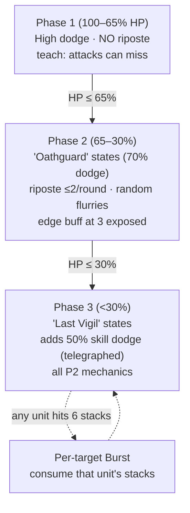
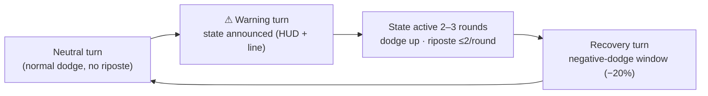

# White Knight of the Fallen Empire — Pandemonium F40 Superboss Design

Status: **IMPLEMENTED 2026-10-04** — module, F40 override, reward, and global status-res rollout shipped; diagnostics pass (`tests/_diag_white_knight.py`). Remaining: playtest numeric tuning and provisional state names.

**Theme:** a white knight of a fallen empire — **Undead**, wielding **holy (Light)** power. A blessed blade that outlived its oath, now standing guard in the deep floors.

**One-line pitch:** a three-phase accuracy-denial duelist that punishes every attack the party throws — basic, skill, or ally — with ripostes that strip armor (Expose), a per-target execution clock at 6 stacks, and a P3 skill-dodge state, all telegraphed so the counterplay is decision discipline rather than RNG.

**Placement:** Pandemonium Floor 40 special override — the second Pandemonium-exclusive superboss after Chrysalis (F20). Identifiers: module `combat/white_knight.py`, enemy key `white_knight`.

---

## 0. Decision log (locked)

1. **Placement** — Pandemonium **F40** special override (not part of the shuffled global pool). Fairness rationale in §5.1.
2. **Phase structure** — P1 teaches (high dodge, no riposte), P2 tests (telegraphed dodge state + riposte + flurries), P3 checks (adds skill dodge).
3. **Riposte** — never in P1; in P2/P3 only while the boss's **state buff is active**. Per landed hit: **50% probabilistic**; **guarantee** — the first hit to land after the state activates is always riposted. **Hard cap: 2 ripostes per round** (Everlong pattern). A successful riposte deals a counter-hit to the attacker and applies **1 Expose stack** to them. Active attacks only — DoT ticks never trigger riposte (debuffs are resisted anyway, §3.10).
4. **Expose (party-side)** — unique stacking debuff applied by ripostes, persists for the fight, no decay. The boss's attacks **ignore CON per stack** (up to 60%). **Per-target burst at 6 stacks** consumes that unit's stacks.
5. **Burst** — per-target (not party-shared). Fires on the boss's turn when any unit is at 6 stacks; consumes that unit's stacks only. **Sure-hit** (cannot be dodged) and **punishing** (heavy; Defend halves only).
6. **Self-buff** — **edge-triggered, offense-only**: when the number of party units carrying ≥1 Expose stack *rises to 3*, the boss gains **DMG+** for a few rounds (DEF+ deliberately dropped). Re-arms only after the count drops below 3 and crosses up again.
7. **Skill dodge** — **P3 only** at **50%**, telegraphed by a state buff distinct from the P2 dodge state. Covers **everything**: player skills, ally skills, single-target, multi-hit, and AoE (rolled once per skill activation).
8. **Ally accuracy denial** — **P2 onward**; allies suffer a flat hit-rate penalty against the boss (floor: never worse than −35% total).
9. **Multi-hit unfocused attacks** — occasional flurries hitting random party targets (Wicked Witch fire-volley precedent).
10. **Reward** — a **unique rapier** (DEX niche; no unique rapier exists yet) whose passive **applies Expose** (§6.3).
11. **Fairness guardrails** — every punish is telegraphed, capped, or both; all state windows have a warning turn (§5.2).
12. **Theme** — White Knight of a Fallen Empire; race **Undead**, element **holy = Light** (light-dominant kit; see §4.1).
13. **Recovery windows** — confirmed: every dodge state ends with a **1-turn negative-dodge window** (negative-value `evasion` buff; the `evasion_down` type is dead code).
14. **Status resistance — global superboss system** — every superboss will carry a `status_res` field (**separate from `elemental_res`**); absent = 0% (existing behavior). The White Knight uses **75%** (single knob; 1.0 = full immunity). Rollout table in §3.10.
15. **Final locks** — rapier **Last Oath** (`last_oath`); P3 state dodge **70%**; elemental profile **blessed plate** (light 0.7 / dark 1.3); burst **sure-hit**, `70–100 + 2×STR`, Defend halves (numeric tuning may follow playtest).
16. **Phase floors (anti-skip / anti-one-shot)** — the boss is HP-floored by phase: P1 cannot drop below 65% max HP, P2 below 30% (P3 is the kill window). Floors lift only when the phase advances at round start, and P2 additionally requires **2 completed rounds** (`P2_MIN_ROUNDS`) before it can end. Implemented as `_PhaseLockedKnight(dict)` (CaptainDict precedent) — a burst can hit a floor but can never skip a phase or kill from above one.

---

## 1. Design goals

- **Skill tested:** accuracy/decision discipline — when to attack, with whom, and when to Defend or hold.
- **Rank target:** top-band special encounter, between Chrysalis (F20, Lv40/1300 HP) and Mary Sue (F50, Lv57/2030 HP). F20 teaches damage windows; F40 teaches accuracy discipline — a deliberate symmetry between the two Pandemonium overrides.
- **Feel:** a fencing duel with a fallen paladin. It punishes wild flurries, rewards measured offense, and drops the blade that strips armor in return.

---

## 2. Fight flow

State loop within P2/P3:

---

## 3. Mechanics specification

### 3.1 Phases & thresholds (tune)

| Phase | HP band | Identity | New mechanics |
|---|---|---|---|
| P1 | 100–65% | The lesson | 55% passive dodge; no riposte |
| P2 | 65–30% | The test | Oathguard states (70% dodge); riposte (≤2/round) + Expose; ally accuracy penalty; random flurries; edge-triggered self-buff |
| P3 | <30% | The check | Adds **50% skill dodge** (telegraphed); states recur slightly faster |

- **Transitions are HP-floored (decision 16):** a burst can drive the Knight to a phase floor but never past it; the next round start advances the phase and lifts the floor. Oathguard additionally lasts at least 2 completed rounds before P3 can begin.

### 3.2 Dodge profile & telegraphs

- Dodge uses the unified system (`combat/stats.py` `get_dodge_chance`). The boss carries a **cap override** field so its dodge can exceed the normal enemy cap of 50%.
- State telegraph = an `evasion`-type buff on the boss (renders automatically as `DGE N%` in the HUD via `_get_entity_buff_tags`) **plus** a custom HUD warning line and an explicit round-start message one turn *before* the state begins.
- States *(proposed)*: P2 "Oathguard", P3 "Last Vigil". Dodge: **55% in P1**, **70% in P2/P3 states** (cap override required).
- Recovery: every state ends with a **1-turn negative-dodge window** (proposed −20%, tune) — implement as an `evasion` buff with a **negative value** or a custom flag.
- ⚠ Implementation trap: the existing Jabberwock `evasion_down` buff type is **never read** by `get_dodge_chance` (dead code). Do not reuse that type name.

### 3.3 Riposte

| Property | Value (tune) |
|---|---|
| Available | P2/P3, only while state buff is active |
| Trigger | Any incoming attack that lands on the boss (basic, skill, ally; active attacks only — DoT ticks excluded) |
| Chance / cap | 50% per landed hit; **first hit after state activation is guaranteed**; **max 2 per round**, reset in `pre_player_hook` |
| On proc | Counter damage to the attacker + **1 Expose stack** on the attacker |
| Damage | small counter, e.g. `4–8 + 50% STR` before mitigation |

- Precedent: Everlong Ship's `on_player_hit_hook` riposte with `ctx["riposte_count"]`.
- **Gap to close:** the current hit hook fires only for the *player's basic attack*. "Any attack type" requires firing a hit hook from player skills, ally basics, and ally skills, and the hook must know the **attacker** (to place Expose). See §7.3.

### 3.4 Expose (party-side stacking debuff)

| Property | Value (tune) |
|---|---|
| Applied by | Successful riposte → +1 stack to the attacker |
| Persistence | Entire fight; no decay |
| Effect | Boss attacks vs that unit use `armor_mult = max(0.4, 1 − 0.10 × stacks)` → up to **60% CON ignore** |
| Cap | **6** |
| HUD | Reuse the `expose_stacks` field on party dicts → the existing HUD tag renders `EXP×N` for free |

- **Do not reuse `apply_expose()`** (`combat/status_effects.py`): it mutates enemy `con_mod`, caps at 5, and is item-oriented. Party members don't use `con_mod` as their armor; the correct translation of "ignore CON per stack" is the `armor_mult` route (precedent: Jabberwock `armor_mult=0.5` = "ignores 50% CON", Mary Sue `0.7`).

### 3.5 Burst (per-target, consumes stacks)

| Property | Value (tune) |
|---|---|
| Trigger | Boss's turn; any single unit at 6 stacks |
| Target | That unit only (per-target clock, not party-shared) |
| Damage | **punishing** heavy single hit, e.g. `70–100 + 2×STR`, armor-ignoring; **sure-hit**, **Defend halves only** (Queen of Hearts execution precedent) |
| After | Consume all of that unit's stacks (back to 0); future ripostes rebuild |

- Ordering: edge-triggered self-buff check at **round start**; burst resolves on the **boss's turn** — so a burst consume can drop the party count below 3 and re-arm the edge trigger. That rhythm is intended.
- Optional readability aid: show a stack counter in the custom HUD per unit (`Player EXP×4`, etc.).

### 3.6 Self-buff (edge-triggered)

| Property | Value (tune) |
|---|---|
| Trigger | Party-wide count of units with ≥1 Expose **crosses up to 3** |
| Effect | **DMG+ ~25%** (`damage_boost`, natively consumed by `enemy_ai`) for ~3 rounds |
| Re-arm | Only after the count drops below 3 and crosses up again (true edge trigger) |
| HUD | `DMG+25%` tag is automatic; custom HUD shows the buff countdown |

### 3.7 Ally accuracy penalty ("Disarming Flourish" *(proposed)*)

- **Active from P2 onward.** Allies' attacks against the boss suffer **−20% hit rate** (tune), implemented as a negative accuracy modifier specific to ally attackers — distinct from and multiplicative-feeling with dodge, but subject to a **floor of −35%** total.
- Precedent for accuracy denial: shadow smoke penalty (`wonderland_curses.get_shadow_accuracy_penalty`), Blind (+25% dodge for the defender).

### 3.8 Multi-hit unfocused attacks

- ~40% of the boss's non-state turns (tune) it performs a 3-hit flurry at **random party targets**, each hit rolling dodge separately.
- Precedent: Wicked Witch fire volley (3 random hits, per-hit riders).
- Note: each hit can proc player-side on-dodge effects (wedding counters, Cheshire favor, Cutlass riposte cap 2/turn) — already capped by those systems; keep an eye in playtest.

### 3.9 Skill dodge (P3)

- While the P3 state is active: incoming **skills** can be dodged at **50%** — **everyone and everything**: player skills, ally skills, single-target, multi-hit, and AoE. Rolled **once per skill activation per target** (the boss rolls once; multi-hit skills don't multiply the misery).
- Telegraphed by its own state buff, visually distinct from the P2 dodge state.
- **Gap to close:** skills currently have *zero* dodge infrastructure (`combat/skills.py`, `combat/ally_skills.py` contain no dodge rolls). This requires new checks (see §7.3).
- Fairness: explicit counterplay exists — Barracks Tier VI **Judgment** deals +30% vs Undead (this boss is Undead), plus Defend, sustain, and the recovery windows.

### 3.10 Status resistance — global superboss system

**Status: IMPLEMENTED 2026-10-04** — helper + all application paths guarded, field rolled out to every superboss YAML (values below are live; tune per-boss as needed). Diagnostics: `tests/_diag_status_res.py`.

**System (new, applies to every superboss):** a `status_res` field, **separate from the elemental profile**, giving each boss a 0.0–1.0 chance to resist any incoming debuff/status application. Absent field = 0.0 (existing bosses are unchanged until explicitly updated). Single knob: `1.0` = full immunity.

- Applies to all enemy-directed applications: burn/bleed/poison/shock, weaken/sunder/blind/dread/silence/curse, stun/freeze/slow/confuse, elemental debuff procs, wedding/weapon-trait riders, and item Expose.
- **White Knight value: 75%** ("blessed plate" flavor); DoT ticks that do land never trigger riposte (active attacks only).
- **Implementation (net-new):** no central debuff gate exists today. Add a shared helper (e.g. `check_status_resisted(target)` in `combat/status_effects.py`) and call it at the application points — `status_effects.py` apply functions, `combat/elemental_debuffs.py` `try_apply_elemental_debuff`, and the skill/item application sites in `combat/skills.py`, `combat/ally_skills.py`, `combat/player_actions.py`, `combat/ally.py`. Precedent for interception: `blank_canvas_shawl.try_consume_afterimage` is already called inside `apply_weaken`. Application functions should return a `"resisted"`-style result where a return value exists.
- Feedback: print a short resist line (per-boss flavor, e.g. "the blessed plate shrugs it off") so players learn the rule quickly.
- **Rollout — update every superboss YAML (starter proposals, per-boss review required):**

| Where | Boss | Proposed `status_res` |
|---|---|---|
| Global pool | Broodmother Vileheart | 25% |
| Global pool | Dream-Devouring Slitcurrent | 25% |
| Global pool | Queen of Mirrors Sylvana | 30% |
| Global pool | Ignis, the Melt-Forge Golem | 30% |
| Global pool | Yinglong, Heaven-Banished Dragon | 40% |
| Global pool | Rientrante, the Administrator | 40% |
| Global pool | Captain of the Everlong Ship | 30% |
| Global pool | The Black Silence | 50% |
| Global pool | Palette, the Chromatic Artisan | 50% |
| Pandemonium | Chrysalis, the Entangled One | 60% |
| Pandemonium F40 | White Knight of the Fallen Empire | **75%** |
| Wonderland | Queen of Hearts | 20% |
| Wonderland | Big Bad Wolf | 25% |
| Wonderland | Wicked Witch of the West | 40% |
| Wonderland | The Jabberwock | 40% |
| Wonderland | Mary Sue | 60% |

- **Player-facing impact to balance for:** status-building loadouts (burn/bleed/sunder/CC) become less reliable vs bosses across the board; the Last Oath's Expose lands at `(1 − status_res)` per proc (25% vs the Knight on a re-clear, 50% vs tier 8s). Tune per-boss values against that curve; per-type exceptions (e.g. hard CC) can come later if needed.
- Interaction (this fight): armor-strip routes mostly bounce — intended; the fight's counterplay leans on raw damage, Judgment, sustain, and recovery windows.

---

## 4. Numbers — proposed defaults *(tune; playtest-only adjustments remain)*

### 4.1 Boss stat block (YAML)

| Field | Proposed | Notes |
|---|---|---|
| level | 48 | Between Chrysalis (40) and Mary Sue (57) |
| base_hp | ~1500 | Chrysalis 1300 · Mary Sue 2030 |
| race | **Undead** | Judgment (+30% vs Undead) is natural counterplay; check `get_race_extra_logic` riders when implementing |
| mods | STR 12 · CON 9 · DEX 15 · WIS 8 · LER 7 · CHA 10 | DEX fuels the dodge identity |
| boss / super_boss | true / true | |
| elemental_dmg | light 1.4 · physical 1.2 (proposed) | Holy = Light in the 7-element system |
| elemental_res | light 0.7 · dark 1.3 | **Blessed plate** (locked): shrugs off Light; the fall left it Dark-weak |
| status_res | 0.75 (tune; 1.0 = full immunity) | Global system field — separate from elemental profile (§3.10) |

### 4.2 Tuning knobs

| Knob | P1 | P2 | P3 |
|---|---|---|---|
| Passive dodge (with cap override) | **55%** | — | — |
| State cadence | — | warn → 2–3 rounds on → 1 recovery | warn → 2 rounds on → 1 recovery |
| Dodge while state active | — | **70%** | **70%** (confirmed) |
| Riposte | none | 50%/hit; first hit after activation guaranteed; **cap 2/round** | same |
| Skill dodge | none | none | **50%**, once per activation (all skills, all sources) |
| Flurry frequency | — | ~40% of non-state turns | ~40% |
| Ally hit-rate penalty | none | **−20%** (floor −35%) | same |
| Recovery window | — | −20% dodge, 1 turn | −20% dodge, 1 turn |
| Status res (all phases) | **75%** (1.0 = immunity) | same | same |
| Edge-buff (3 exposed) | — | +25% DMG, 3 rounds | same |
| Burst at 6 stacks | — | `70–100 + 2×STR`, sure-hit, Defend halves | same |

---

## 5. Fairness & counterplay

### 5.1 Why F40 is the fair shelf

- **It's already a milestone floor** (`floor % 20 == 0`) — the game already spawns a superboss there; this swaps in a bespoke encounter exactly like Chrysalis does at F20.
- **Milestone floors skip the random floor curse** (`apply_curse_on_floor_start` is only called in the normal-floor path), so the fight itself is never at the mercy of a bad 2.5× Apocalyptic roll — the cursed climb to it is the attrition.
- **The player toolkit is mature at F40:** Barracks V–VI skills (Judgment, +30% vs Undead), Chronoweave/Tarnished Jade-class uniques, wedding accessories, sustain items — the answers to dodge/skill-dodge exist. Note superboss status resistance (§3.10) — the White Knight at 75% — so debuff-based routes are unreliable here; the fight leans on raw damage, Judgment, sustain, and recovery windows.
- **No-flee and re-challenge lock** already apply to milestone bosses (first-ever clear only); honor conventions item #33.

### 5.2 Guardrail table

| Risk | Guardrail |
|---|---|
| Riposte explosion (multi-hit/Furioso/Abyss Tempo) | Hard cap 2/round, reset each round |
| Stack snowball | Expose capped at 6; burst consumes; single source (riposte only) |
| Burst skip / one-shot | HP floors per phase (65% / 30%) + P2 minimum 2 rounds; floors lift at round start only |
| Permanent self-buff | Edge-triggered + limited duration |
| State fatigue | Warning turn before every state; recovery turn after |
| Total accuracy denial | Ally penalty floored at −35%; skill dodge P3-only and once per activation |
| Skill-dodge with no answer | 50% P3-only, once per activation; answers: raw damage (Judgment), Defend/sustain, recovery windows |
| DoT/riposte interaction | DoT ticks never trigger riposte; status resistance (§3.10) keeps DoTs rare regardless |
| Debuff denial stacking | 75%, not 100% — status-focused allies keep some agency; values are per-boss tunable |

### 5.3 Phase counterplay loop

- **P1:** learn the dodge — basics whiff often; skills and setup (buffs, Defend) are safe; damage-over-time debuffs largely bounce off the boss's status resistance.
- **P2:** watch the warning line; decide *whether to attack the boss at all* during states (riposte + Expose) or switch to utility; ally attacks suffer the accuracy penalty — avoid letting 3 units sit at 1+ stacks (edge buff); never let one unit idle at 5–6 stacks.
- **P3:** skills can now whiff (50%) — hold burst for the negative-dodge recovery windows; spend defensive cooldowns on the burst clock.

---

## 6. Reward — "Last Oath", unique rapier *(locked)*

### 6.1 Why a rapier

- **Boss fit:** parry–riposte–lunge is literally fencing vocabulary; a duelist boss with a rapier reads instantly. In-world precedent already exists: Zephyr Rapier (`resources/items.py`), Captain Hook's rapier (`combat/wl_floor_bosses.py`).
- **Reward fit:** there is **no unique rapier** and no DEX-precision unique in the lineup (Abyss Fang = STR/DEX, Cutlass = STR, Gloves = STR/DEX/LER, Brush = WIS/LER). This fills a real endgame gap.
- **Thematic loop:** DEX is the dodge/accuracy stat — you beat the evasion master and earn the precision blade.

### 6.2 Item spec (proposed)

| Field | Proposed (tune) |
|---|---|
| id | `last_oath` (locked) |
| name | **Last Oath** (locked) |
| slot / type | weapon / equipment |
| base_mods | DEX 15 · WIS 5 · LER 3 |
| scaling_stat | ["Dexterity"] (or ["Dexterity", "Wisdom"]) |
| elemental_dmg | physical 1.3 · light 1.2 (pale holy blade) |
| unique / drop_rarity | true / "unique" |
| drop_source | `white_knight` |

### 6.3 Signature passive — LOCKED: Expose applier

- **"Finesse — your basic attacks apply Expose (1 armor reduction) to the target; crits apply 2."** Uses the existing item-side `apply_expose()` (`combat/status_effects.py`) and respects its **5-total reduction cap** per fight.
- Note the two distinct "Expose" economies: the **weapon** reduces an enemy's `con_mod` via the existing system (shows as `Exposed×N`), while the **boss** puts `EXP×N` stacks on party members to fuel its `armor_mult`. Keep both readable in the HUD to avoid confusion.
- Implementation follows the **unique equipment actor-based convention**: effect module in `combat/weapon/<name>.py` with `_actor_has_<id>(actor)`, wired into BOTH `combat/player_actions.py` and `combat/ally.py`. This passive is a per-hit proc — no per-ally state ticking needed.

### 6.4 Grant flow

- Grant inside the boss module's victory block, guarded by `boss_defeated_white_knight` (Everlong pattern: `build_item` → `prompt_acquire_item`).
- `unique: True` + `drop_source` keep it out of random drop tables.

---

## 7. Implementation plan

### 7.1 New files

| File | Purpose |
|---|---|
| `combat/white_knight.py` | Boss module (`combat_white_knight(player, floor=None, enemies=None)`) using `superboss_combat_loop`; all state in `context` |
| `combat/weapon/last_oath.py` | Reward passive — Expose-on-hit (actor-based) |
| `tests/_diag_white_knight.py` | Manual diagnostic harness (context-only: phases, stacks, burst math, caps) |

### 7.2 Files to modify

| File | Change |
|---|---|
| `resources/enemies/enemies_data/superbosses.yaml` | Add `white_knight` entry (race Undead; light/dark element profile) |
| `dungeon.py` | Import module; add `pandemonium_mode and floor == 40` override branch mirroring the Chrysalis block (before the generic pool peek so the pool isn't consumed); `_record_superboss_defeat(player, "white_knight")`; reward block (gold `500 + floor×40` ×2.5, XP `800 + floor×60` ×1.5, mirroring Chrysalis); floor advance + save |
| `gui/screens/dungeon_screen.py` | `_gui_superboss` dispatch branch for the `"white_knight"` string tier (mirror `"chrysalis"`) |
| `combat/stats.py` | Read `entity.get("dodge_cap_override")` in `get_dodge_chance`; add shared `roll_skill_dodge(target, attacker)` helper |
| `combat/status_effects.py` + application sites | **Global status-res system:** `status_res` field + `check_status_resisted()` helper + call sites per §3.10 (status applies, elemental debuffs, skill/item applications) |
| All superboss YAMLs (`superbosses.yaml`, `wonderland.yaml`) | Add per-boss `status_res` values per the §3.10 rollout table |
| `combat/skills.py`, `combat/ally_skills.py` | Roll skill dodge (boss field-gated; 50%, once per activation, all skill sources) |
| `combat/player_actions.py` | Fire hit hook from skill/workshop/brush paths; thread `attacker` |
| `combat/ally.py` | Fire hit hook from ally basic + ally skill paths; thread `attacker` |
| `combat/superboss_common.py` | Pass hit hook through to ally turns; extend wrapper with `attacker` |
| 6 existing boss modules | Add `attacker=None` (or `**kwargs`) to `on_player_hit_hook` signatures — mechanical, signature-compatible update |
| `combat/combat_ui.py` | Custom HUD via module hook (state countdown, per-unit Expose, burst warning); buff tags already render `DGE`/`DMG+`; party `expose_stacks` renders `EXP×N` |
| `gui/screens/changelog_screen.py` | Changelog bullets when implemented (current version v0.1.8.0 unless bumped) |

### 7.3 Engine gaps & verified gotchas

1. **Enemy dodge cap is 50%** (`ENEMY_DODGE_CAP`) — the cap override field is mandatory for this design.
2. **Skills never roll dodge anywhere** — P3 skill dodge is net-new logic in both skill engines.
3. **The hit hook fires only for the player's basic attack today** (`player_actions.py` basic path passes `on_hit`; the skill path, glove/brush paths, and `handle_ally_turn` do not). "Any attack type" = new call-site coverage + attacker attribution. This is the largest integration task; consider updating all six existing hook owners to accept an optional `attacker` kwarg in the same pass.
4. **Party-side Expose ≠ `apply_expose()`** — use a party-stack helper + boss-side `armor_mult` translation (§3.4).
5. **`evasion_down` is dead code** (never read by `get_dodge_chance`) — use negative-value `evasion` buffs for recovery windows.
6. **Status-res system is implemented** (2026-10-04): `check_status_resisted()` reads the `status_res` field across all application paths, and every superboss carries values (§3.10). The White Knight itself only needs its YAML entry when built.
7. **HUD freebies:** `evasion` → `DGE N%`, `damage_boost` → `DMG+N%`, and party `expose_stacks` → `EXP×N` all render without new UI code.
8. **Milestone floors skip curses** and are no-flee; keep the re-challenge lock convention (only first-ever clear runs the override).

### 7.4 Save compatibility

- All fight state lives in `context` — **no new persistent player fields**.
- Persistent additions: `boss_defeated_white_knight` flag and the `defeated_superbosses` list entry (both set directly; no `ensure_player_fields()` change strictly required, but adding a `.setdefault()` for the flag is harmless if preferred).

---

## 8. Testing checklist (manual harness + playtest)

- [ ] Phase transitions at thresholds; P1 has no riposte source at all
- [ ] State telegraph: warning line the round before; buff tag visible; recovery turn applies the negative-dodge window (and doesn't stack)
- [ ] Riposte: probabilistic 50%/hit; first hit after state activation guaranteed; cap exactly ≤2/round across mixed basic + skill + ally triggers; DoT ticks do not trigger
- [ ] Status res: global helper defaults to 0% when field absent; White Knight at 75% applies across all sources; resist message shown; 1.0 = immunity; landing DoTs still don't trigger riposte
- [ ] Status res rollout: every superboss YAML parses the new field; values match the §3.10 table
- [ ] Expose: applied only by riposte; stacks persist; `armor_mult` scaling correct at 1–6
- [ ] Burst: fires per-target at 6, consumes only that unit, Defend halves; re-arm of edge buff after consume
- [ ] Edge buff: single fire per crossing; no re-fire while ≥3; re-arms below 3
- [ ] Ally accuracy penalty respects the −35% floor
- [ ] P3 skill dodge: 50%, covers player + ally skills, single/multi/AoE; once per activation; telegraph visible
- [ ] Dodge cap override applies only to this boss
- [ ] Defeat flag + unique drop granted exactly once; drop absent from random tables; rapier Expose proc respects the 5-cap
- [ ] F40 override replaces the pool encounter correctly; re-challenge does not swap bosses; no-flee message
- [ ] GUI dispatch (`_gui_superboss`) and terminal path both route correctly
- [ ] Save/load mid-run safety: context fights are ephemeral; no stale state leaks

---

## 9. Review items — all resolved (2026-10-04)

1. **Names** — boss: **White Knight of the Fallen Empire** (locked); rapier: **Last Oath** / `last_oath` (locked). State names "Oathguard" / "Last Vigil" remain *provisional defaults* — cosmetic only, not blocking.
2. **Riposte guarantee** — confirmed: the first hit after state activation is guaranteed (2/round cap still applies).
3. **Status resistance** — elevated to a **global superboss system** (separate from elemental profiles): every superboss gains a `status_res` field; the White Knight's value is **75%** (1.0 = immunity switch). DoT ticks never trigger riposte (§3.10).
4. **P3 dodge** — confirmed at **70%**.
5. **Elemental profile** — blessed plate locked: **light 0.7 / dark 1.3**.
6. **Burst** — confirmed: sure-hit, Defend halves only, `70–100 + 2×STR` (numbers playtest-tunable).

Everything is locked for implementation; remaining tolerance is numeric tuning at playtest and cosmetic naming.

---

*When implemented: add changelog bullets under the active version per the changelog-versioning convention; consider a README superboss-table row if this remains Pandemonium-exclusive content.*
