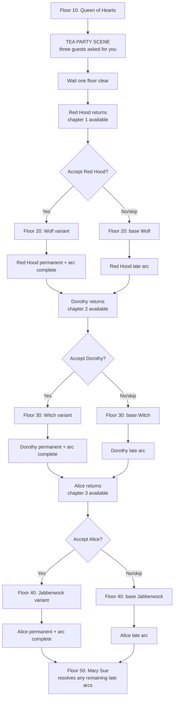

# Wonderland Heroine & Floor Rework — Design Proposal

**Status:** Implemented 2026-11-08 — staged guest pacing, late arcs, baseline boss variants, and depth-scaled auto-gear shipped. Balance/playtest tuning remains.
**Scope:** Inn guest pacing, heroine quest order, auto-equipment tiers, and superboss variants.
**Related:** `docs/wonderland_quests_design.md`, `unrelated_for_coding/wonderland_overview.md`,
`unrelated_for_coding/wonderland_heroines_full_dict.md`.

> **Recommendation:** preserve the fixed superboss ladder (Queen → Wolf → Witch →
> Jabberwock → Mary Sue), stage the heroines one chapter at a time, and let
> accepting a heroine change **her canonical boss fight's structure** rather
> than moving bosses between floors. Alice is the last heroine because her
> Jabberwock stays on Floor 40.

---

## 1. Decisions captured

- **Remove the Day 60 requirement.** Shipped: the Veilholt book now needs only
  two Floor-20 biomes and a Looking Glass Shard.
- **The inn starts empty.** Before Floor 10, no heroine is waiting.
- **Floor 10 is the hinge.** After the Queen of Hearts falls, entering the inn
  plays the three-guest scene and invites Red Hood.
- **Picking a heroine changes the structure of her superboss fight.**
- **Completing that arc offers the next heroine quest.**
- **Do not break the existing superboss ladder.** Jabberwock is already tuned
  as a Floor-40 fight; it must not be moved to Floor 20 by a heroine choice.
- **Alice is the last heroine** because Jabberwock is the last personal boss
  before Mary Sue.
- **Strict order:** Red Hood → Dorothy → Alice.
- **Late arcs keep the full signature-weapon upgrade path.**

---

## 2. Current behavior (baseline)

| Floor | Superboss | Heroine tied to it |
|---|---|---|
| 10 | Queen of Hearts | — |
| 20 | Big Bad Wolf | Red Hood |
| 30 | Wicked Witch of the West | Dorothy |
| 40 | Jabberwock | Alice |
| 50 | Mary Sue | All three (fallback resolution) |

Today all three heroines sit in the Wonderland inn from the first visit. The
player can recruit any or all as temporary allies immediately. Their personal
superboss promotes them to permanent if they are in the party when it dies.

**Problems with the current flow**

- The inn spoils all three arcs at once and ignores floor pacing.
- Recruiting all three at once makes the tea party a menu, not a story space.
- Heroine choice has no effect on the dungeon run.
- Simply moving each heroine's boss to the next floor breaks balance
  (Jabberwock at Floor 20 is the obvious failure case).

---

## 3. Why not rotate the boss list?

The tempting version is: pick a heroine at Floor 10, and the next superboss
becomes her nemesis. That creates three problems:

1. **Difficulty inversion.** Jabberwock is a Floor-40 encounter. At Floor 20
   the player has roughly half the levels, gear and party slots it was tuned for.
2. **Drop and progression inversion.** Vorpal Blade fragments, Witch materials,
   and Wolf drops are placed around their canonical floors.
3. **Writing inversion.** The Wolf and Witch are early-story antagonists; Alice's
   Jabberwock is the final personal chapter before the Author.

**Recommendation:** keep the boss ladder fixed. Let the player choose a heroine,
but let that choice change **how her canonical boss fight is structured**, not
**which boss appears on which floor**. This is the only option that preserves
the existing encounter design, drops and difficulty curve.

---

## 4. Recommended design — “The Hatter's Guest List”

A fixed ladder with sequential heroine chapters. The inn is a staged guest
room, not a roster screen.



### 4.1 Floor behavior

| Floors | Inn state | What can happen |
|---|---|---|
| 1–9 | Empty tea party | Hatter: no guests have asked for you. |
| 10 | Queen of Hearts | Clear the Queen, then enter the inn for the three-guest scene. |
| 11–19 | Red Hood available | Accept → Red Hood travels with you; Wolf variant armed. |
| 20 | Big Bad Wolf | Base Wolf, or the Red Hood variant if armed. |
| 21–29 | Dorothy available | Accept → Dorothy travels with you; Witch variant armed. |
| 30 | Wicked Witch | Base Witch, or the Dorothy variant if armed. |
| 31–39 | Alice available | Accept → Alice travels with you; Jabberwock variant armed. |
| 40 | Jabberwock | Base Jabberwock, or the Alice variant if armed. |
| 41–49 | Late arcs / cleanup | Resolve skipped guests before the finale. |
| 50 | Mary Sue | Fallback resolves any remaining arcs. |

The first guest triggers on **the Floor-10 clear flag + entering the inn** —
there is no extra floor-count wait. Dorothy is invited on the first inn entry
after the Wolf; Alice on the first inn entry after the Witch.

### 4.2 Heroine state machine

Replace the current “everyone is in the inn” model with a per-heroine arc state:

```
away → invited → accepted → resolved
          │          │
          │          └── boss defeated with her: permanent + variant cutscene
          └── ignored/skipped → late → resolved
```

| State | Meaning |
|---|---|
| `away` | Not in Wonderland yet / not at the inn. |
| `invited` | At the tea party; can be accepted or deferred. |
| `accepted` | Temp ally; her canonical boss variant is armed. |
| `late` | Her boss died without her; a shorter reconciliation arc is available. |
| `resolved` | Permanent ally; arc complete. |

**Do not dead-end a guest.** A skipped heroine must always be recoverable
through the late arc. The late arc grants the same permanence and keeps the
signature-weapon facilities (Godmother / Woodcutter / Wizard) available; only
the boss-variant scene is missed.

### 4.2.1 Clarifying “until the next superboss is defeated”

The recommended reading is **the preceding boss gates the next heroine**,
not the heroine's own boss:

- Red Hood arrives **after Floor 10** (before the Floor-20 Wolf).
- Dorothy arrives **after Floor 20** (before the Floor-30 Witch).
- Alice arrives **after Floor 30** (before the Floor-40 Jabberwock).

This is the only ordering that lets the first pick change her own boss while
keeping the ladder fixed and Alice last. If “until the next superboss” means
“after her own boss,” the pick can no longer alter that boss; the variant would
have to move to the following floor's boss, which breaks the heroine/nemesis
pairing.

### 4.3 What “changes the superboss” means

Accepting a heroine sets a variant flag. The boss module reads that flag and
changes **structure**, not raw stats:

| Boss | Variant | Shipped baseline |
|---|---|---|
| Big Bad Wolf (F20) | **Huntress's Oath** | Howl is interrupted (no damage buff, no swallow extension); at 50% HP Red Hood opens the old wound for 8% max HP. |
| Wicked Witch (F30) | **Emerald Road** | Phase 2 begins with a full party debuff cleanse; phase 3 begins with a 10% max-HP party heal. |
| Jabberwock (F40) | **Vorpal Opening** | Phase 2 begins with a 6% max-HP Vorpal strike; the first phase-3 Page Storm is cut apart. |

These are the baseline variants. Richer mechanics (Wolf grab, monkey split, a
Vorpal shield) can be layered in the Phase 5 polish pass without moving bosses.

Guardrails:

- The **base fight is the default**. If the heroine is not accepted, the boss
  runs exactly as it does today.
- Variants add mechanics and story, not stat inflation. They must be tuned to
  roughly the same difficulty as the base fight, with the heroine's tools
  compensating for the extra mechanic.
- Drops, boss flags, Awakening rewards, and permanent-unlock rules stay the same.
- Alice's variant only exists at Floor 40, so Jabberwock never appears early.

### 4.4 Quest flow and “choose another quest”

- After the Floor-10 scene, `sq_wonderland_01` adds a **Return to the Mad
  Hatter's tea party** objective. The Hatter scene plays on inn entry.
- Red Hood's quest starts after the **first conversation** at the inn
  (`heroine_met`), not on entering Wonderland.
- Accepting her advances the quest to “travel with her” and arms the F20 variant.
- After the Wolf, her arc resolves; the Journal marks the quest complete and the
  next guest arrives. The player now “chooses another quest” by accepting the
  next guest (or a late arc, if one is waiting).
- If multiple late arcs exist, the inn presents a choice; otherwise the next
  guest appears in order.
- Journal hints: `sq_wonderland_01` now has a **Return to the Mad Hatter's tea
  party** objective, and the inn always offers **“Ask the Hatter about the
  guests”** so a player who forgets the next condition has a non-wiki answer.

### 4.5 Late arc (skipped heroine)

The late arc is short and focused on closure:

- Meet the heroine at the tea party after her boss is already dead.
- One dialogue choice at the inn resolves the arc; no second dungeon trip.
- Promote to permanent; mark resolved.
- No boss variant, but no lost permanence or signature weapon — the
  Godmother / Woodcutter / Wizard upgrade paths remain fully available.

This preserves the player's freedom to skip while keeping all three heroines
obtainable.

### 4.6 Mary Sue fallback

Floor 50 remains the safety net:

- Any heroine in the party becomes permanent through the existing
  `_resolve_heroines()` path.
- Any guest still unresolved is marked `late`, so her closure remains
  available at the inn after the finale.
- No heroine becomes permanently missable.

### 4.7 Auto-equipped heroine gear

Temporary heroines arrive with four pieces built from their signature set.
The tier follows the party's deepest Wonderland floor, **not** the transient
`saved_dungeon_floor` cursor:

| Wonderland max floor | Rarity | Enhancement |
|---|---|---:|
| 1–15 | common | +0 |
| 16–25 | uncommon | +1 |
| 26–35 | rare | +3 |
| 36+ | rare | +4 |

- The 15/25/35 bands put Red Hood (invited after Floor 10) on the basic tier,
  Dorothy (after Floor 20) on tier 1, and Alice (after Floor 30) on tier 2.
- Enhancement is capped at **rare +4**. The equipment rework applies
  enhancement *before* the rarity multiplier, so the old flat +5 on all four
  pieces dominated heroine stats (Red Hood reached 44 effective DEX at level
  26).
- `create_heroine_ally()` takes the maximum of the passed floor and
  `leveling.get_shared_biome_max_floor(player, "wonderland")`, so clearing a
  floor and re-entering the inn can no longer drop a guest to the floor-1 tier.
- Existing temporary heroines are re-tiered once on load by
  `migrate_heroine_auto_gear()`. Only slots still holding the exact auto-equip
  item id are replaced, preserving quest weapons (Vorpal Blade, Ruby Slippers)
  and any player-issued gear. `_wonderland_temp=False` heroines are untouched.

---

## 5. Data model (implemented)

Keep the existing ally fields (`_heroine_key`, `_wonderland_temp`,
`wonderland_heroine_<key>_permanent`) and add one guest-arc block:

```python
player["wonderland_guests"] = {
    "red_hood": "away",   # away | invited | accepted | late | resolved
    "dorothy":  "away",
    "alice":    "away",
}
player["wl_hatter_three_guests_seen"] = False
```

Seeded in `character.ensure_player_fields()` and `build_character()` via
`wonderland_guests.ensure_guest_state()`.

**Derived availability** (no extra counters needed):

- `red_hood` is invited when `wl_boss_defeated_queen_of_hearts` is set and the
  player enters the inn.
- `dorothy` is invited on the first inn entry after the Wolf, once Red Hood is
  `resolved` or `late`.
- `alice` is invited on the first inn entry after the Witch, once Dorothy is
  `resolved` or `late`.
- Late arcs become available when the heroine's boss flag is set but the guest
  state is still `away`/`invited`/`accepted`.

This keeps old saves easy to migrate and avoids a fragile “guest phase” integer.

### Hook points

| File | Change |
|---|---|
| `facilities/inn.py` | Replaced the static three-heroine menu with guest-state-driven options, Hatter scenes, and a guest hint option. |
| `wonderland_guests.py` | Guest state machine, strict-order invitations, late arcs, variant gating, Mary Sue fallback. |
| `combat/ally.py` | `promote_heroine_to_permanent()` marks the guest arc `resolved`. |
| `combat/big_bad_wolf.py` | Red Hood variant: Howl interrupted + Huntress's Oath at 50% HP. |
| `combat/wicked_witch.py` | Dorothy variant: phase-2 cleanse + phase-3 10% party heal. |
| `combat/jabberwock.py` | Alice variant: Vorpal Opening damage + first Page Storm cut. |
| `dungeon.py` | `on_boss_defeated()` closes/late-flags guest arcs; no boss relocation. |
| `quests.py` / `resources/quests.py` | Heroine objectives read guest states; `sq_wonderland_01` gains the tea-party scene objective. |
| `character.py` | Seeds/migrates `wonderland_guests` and `wl_hatter_three_guests_seen`. |
| `docs/wonderland_quests_design.md` | Links this proposal and documents the way-in guide. |

---

## 6. Save migration

| Save state | Migration |
|---|---|
| All heroines permanent | guest arcs `resolved`; no replay. |
| Heroine permanent flag set | `resolved`. |
| Heroine in party, `_wonderland_temp=False` | `resolved`. |
| Heroine in party, temp, boss flag not set | `accepted`; variant armed for her floor. |
| Heroine boss flag set, not permanent | `late` if the boss floor has passed; otherwise `accepted`/`invited` as appropriate. |
| `wonderland_unlocked`, max_floor < 10 | all guests `away`; Hatter sealed dialogue. |
| max_floor >= 10, no flags | `wl_hatter_three_guests_seen=False`; show the scene on next inn visit. |
| Floor 10 cleared, Red Hood not permanent | `red_hood = invited` on the next inn entry. |

Old saves with the current free-inn state should not lose progress: if a save
already has all three heroines permanent (the common case), all arcs are
resolved and the new inn is quiet.

---

## 7. Balance guardrails

- **No boss relocation.** Floor numbers, stats, drops and Awakening rewards are
  fixed.
- **Variant ≠ harder.** New mechanics should be offset by the heroine's tools;
  the base fight remains the reference difficulty.
- **No early permanence.** A heroine becomes permanent only after her canonical
  boss (through the variant, a late arc, or the Mary Sue fallback).
- **Signature weapons remain obtainable.** Godmother / Woodcutter / Wizard gates
  and boss materials do not move. Signature-weapon timing follows each arc:
  Woodcutter (Floor 15+), Wizard (Floor 25+), Godmother (Floor 35+).
- **Party-cap respect.** Heroines count as allies and must obey Command
  Resonance front/bench caps.
- **Alice last.** She cannot be accepted before Floor 31, so the Floor-40
  Jabberwock is always fought at its designed power level.

---

## 8. Implementation phases

| Phase | Work | Status |
|---|---|---|
| **0** | Remove Day 60; Looking-Glass Road guide. | ✅ shipped |
| **1** | Guest pacing: `wonderland_guests`, inn gating/scenes, strict order, guest hint. | ✅ shipped |
| **2** | Red Hood slice: Wolf variant, permanent resolution, late arc. | ✅ shipped (baseline) |
| **3** | Dorothy slice: Witch variant, late arc. | ✅ shipped (baseline) |
| **4** | Alice slice: Jabberwock variant, late arc, Mary Sue fallback. | ✅ shipped (baseline) |
| **5** | Balance/playtest tuning, Journal locked hints, guest-ledger polish, docs. | 🔄 pending |

Implementation reference: `wonderland_guests.py`; diagnostics in
`tests/_diag_wonderland_guests.py` and `tests/_diag_quests.py`.

---

## 9. Decisions resolved

1. **First guest:** Floor-10 clear flag + entering the inn. ✅
2. **Guest order:** strict Red Hood → Dorothy → Alice. ✅
3. **Late arcs:** keep the full signature-weapon upgrade path. ✅

Remaining tuning questions:

- Are the three baseline variants (Huntress's Oath, Emerald Road, Vorpal
  Opening) the right strength, or should they be more/less generous?
- Should the Mary Sue fallback auto-promote skipped guests, or leave them as
  late arcs at the inn (current behavior)?
- Should the Journal show locked upcoming guests as “not yet arrived,” or only
  reveal them when they appear?
- Does the Hatter hint need to mention the exact floor if the player forgets?

---

## 10. Test plan

- Guest-state transitions at F10 clear + inn entry, F20, F30, F40, F50.
- Inn menu shows only the current guest(s); the Hatter hint always names the
  next trigger.
- Variant flags arm only on acceptance and only for the matching boss.
- Base boss fights are byte-for-byte unchanged when no variant is armed.
- Skip → late arc → permanent; no heroine becomes missable.
- Mary Sue fallback resolves every remaining arc.
- Old-save migration matrix from §6.
- Party-cap interaction: a recruited heroine cannot exceed the current
  Resonance front/bench limits.
- Regression: existing `tests/_diag_quests.py` Wonderland sections still pass.
